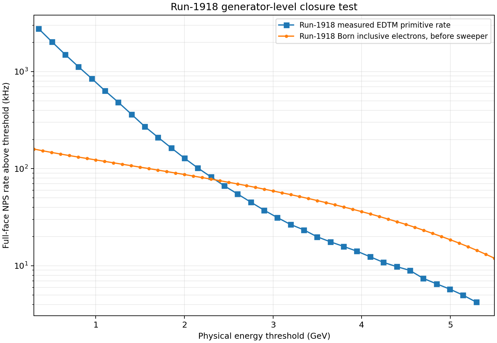
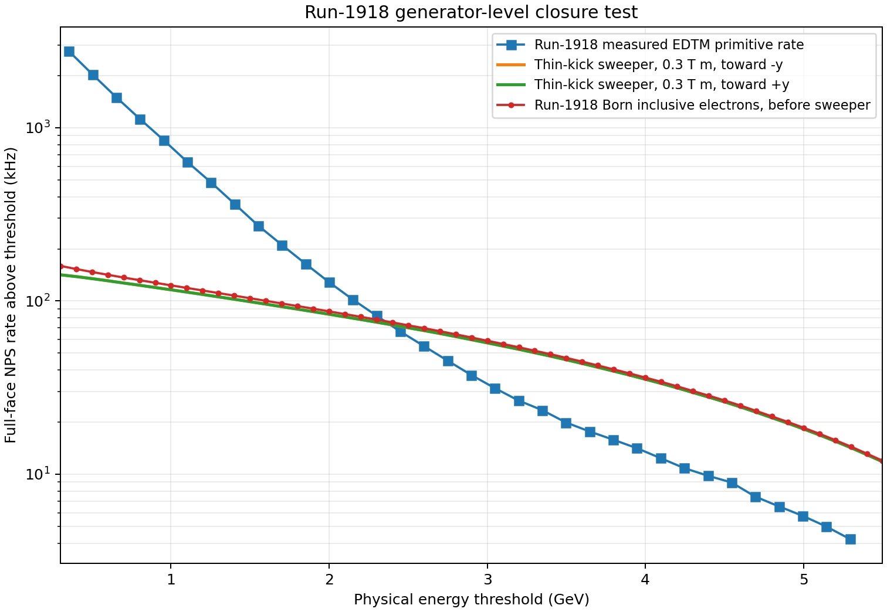
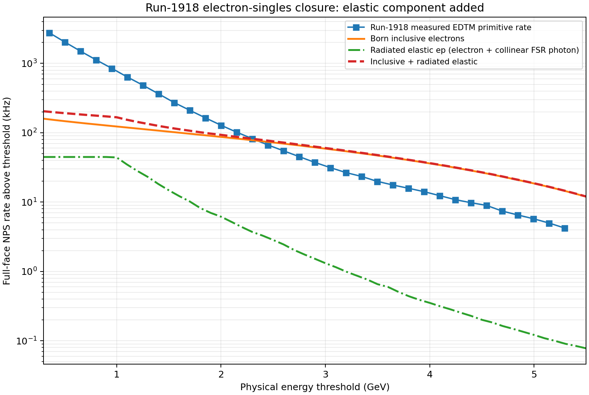
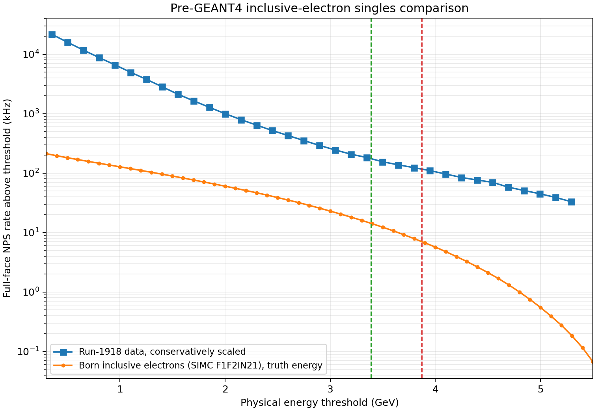

# GEp NPS inclusive-electron singles study

> **Historical exploratory study, superseded for proposal-rate use.** Run 1918 used NPS as a DVCS real-photon detector, not as an electron detector. Its EDTM/scaler closure remains a valid check of the occupancy method, but its rate spectrum and luminosity-scaled projection are not the current GEp electron-singles baseline. The current benchmark is documented in [NPS validation status](nps_validation_status.md) using electron runs 6158, 6165, and 6168.

**Status:** archived generator-level exploration, 25 October 2026

## Primary closure question

Can the generator reproduce the measured run-1918 NPS primitive-rate curve under the actual run-1918 beam, target, angle, distance, and current conditions before any extrapolation to GEp?

This separated generator completeness and normalization from later changes in luminosity and kinematics. It is retained as a record of the exploratory generator test, not as the current empirical electron-trigger-rate anchor.

## Direct run-1918 comparison

The run-1918 preset uses 10.538 GeV beam energy, 28.787 microamperes, a 10 cm LH2 target, NPS at 18.72 degrees and 3.0 m, and the full NPS face. A one-million-trial calculation gives 159.47 kHz of Born inclusive-inelastic electrons geometrically directed at the NPS face before the sweeper magnet.

| Physical threshold | Measured run-1918 primitive | Born inclusive electrons before sweeper | Simulation/data |
|---:|---:|---:|---:|
| 1.4 GeV | 365.1 kHz | 107.4 kHz | 0.29 |
| 2.0 GeV | 128.4 kHz | 87.1 kHz | 0.68 |
| 2.7 GeV | 48.2 kHz | 66.9 kHz | 1.39 |
| 3.0 GeV | 33.2 kHz | 59.0 kHz | 1.78 |
| 3.4 GeV | 22.1 kHz | 49.3 kHz | 2.23 |
| 4.0 GeV | 13.5 kHz | 36.1 kHz | 2.68 |



The spectra cross near 2.3 GeV. The calculation is deficient at low threshold but already exceeds the measured high-energy tail before charged-particle sweeping. This is therefore not a simple overall missing-rate factor. Because run 1918 operated NPS as a photon arm with the sweeper, the orange electron curve is an intentionally unphysical upper bound until sweeper rejection is included. The comparison nevertheless establishes the correct place to debug the generator and component inventory without any GEp scaling.

## First-order run-1918 sweeper test

The maintained NPS simulation geometry places the sweeper center 1.6 m from the target. With NPS at 3.0 m, a thin-kick treatment therefore has a 1.4 m downstream lever arm. For the nominal 0.3 T m run-1918 field integral, the electron kick is

```text
delta theta = 0.2998 * (0.3 T m) / p[GeV]
```

This corresponds to an NPS-face displacement of about 9.0 cm at 1.4 GeV, 4.2 cm at 3.0 GeV, and 3.1 cm at 4.0 GeV. The official Fall-2023 NPS settings identify KinC_x60_3, the run-1918 setting, as sweeper ON at +468 A. The accompanying field plot shows positive Bx in the NPS aperture. With the beam along +z, the Lorentz force on an electron is therefore toward negative Hall y: vertically downward on the NPS face. The calculation shifts each generated electron in y and retains it only if its shifted intercept remains within the 73.8 cm NPS height. The opposite sign is retained only as a symmetry check.

| Threshold | No field | Run-1918 kick toward negative y | Opposite-sign kick | Measured primitive |
|---:|---:|---:|---:|---:|
| 1.4 GeV | 107.4 kHz | 102.3 kHz | 102.3 kHz | 365.1 kHz |
| 2.0 GeV | 87.1 kHz | 83.8 kHz | 83.9 kHz | 128.4 kHz |
| 2.7 GeV | 66.9 kHz | 64.9 kHz | 65.0 kHz | 48.2 kHz |
| 3.0 GeV | 59.0 kHz | 57.3 kHz | 57.3 kHz | 33.2 kHz |
| 3.4 GeV | 49.3 kHz | 48.0 kHz | 48.0 kHz | 22.1 kHz |
| 4.0 GeV | 36.1 kHz | 35.3 kHz | 35.3 kHz | 13.5 kHz |



The confirmed run-1918 polarity bends electrons downward. Because the generated distribution is nearly symmetric in vertical position and NPS is 73.8 cm high, simple loss across the calorimeter boundary removes only about 2--5% of the integrated rate over this threshold range. Thus the face-edge effect of the sweeper cannot explain the high-threshold discrepancy, and it certainly cannot generate the large measured low-threshold excess. A detailed aperture/field-map calculation is not presently justified for this closure exercise; the remaining disagreement should instead be treated as evidence that the measured primitive spectrum contains particle species and detector effects absent from the single primary-electron calculation.

## Radiated elastic electron-singles contribution

A separate one-million-attempt SIMC hydrogen-elastic calculation was run at the actual run-1918 beam energy, target thickness, NPS angle, distance, and current. The proton-arm Monte Carlo was disabled (`spect_mode = -2`), so these are NPS electron singles rather than HMS--NPS coincidences. The calculation includes SIMC internal and external radiative effects and gives an integrated full-face elastic-channel rate of 44.72 kHz before applying an NPS energy threshold. Of the one million attempted events, 49,727 contributed to the exported weighted sample.

SIMC's `rad2` photon is emitted along the outgoing electron in the peaking approximation. Two threshold interpretations were therefore checked: the post-radiation electron energy alone, and the electron energy plus the collinear final-state-radiation photon energy. The latter is the more appropriate idealized NPS trigger-energy proxy if both showers remain in the same local sum. The difference is less than one percent over the threshold range below, so final-state photon recovery does not materially change this particular singles-rate closure test.

| Threshold | Measured primitive | Born inclusive | Radiated elastic, electron plus FSR | Inclusive plus elastic | Simulation/data |
|---:|---:|---:|---:|---:|---:|
| 1.4 GeV | 365.1 kHz | 107.4 kHz | 18.2 kHz | 125.6 kHz | 0.34 |
| 2.0 GeV | 128.4 kHz | 87.1 kHz | 6.2 kHz | 93.2 kHz | 0.73 |
| 2.7 GeV | 48.2 kHz | 66.9 kHz | 2.0 kHz | 69.0 kHz | 1.43 |
| 3.0 GeV | 33.2 kHz | 59.0 kHz | 1.3 kHz | 60.3 kHz | 1.82 |
| 3.4 GeV | 22.1 kHz | 49.3 kHz | 0.8 kHz | 50.1 kHz | 2.27 |
| 4.0 GeV | 13.5 kHz | 36.1 kHz | 0.4 kHz | 36.5 kHz | 2.70 |



Adding radiated elastic scattering improves the low-threshold closure only modestly: at 1.4 GeV the calculated electron total rises from 107.4 to 125.6 kHz, still a factor of 2.91 below the measured primitive rate. Above about 2.3 GeV the generator total remains larger than the measured curve. This confirms that the missing low-threshold rate is not ordinary elastic ep scattering or recovery of its final-state bremsstrahlung photon. The next useful component test is therefore photon and neutral production, together with pileup or detector-level mechanisms capable of preferentially enhancing the low-threshold end.

## Secondary GEp configuration

- Beam energy: 10.700 GeV.
- Beam current: 75 microamperes.
- Target: 30 cm LH2 at 0.0708 g/cm3.
- NPS central angle: 26.651 degrees.
- NPS distance: 3.0 m.
- Active face: 61.5 by 73.8 cm, with no fiducial cut.
- Generated electron energy: 0.30 to 10.65 GeV.
- Target vertex, NPS face position, and electron energy are sampled uniformly.
- Absolute inelastic cross section: SIMC's `F1F2IN21_v1.0` proton model.

The event weight includes the 75-microampere electron flux, the full 30 cm hydrogen areal density, the sampled energy interval, and the exact planar-face solid-angle Jacobian `cos(incidence)/distance^2`. Events are written with weighted Hall-coordinate vertices and electron four-vectors for subsequent GEANT4 transport.

## Initial GEp generator-level result

A one-million-trial calculation produced 431,383 positive-weight inelastic events. The absolute Born inclusive-inelastic rate reaching the full NPS face is 212.58 kHz before detector response. A 100,000-trial calculation gave 211.54 kHz, showing sub-percent convergence for the integral.

| Physical electron-energy threshold | Born inclusive-inelastic electron rate |
|---:|---:|
| 70% = 3.387 GeV | 14.34 kHz |
| 75% = 3.629 GeV | 10.27 kHz |
| 80% = 3.870 GeV | 7.07 kHz |

For comparison, the conservatively scaled run-1918 full-face primitive rates are 175.5, 140.0, and 117.0 kHz at the same physical thresholds. At generator truth level, Born inclusive electrons account for only about 6--8% of those GEp projections. The direct run-1918 comparison above now takes priority over interpreting this scaled comparison.



## Interpretation and limitations

This is not yet a simulated trigger curve. It presently omits:

- GEANT4 shower development and the VTP 3x3 response;
- pileup and overlapping subthreshold showers;
- photons, neutrons, target-window events, and beamline backgrounds;
- full sweeper field-map transport and its physical aperture and iron (the
  run-1918 polarity and first-order 0.3 T m vertical kick are included above).

GEANT4 response will generally move an electron's trigger-sum energy below its incident energy, so it is not expected to close the low-threshold gap by itself. The generator-level result now shows that the data-derived primitive curve cannot be interpreted as ordinary Born inclusive-electron plus radiated elastic scattering alone. The absolute inclusive cross-section normalization still warrants an independent check because the same calculation exceeds the measured high-energy tail.

## Next validation steps

1. Independently check the `F1F2IN21` differential-cross-section normalization at representative run-1918 energy and angle points.
2. Treat detailed sweeper aperture and field-map transport as optional rather than critical-path work; the run-1918 polarity is now confirmed.
3. Add photon and neutral channels required by the residual run-1918 spectrum, beginning with the largest physically plausible sources.
4. Quantify pileup and other detector-level contributions that preferentially populate the low-threshold region.
5. Do not use this run-1918 photon-arm study for GEp electron-rate scaling; use the dedicated electron-run benchmark and validate the inclusive generator against it.

## Reproduction

```text
bash gep_hallc_reboot/build_nps_inclusive_singles.sh
gep_hallc_reboot/nps_inclusive_singles_generator 1000000 /tmp/nps_inclusive_1m.csv
python3 gep_hallc_reboot/analyze_nps_inclusive_singles.py /tmp/nps_inclusive_1m.csv
gep_hallc_reboot/nps_inclusive_singles_generator 1000000 /tmp/nps_run1918_inclusive_1m.csv run1918
python3 gep_hallc_reboot/analyze_nps_inclusive_singles.py /tmp/nps_run1918_inclusive_1m.csv --comparison run1918 --output-prefix gep_hallc_reboot/nps_run1918_inclusive_closure
python3 gep_hallc_reboot/analyze_nps_inclusive_singles.py /tmp/nps_run1918_inclusive_1m.csv --comparison run1918 --sweeper-bdl-tm 0.3 --output-prefix gep_hallc_reboot/nps_run1918_sweeper_thin_kick
./run_simc infiles/nps_run1918_elastic_singles.inp
python3 gep_hallc_reboot/analyze_run1918_elastic_singles.py worksim/nps_run1918_elastic_singles.hybrid.csv outfiles/nps_run1918_elastic_singles.hist
```
