# NPS validation status for the GEp Hall C reboot

**Status:** current synthesis, 28 October 2026

## Purpose

This document records what the completed NPS data and simulation work establishes, while keeping it separate from the unresolved raw-trigger and DAQ questions. Detailed chronological studies are preserved in the [NPS simulation-development archive](archive/nps_simulation_development_2026-10-25/README.md).

## Established capabilities

- Real SIMC elastic events can be serialized with their weights, vertices, and post-target electron vectors and transported through the maintained NPS GEANT4 geometry.
- The Hall-to-GEANT4 coordinate mapping and the SIMC/GEANT4 material boundary have been tested explicitly. Target and cell material already traversed in SIMC are disabled in the external-primary GEANT4 mode.
- Crystal-level energy deposition, shower sharing, 3x3 local sums, cluster position, fiducial response, and threshold retention can be studied event by event.
- NPS/DVCS data provide empirical checks of reconstructed elastic response, resolved secondary clusters, decoded pulses, waveform behavior, sparsification effects, and current-dependent occupancy.
- A hard-bremsstrahlung `gamma p -> pi0 p`, `pi0 -> gamma gamma` background generator and common elastic-selection variables have been implemented and exercised.

## Valid conclusions with limited proposal scope

- The run-6151 and run-2875 studies are useful validations of NPS response and the SIMC-GEANT4 workflow, but their selected background rates are not raw GEp trigger-rate predictions.
- Resolved extra clusters and decoded in-time pulses in the same 3x3 region produced negligible changes to the modeled elastic threshold efficiency in the studied samples. This does not bound unsparsified subthreshold analog activity or the global NPS trigger rate.
- The inherited detector geometry and passive-material choices materially affect acceptance and response tails and must remain explicit in production configurations.
- A 3x3 trigger sum contains less energy than the full reconstructed shower. Thresholds must therefore be expressed in the actual VTP trigger-energy convention rather than only as a percentage of incident electron energy.
- Final-state bremsstrahlung photons near the outgoing electron direction may contribute to the same calorimeter cluster; transporting only the post-radiation electron can overstate radiative threshold losses.

## Superseded numerical baselines

- The earlier 8.43-million-event hybrid projection is not the current proposal yield. The run-17193 data anchor gives 12.053 million events at its own kinematics after applying the measured data/SIMC factor of 0.7734 once. A matched high-statistics SIMC calculation gives a Q2 = 11 / run-17193 yield ratio of 0.88647, reducing the original-kinematics projection to 10.685 million before the NPS response requirement. The new GEANT4 sample projects approximately 7.70 million events at a 70% incident-energy threshold and 7.51 million at 80%, using a 3x3 sum and the working fiducial. Those response-reduced values retain important threshold, radiative-photon, and passive-geometry caveats.
- Offline-selected accidental or correlated-background rates at the hertz level must not be used for online-trigger planning. The XEM2 branch previously labeled S1X AND S1Y is actually the broad S1X OR S1Y and scales to approximately 810 kHz. The practical double-ended, paddle-matched S1X AND S1Y logic is instead data-anchored at approximately 40--60 kHz. The validated GEp inclusive calculation places the high-threshold NPS trigger rate near 7--14 kHz, making the corresponding raw S1 accidental contribution approximately 6--17 Hz at 20 ns and twice that at 40 ns.
- The 3 m NPS position is a reasonable design standard but remains subject to acceptance-matching optimization.

## Electron-run NPS trigger-rate benchmark

Runs 6158, 6165, and 6168 used NPS as an electron detector with the sweeper off. They share a 6.370 GeV beam, 10 cm LH2 target, approximately 25.6 microamp beam current, 4.598 GeV central electron energy, and 9.5 m NPS distance. Their central NPS angles are 21.17, 19.87, and 18.56 degrees. Unbiased 1 microsecond EDTM windows give the following direct full-face trigger rates after converting each run through its own measured VTP/offline-energy relation:

The EDTM normalization is independently validated at the actual 1.6 GeV VTP hardware threshold. With the same BCM4A current cut of at least 20 microamps, the EDTM/scaler ratios are 0.991 for run 6158, 1.011 for run 6165, and 0.983 for run 6168. The agreement is within 1.7% in every run across direct pTRIG1 rates from 25.69 to 52.60 kHz.

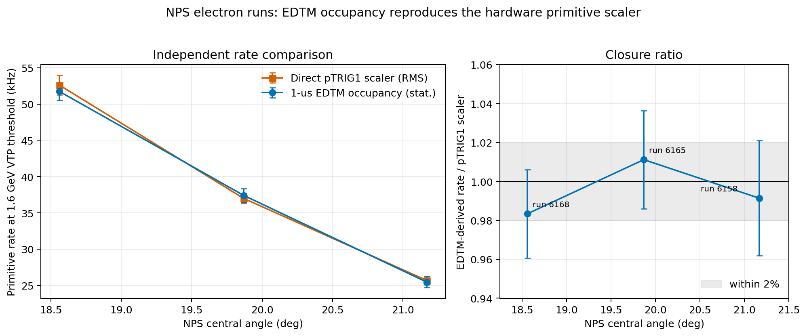

This closure establishes that the 1 microsecond occupancy conversion and channel selection reproduce the hardware trigger before the method is used to scan higher thresholds.

At the same 1.6 GeV VTP setting, corresponding to approximately 1.46 GeV offline or 30.1% of the proposal electron energy, the acceptance-weighted 75 microamp, 30 cm projection is 652 +/- 40 kHz for the exponential angular model and 774 +/- 46 kHz for the power-law model. With the 40--60 kHz practical HMS S1 range, these imply 0.52--0.78 and 0.62--0.93 kHz of accidentals at 20 ns, respectively; the 40 ns values are twice as large. The quoted NPS uncertainties propagate scaler snapshot RMS and do not include the angular-model choice, beam-energy transfer, or HMS trigger-range uncertainty.

| NPS angle | 70% = 3.387 GeV | 75% = 3.629 GeV | 80% = 3.870 GeV |
|---:|---:|---:|---:|
| 21.17 degrees | 1.26 +/- 0.17 kHz | 0.89 +/- 0.14 kHz | 0.55 +/- 0.11 kHz |
| 19.87 degrees | 2.44 +/- 0.24 kHz | 1.76 +/- 0.20 kHz | 1.08 +/- 0.16 kHz |
| 18.56 degrees | 3.76 +/- 0.32 kHz | 2.70 +/- 0.27 kHz | 2.01 +/- 0.23 kHz |

The monotonic factor-of-three angular dependence demonstrates why neither luminosity scaling alone nor addition of the three overlapping views is appropriate.

The 30 by 36 crystal active face is approximately 0.615 by 0.738 m. At the proposed 26.651-degree central angle and 3 m distance it covers polar angles from about 20.82 degrees at the lowest-angle edge to 33.14 degrees at the corners. A first acceptance-weighted extrapolation fits the three measured, face-integrated rates with either an exponential or power-law angular density and integrates that density over the proposed face. Scaling from 10 to 30 cm LH2 and to 75 microamps gives:

| Physical threshold | Exponential model | Power-law model | S1 accidental at 20 ns | S1 accidental at 40 ns |
|---:|---:|---:|---:|---:|
| 70% | 23.0 kHz | 28.2 kHz | 18--34 Hz | 37--68 Hz |
| 75% | 16.2 kHz | 20.0 kHz | 13--24 Hz | 26--48 Hz |
| 80% | 7.6 kHz | 9.4 kHz | 6--11 Hz | 12--23 Hz |

The accidental columns span the 40--60 kHz projected practical HMS S1 trigger and both NPS angular models. The model spread is not a confidence interval. Only the lowest-angle edge of the proposed face overlaps the calibration coverage, and the calibration beam energy is substantially lower than the proposal beam energy. These values are therefore a data-anchored working bracket, not a final proposal prediction. A generator validated against these electron data is still needed to transfer the spectrum in beam energy and angle.

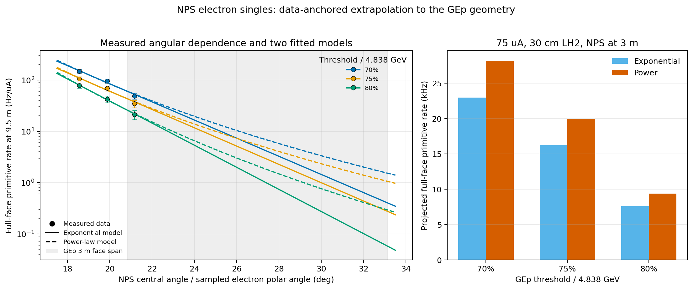

*Points are the measured EDTM-window rates. Color denotes physical threshold; solid and dashed curves are exponential and power-law fits to the three face-integrated measurements. The shaded band is the polar-angle range sampled by the proposed 3 m face. The right panel shows the integrated and luminosity-scaled working bracket.*

The numerical inputs and reproducible projection are retained in [the measured threshold key points](nps_electron_edtm_angle_key_points.csv), [the GEp projection table](nps_electron_gep_acceptance_projection.csv), and [the acceptance-weighting script](model_nps_electron_gep_acceptance.py).

### Five-pass electron-run comparison

Runs 2855, 5183, and 3888 provide a complementary five-pass electron sample at 10.54 GeV beam energy, 10 cm LH2, 9.5 m NPS distance, and central NPS angles of 16.58, 15.57, and 14.76 degrees. Their central elastic-electron energy is 7.072 GeV, so this is a beam-energy and angular-trend cross-check rather than a perfectly matched GEp-electron benchmark. The EDTM occupancy method was checked independently against the hardware trigger at each run's actual VTP threshold: the EDTM/pTRIG1 ratios are 0.973 for run 2855 at 1.4 GeV, 1.000 for run 5183 at 1.6 GeV, and 1.039 for run 3888 at 1.4 GeV.

The same 100,000-event replay samples show no material EDTM live-time loss. Accepted EDTM events divided by the cumulative EDTM scaler count are 1.00019, 1.00001, and 1.00000 for runs 2855, 5183, and 3888, respectively; the tiny excursions above unity are consistent with scaler/event boundary bookkeeping. Runs 2855 and 5183 used approximately 40 Hz EDTM, whereas run 3888 used approximately 4.94 Hz. Thus run 3888's lower accepted EDTM rate is a pulser setting, not large DAQ deadtime. Moreover, DAQ live time changes the number of unbiased EDTM windows recorded but does not rescale the trigger sample occupancy measured within those accepted windows. These results are tabulated in [the five-pass EDTM live-time check](nps_fivepass_edtm_livetime.csv).

At the same absolute thresholds used for the proposal study, the measured full-face trigger rates are:

| Run | NPS angle | Beam current | 70% = 3.387 GeV | 75% = 3.629 GeV | 80% = 3.870 GeV |
|---:|---:|---:|---:|---:|---:|
| 2855 | 16.58 degrees | 37.75 microamps | 5.72 +/- 0.48 kHz | 5.10 +/- 0.45 kHz | 4.45 +/- 0.42 kHz |
| 5183 | 15.57 degrees | 29.22 microamps | 8.87 +/- 0.36 kHz | 7.22 +/- 0.33 kHz | 5.94 +/- 0.30 kHz |
| 3888 | 14.76 degrees | 38.03 microamps | 18.77 +/- 1.07 kHz | 15.11 +/- 0.96 kHz | 12.38 +/- 0.86 kHz |

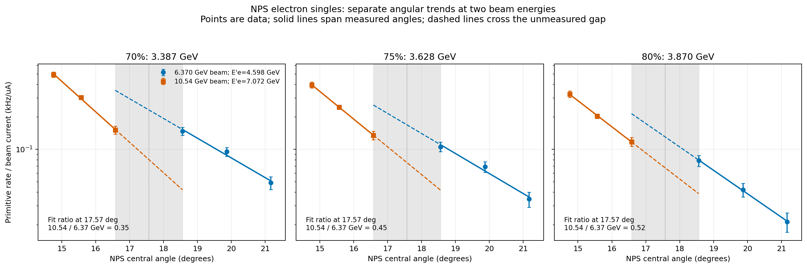

*Rates are normalized by beam current. Solid lines span the measured angles in each dataset; dashed lines extrapolate across the unmeasured 16.58--18.56-degree gap. The shaded region and the dashed lines make that extrapolation explicit.*

Separate exponential fits evaluated at the midpoint of the angular gap, 17.57 degrees, give five-pass/three-pass ratios of 0.35, 0.45, and 0.52 at the 70%, 75%, and 80% thresholds. These numbers are suggestive evidence that raising the incident beam energy does not automatically increase the high-threshold trigger rate. They are not yet an empirical beam-energy correction: there is no angular overlap, the central elastic-electron energies differ, and run 2855 has a less stable VTP/offline linear calibration than the other runs. A validated inclusive generator or a data setting that overlaps in angle is needed before transferring this comparison quantitatively to GEp.

The plotted values and fits are retained in [the beam-energy comparison table](nps_beam_energy_angle_comparison.csv) and [its plotting script](plot_nps_beam_energy_angle_comparison.py).

### First inclusive-generator closure

The existing `F1F2IN21` Born inclusive-inelastic generator has now been run with the actual beam energy, current, 10 cm LH2 target, NPS angle, 9.5 m distance, and full active face for all six electron runs. Matched SIMC radiated-elastic electron-singles calculations use the same face geometry with no HMS coincidence acceptance and include the collinear final-state-radiation photon in the idealized trigger-energy proxy. The absolute cross-section normalizations were used directly; no run-dependent or global normalization was fitted to the data. Evaluating thresholds relative to each run's central elastic endpoint gives inclusive/data ratios of 0.95--1.35 for the three-pass runs and 0.90--3.08 for the five-pass runs. The larger discrepancies are conservative overpredictions in runs 5183 and 3888; the angular and threshold trends remain correct.

An independent SHMS comparison uses XEM2 runs 17193--17199 at 10.55 GeV. Integrated over the nominal SHMS generated momentum and angular envelope, the same inclusive model predicts 8.014 Hz/microampere, compared with 10.713 Hz/microampere measured for the pEL_REAL electron-enriched trigger rate. The generator/data ratio is 0.748 and varies by only 0.65% across the seven runs. Because pEL_REAL is an electron-enriched hardware trigger rather than a pure reconstructed-electron sample, the remaining rate can reasonably contain pion leakage, secondary particles, accidental logic combinations, and detector backgrounds. Together, the three-pass NPS, five-pass NPS, and XEM2 SHMS comparisons provide three substantially independent data anchors for the generator.

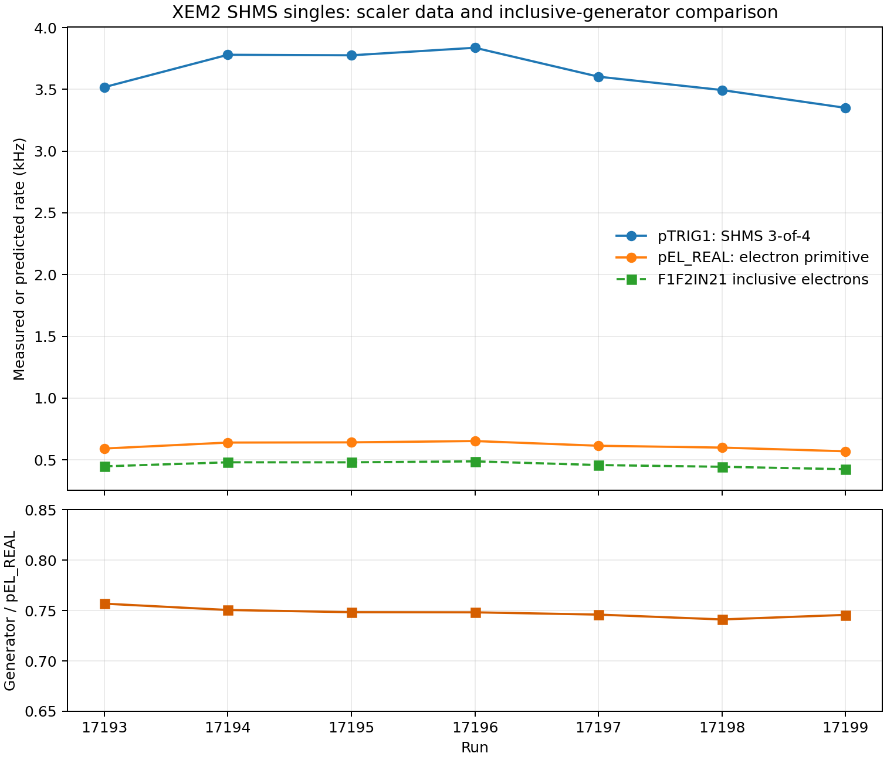

At the GEp working point, the direct full-face calculation gives inclusive-inelastic rates of 14.339, 10.256, and 7.054 kHz at 70%, 75%, and 80% of the 4.838 GeV elastic energy. A matched two-million-trial SIMC electron-singles calculation adds only 0.076, 0.047, and 0.030 kHz of radiated elastic events. With the 40--60 kHz practical HMS S1 range, the combined rates imply 11.5--17.3/23.1--34.6 Hz, 8.2--12.4/16.5--24.7 Hz, and 5.7--8.5/11.3--17.0 Hz of accidentals for 20/40 ns windows. Inflating the inclusive component by 35% gives a deliberately conservative 70% upper working range of 15.5--23.3 Hz at 20 ns and 31.1--46.6 Hz at 40 ns.

## Corrected HMS S1 trigger interpretation

The XEM2 scaler audit separates three distinct quantities. The `H.S1XS1Y.scalerRate` branch is numerically S1X OR S1Y and scales to approximately 810 kHz at 75 microamperes and 30 cm LH2. Inclusion-exclusion gives an S1X AND S1Y plane overlap of approximately 39.9 kHz after the same naive scaling. A dedicated run-17193 replay retains individual paddle-end times in 7,669 unbiased 1 microsecond EDTM windows. Requiring both PMTs on the same physical paddle in S1X and independently both PMTs on one S1Y paddle gives 12.73--14.84 kHz at the run conditions, or approximately 51--60 kHz after naive GEp luminosity scaling. The X and Y paddle numbers are independent because the planes are orthogonal.

The EDTM method closes independently against the direct plane scalers: 107.4 versus approximately 110.7 kHz for S1X and 97.3 versus approximately 101.0 kHz for S1Y. This supports a current practical-trigger working range of 40--60 kHz. It does not yet replace a hardware implementation test or an elastic-efficiency measurement; prescaled looser S1 triggers should be included for that purpose.

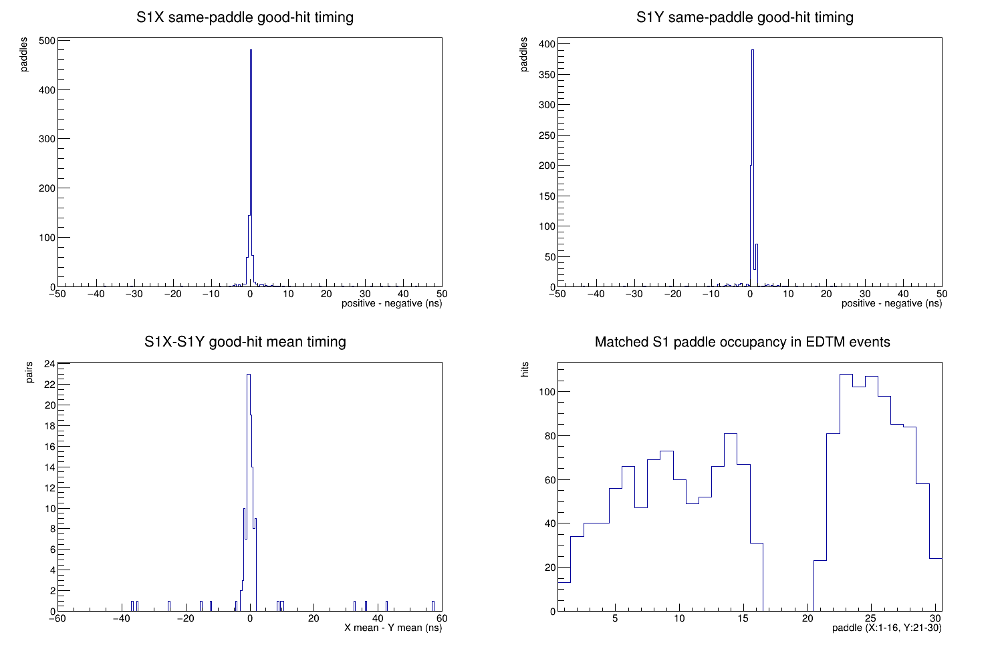

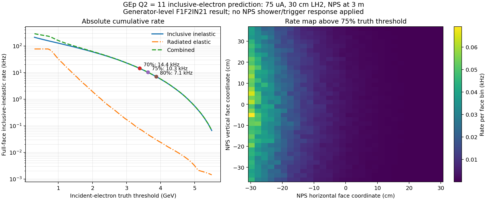

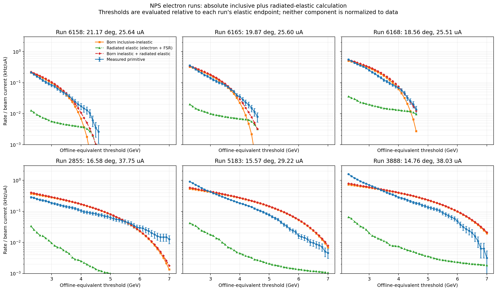

*Measured cluster-trigger rate curves and generator predictions are normalized only by each run's beam current. The calculation combines Born inclusive-inelastic electrons with SIMC radiated-elastic electrons and collinear final-state-radiation photons. It is still evaluated at generator-level energy and does not yet contain the NPS trigger-sum response.*

More importantly for the beam-energy question, the generator reproduces most of the observed reduction from the three-pass to five-pass setting. Separate angular fits evaluated at the midpoint of the unmeasured angular gap give:

| Physical threshold | Measured five-pass / three-pass | Born-inelastic generator ratio |
|---:|---:|---:|
| 70% = 3.387 GeV | 0.35 | 0.48; 0.46 with elastic |
| 75% = 3.629 GeV | 0.45 | 0.55; 0.51 with elastic |
| 80% = 3.870 GeV | 0.52 | 0.65; 0.60 with elastic |

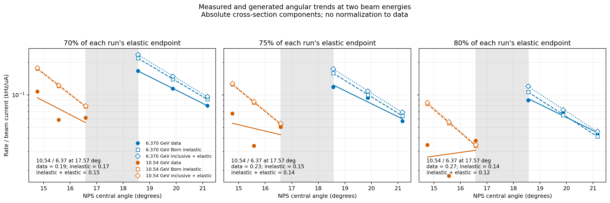

This is encouraging first-principles closure: the model predicts the correct sign, approximate size, angular rise, and threshold dependence without being normalized to either dataset. The radiated-elastic addition is modest at these high thresholds, ranging from about 0.10 to 0.48 kHz, and improves some closures while increasing existing overpredictions elsewhere. It is not yet the final transfer model. The SIMC radiative spectrum places most integrated elastic weight below the high-threshold region, so the elastic result retains the previously identified final-state-radiation and radiative-convention caveat. NPS trigger-sum response will generally lower a generator-level prediction at a fixed reconstructed threshold and must be applied explicitly. Run 2855's less stable VTP/offline calibration and the angular gap remain additional limitations.

The numerical comparison and reproducible analysis are retained in [the six-run validation table](nps_inclusive_generator_six_run_validation.csv), [the validation script](analyze_nps_inclusive_generator_validation.py), and [the generator source](nps_inclusive_singles_generator.f90).

### Inclusive-electron GEANT4 response pilot

The generator-level comparison justified a detector-response pilot for runs 6168 and 5183. A Hall-coordinate error in the first inclusive export was identified because the transported electrons did not enter NPS; correcting the generator from vertical Hall `x` to horizontal Hall `y` changed the exported vectors but left the calculated cross sections and rates unchanged. The corrected 5,000-event samples have 4,952 and 4,951 NPS entries, respectively.

The inherited GEANT4 energy branch carries the previously identified `1.04^2` scale. Two conventions were therefore retained: a raw-deposition diagnostic with that factor removed, and the experimentally relevant comparison in which each run's measured offline-to-VTP threshold relation is applied directly to the inherited VTP-like 3x3 sum.

| Run | Physical threshold | Measured cluster-trigger rate | GEANT4 3x3 in measured VTP convention | Simulation/data |
|---:|---:|---:|---:|---:|
| 6168 | 70% = 3.387 GeV | 3.76 kHz | 2.25 kHz | 0.60 |
| 6168 | 75% = 3.629 GeV | 2.70 kHz | 1.19 kHz | 0.44 |
| 6168 | 80% = 3.870 GeV | 2.01 kHz | 0.46 kHz | 0.23 |
| 5183 | 70% = 3.387 GeV | 8.87 kHz | 7.79 kHz | 0.88 |
| 5183 | 75% = 3.629 GeV | 7.22 kHz | 6.83 kHz | 0.95 |
| 5183 | 80% = 3.870 GeV | 5.94 kHz | 5.97 kHz | 1.01 |

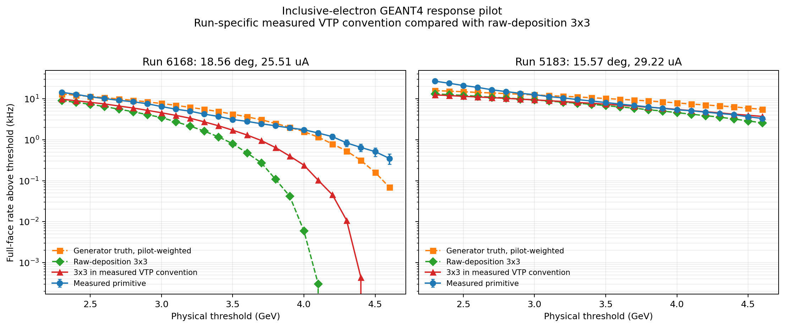

Run 5183 now exhibits excellent absolute closure across the proposal threshold interval. Run 6168 does not: its inelastic continuum is strongly depleted once the 3x3 response is applied near the 4.6-GeV elastic region. The remaining measured rate is therefore sensitive to the elastic and radiative treatment. The SIMC radiated-elastic calculation supplies too little high-threshold weight to close that gap, making recovery of collinear final-state radiation and the SIMC radiative convention a critical next validation rather than a small correction. The two-run pilot should not yet be generalized to all six settings until that component is resolved.

The numerical result and reproducible extraction are retained in [the response table](nps_inclusive_geant4_pilot.csv), [the response analysis](analyze_nps_inclusive_geant4_pilot.py), and [the compiled crystal-sum extractor](extract_nps_inclusive_geant4_response.C).

### Run-1918 photon-arm cross-check

Run 1918 used NPS as a real-photon detector in DVCS rather than as an electron detector. Its unbiased EDTM occupancy still reproduces the measured `pTRIG1` scaler within 3.1%, validating the trigger channel and occupancy method. Its earlier luminosity-scaled values of 175.5, 140.0, and 117.0 kHz at the three thresholds describe a different detected particle and production spectrum and must not be substituted for the electron-singles benchmark above.

### Separate elastic-core efficiency check

Run 6151 addresses a different question: how efficiently would a high threshold retain clean elastic electrons? It is not used to derive the electron-singles rate benchmark above. Run 6151 provides a proton-tagged elastic core with 4.598 GeV electrons, close to the 4.838 GeV proposal energy. Applying its separate calibration, `E_VTP = 0.2230 + 0.9112 E_offline`, gives:

| Physical threshold fraction | Run-6151 elastic-core trigger efficiency |
|---:|---:|
| 70% | 99.3% |
| 75% | 98.8% |
| 80% | 96.5% |

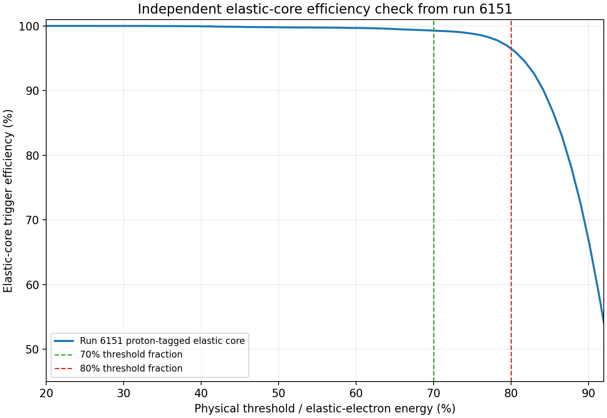

*This is a conditional trigger efficiency for the selected, non-radiative elastic core. It is not the efficiency for the full radiative SIMC distribution or the NPS geometric fiducial, and it should not replace the lower full-sample GEANT4 retention in the yield estimate.*

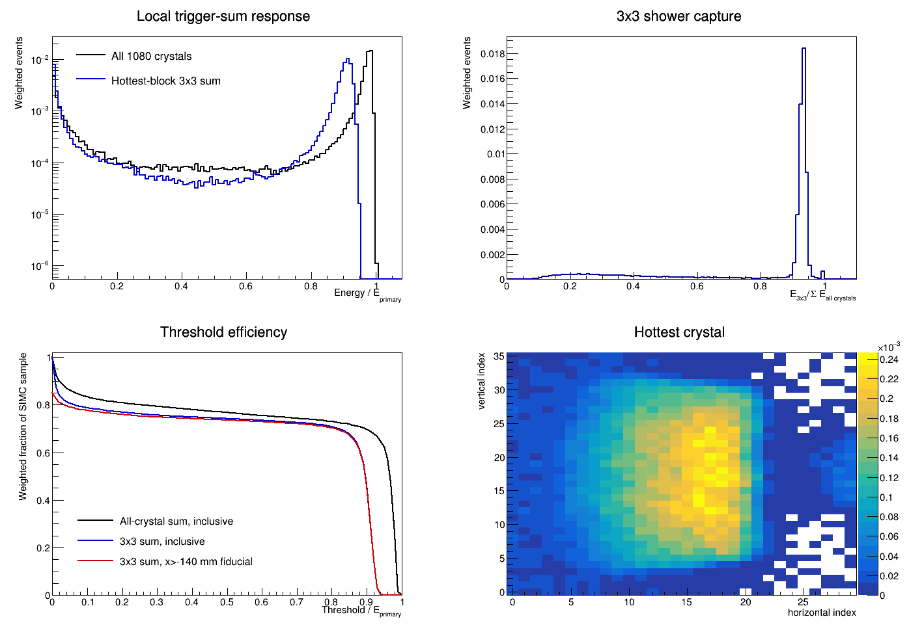

*The high-statistics GEANT4 sample shows total and 3x3 shower response, threshold efficiency, and the hottest-crystal distribution. The working selected-yield projections use the red `x > -140 mm` fiducial-plus-3x3 efficiency curve. That fiducial is not applied to the full-face trigger-rate or accidental-rate tables above.*

## Unresolved critical-path measurements

1. Establish the effective end-to-end HMS-NPS online coincidence width.
2. Determine whether HMS S1/S2 3-of-4 logic can be retained with the proposed FPP configuration and measure its elastic efficiency.
3. Establish sustainable Hall C DAQ rate, event-size dependence, deadtime, and livetime measurement conventions.
4. Optimize NPS distance, choosing the largest distance consistent with solid-angle matching to the HMS elastic envelope while tracking yield, edge losses, resolution, occupancy, and trigger rate.
5. Complete the FPP figure-of-merit and final precision projection.

These questions, rather than further refinement of offline-selected DVCS background rates, control proposal readiness.
