# GEp Hall C reboot: proposal-readiness summary

**Working point:** Q2 approximately 11 GeV2, 10.7 GeV beam, 75 uA, 30 cm LH2, positive-polarity HMS proton arm, NPS electron arm at 3 m

**Updated:** 5 November 2026

## Executive summary

The present evidence supports the physics reach of an HMS-plus-NPS GEp measurement, but the online trigger and DAQ design remains a critical proposal item.

- An XEM2 elastic-calibration benchmark closely matches the proposed HMS proton momentum and angle. Transferring its data normalization to Andrew's original Q2 = 11 kinematics gives approximately 10.68 million events before the NPS response requirement. The high-statistics GEANT4 calculation retains approximately 7.70 million at a 70% incident-energy threshold and 7.51 million at 80%.
- The XEM2 scaler branch previously labeled S1X AND S1Y is actually S1X OR S1Y and scales to approximately 810 kHz. A new paddle-level replay of run 17193 measures the practical double-ended, paddle-matched S1X AND S1Y logic directly. It projects to approximately 51--60 kHz at 75 uA and 30 cm LH2; scaler inclusion-exclusion gives 39.9 kHz. The current working HMS range is therefore 40--60 kHz, with 810 kHz retained only as a loose OR upper bound.
- Three substantially independent comparisons anchor the absolute `F1F2IN21` inclusive-inelastic generator to data.  Transferring it to the proposal geometry gives electron-component rates, including radiated elastic singles, of 14.42 kHz at a 70% truth-energy threshold, 10.30 kHz at 75%, and 7.08 kHz at 80%.  These are not total NPS trigger-rate predictions.
- Run 6887 directly demonstrates a substantial non-electron component.  Its measured total rates are 95.1, 73.7, and 57.7 kHz at the three reference thresholds, while GEANT4-folded inclusive electrons give 47.0, 37.2, and 28.4 kHz.  A completed target-on Wiser-pi0 chain adds only 2.55, 1.09, and 0.46 kHz in the working corrected-3x3 convention; pi-minus is negligible.  The fully inclusive neutral-background calculation is not yet complete.
- Accidental rates computed from the 7--14 kHz electron component alone are lower bounds, not final trigger predictions.  Until the total NPS rate is established, the trigger design should retain explicit 0.1, 0.3, and 1.0 MHz NPS scenarios.
- The HMS 3-of-4 trigger scales to approximately 2.90 kHz. If it can be implemented with high elastic efficiency in the FPP configuration, the corresponding nominal 70%-threshold accidental contribution falls below 1 Hz at 20 ns, or approximately 1.7 Hz at 40 ns.
- A new single-analyzer Hall C FPP GEANT4 calculation gives a useful-pT efficiency of 26.264%, an effective analyzing power of 0.06311, and an intrinsic FOM of 0.001046 per incident proton. Approximately 76% of the FOM lies below 5 degrees, while a 1-degree lower cut retains 97.3%. Applying the provisional NPS-response-reduced yield gives a polarized FOM of approximately 5,670--5,820, comparable to and modestly above the approximately 5,350 SBS best-case planning baseline. This is an ideal truth-associated reconstruction result, not yet a final precision projection.

Earlier DVCS-based studies remain useful for validating the analysis chain, calorimeter response, occupancy, and selected physics backgrounds. Their few-hertz accidental estimates described events surviving restrictive selections and must not be used as predictions of the raw online accidental rate. Those notes are preserved in the [DVCS benchmark archive](archive/dvcs_benchmark_exploration_2026-10-24/README.md).

## 1. Empirical HMS trigger benchmark

XEM2 runs 17193--17199 provide an unusually close positive-polarity HMS comparison:

- Beam energy: 10.544--10.551 GeV.
- Target: 10 cm LH2.
- HMS: +6.476 GeV/c at 19.52 degrees.
- SHMS electron arm: -4.935 GeV/c at 26.0 degrees.
- Proposed GEp HMS setting: near 6.7 GeV/c and 18.8 degrees.

The current-normalized rates agree to better than one percent across the seven runs:

| Trigger quantity | XEM2 current-normalized rate | Simple 75 uA, 30 cm projection |
|---|---:|---:|
| HMS S1X plane | 1.972 kHz/uA | 444 kHz |
| HMS S1Y plane | 1.807 kHz/uA | 407 kHz |
| `S1XS1Y` branch = S1X OR S1Y | 3.602 kHz/uA | 810 kHz |
| Derived S1X AND S1Y plane overlap | 0.1773 kHz/uA | 39.9 kHz |
| HMS 3-of-4 physics | 12.87 Hz/uA | 2.90 kHz |
| SHMS-HMS coincidence | 0.195 Hz/uA | 44 Hz |

The combined scaler branch was previously mislabeled as AND. Its magnitude and inclusion-exclusion behavior establish that it is OR; it is not XOR. A dedicated run-17193 replay independently measures double-ended, paddle-matched S1 hits in 7,669 unbiased 1 microsecond EDTM windows. The EDTM rates for S1X and S1Y are 107.4 and 97.3 kHz, within 3--4% of their direct scalers. Requiring a valid paddle in both orthogonal planes gives 12.73--14.84 kHz at the run conditions, depending on the X--Y timing requirement, which naively scales to 51--60 kHz. Scaler inclusion-exclusion scales to 39.9 kHz. Here “paddle-matched” means that both PMTs on one physical paddle fire within each plane; the selected X and Y paddle numbers are independent.

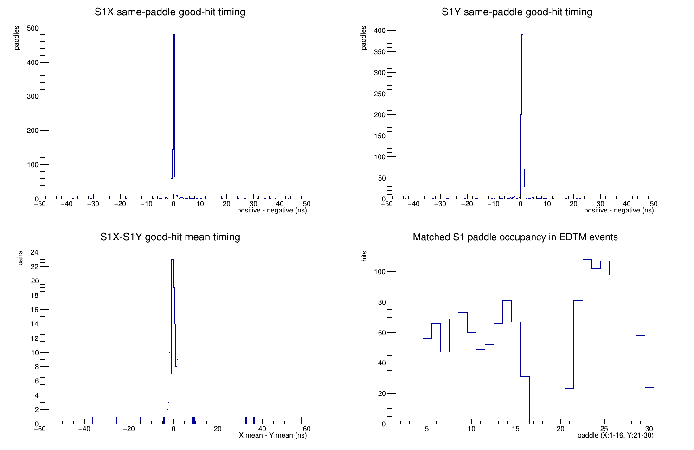

The SHMS-HMS coincidence row is not a GEp trigger prediction: NPS has a different solid angle, threshold response, and background environment from SHMS. The target-length extrapolation is also intentionally simple and requires an extended-target acceptance correction. Hardware-level confirmation of the online gate and elastic efficiency remains necessary, preferably using prescaled looser S1 efficiency triggers.

### Three independent data anchors for the inclusive generator

The proposal-rate calculation is supported by three complementary comparisons rather than a normalization to a single run:

1. The three-pass NPS electron runs at 6.37 GeV test the absolute rate, angular dependence, and high-threshold behavior in NPS itself. Generator/data ratios of 0.95--1.35 provide the strongest closure.
2. The five-pass NPS electron runs at 10.54 GeV test the beam-energy transition and smaller-angle trend. The generator reproduces the direction and approximate magnitude of the change and generally overpredicts the measured rates, reaching a factor of approximately three in the least favorable high-threshold cases.
3. XEM2 runs 17193--17199 test a different detector, transport acceptance, and hardware trigger at 10.55 GeV. A five-million-trial calculation over the nominal SHMS generated envelope gives 8.014 Hz/microampere, compared with 10.713 Hz/microampere measured for pEL_REAL. The generator therefore accounts for 74.8% of this electron-enriched trigger rate, with only 0.65% relative run-to-run variation in the ratio.

These checks span two beam energies, multiple angles, NPS and SHMS, and distinct trigger implementations. They establish that the generator gives a reasonable absolute estimate of the genuine electron-scattering contribution. They do not imply that it models every contribution to a hardware trigger: pEL_REAL can contain residual pion, secondary-particle, accidental, and detector-background activity, while the broader SHMS pTRIG1 3-of-4 rate contains all charged-particle triggers.

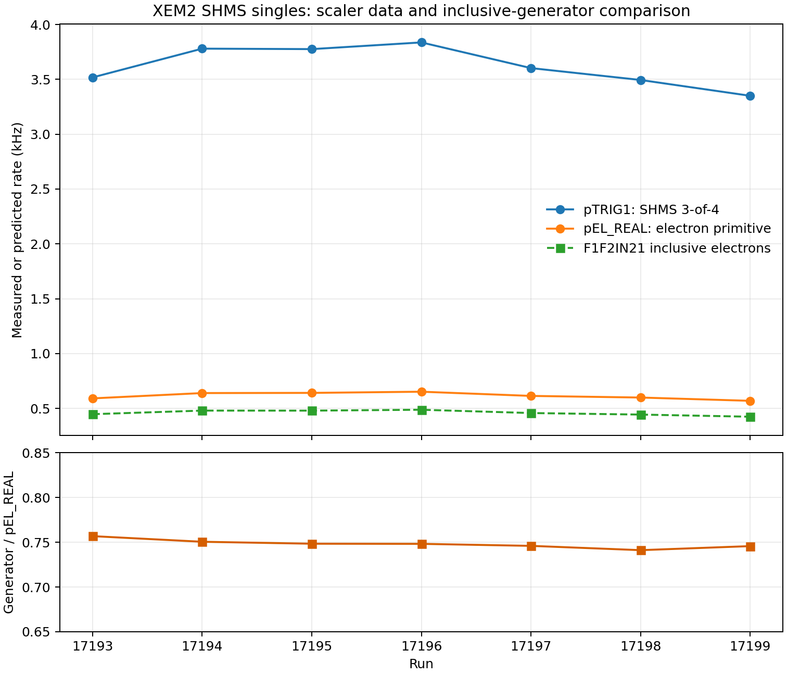

## 2. Online accidental-coincidence budget

For independent singles trigger streams:

R_accidental = R_NPS x R_HMS x coincidence_width.

With the current 40--60 kHz practical HMS S1 range:

| Assumed NPS trigger rate | 20 ns | 40 ns |
|---:|---:|---:|
| 0.1 MHz | 80--120 Hz | 160--240 Hz |
| 0.3 MHz | 0.24--0.36 kHz | 0.48--0.72 kHz |
| 1.0 MHz | 0.80--1.20 kHz | 1.60--2.40 kHz |

The rounded 1 MHz by 1 MHz case gives 20 kHz at 20 ns and 40 kHz at 40 ns. This was a useful conservative sanity envelope before an electron-data NPS estimate existed; it is not the current working prediction. These values precede correlated physics triggers and trigger deadtime.

The earlier electron-run angular extrapolation gave a useful empirical bracket, but it crossed both an angular gap and a beam-energy change. The now-validated inclusive generator permits a direct calculation of the **electron component** at the proposal conditions:

| Physical NPS threshold | Inclusive inelastic | Radiated elastic | Modeled electron rate | Electron-only accidental rate, 20 ns | Electron-only accidental rate, 40 ns |
|---:|---:|---:|---:|---:|---:|
| 70% = 3.387 GeV | 14.339 kHz | 0.076 kHz | 14.415 kHz | 11.5--17.3 Hz | 23.1--34.6 Hz |
| 75% = 3.629 GeV | 10.256 kHz | 0.047 kHz | 10.303 kHz | 8.2--12.4 Hz | 16.5--24.7 Hz |
| 80% = 3.870 GeV | 7.054 kHz | 0.030 kHz | 7.084 kHz | 5.7--8.5 Hz | 11.3--17.0 Hz |

These values use `R_accidental = R_NPS x R_HMS x coincidence_width`, assume independent singles trigger streams, and precede correlated physics triggers and trigger deadtime. They are generator-level truth-energy rates for electrons only; applying the NPS 3x3 shower response should generally lower the electron contribution, while neutral and other backgrounds increase the total.  The accidental columns are therefore electron-component bookkeeping, not lower or upper bounds on the total trigger rate.

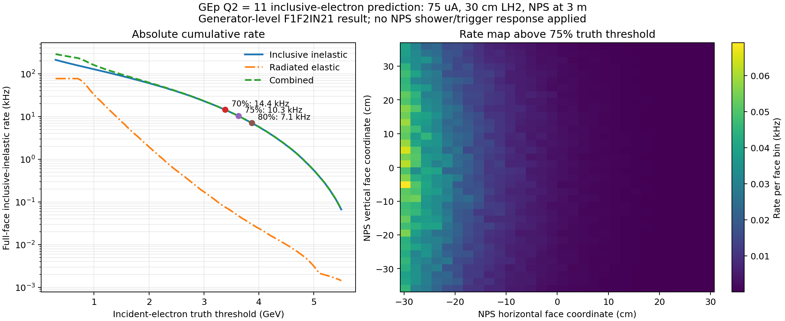

If the measured 2.90 kHz HMS 3-of-4 trigger can replace S1-only without sacrificing elastic efficiency, the 14.42 kHz modeled electron component implies approximately 0.84 Hz at 20 ns and 1.67 Hz at 40 ns at the 70% threshold.  Neutral-background accidentals must be added separately.  This large HMS-logic leverage is why establishing FPP compatibility of the 3-of-4 trigger remains a critical-path question.

## NPS electron-enriched trigger rate versus threshold and angle

Runs 6158, 6165, and 6168 used NPS as an electron detector with the sweeper off. They share a 6.370 GeV beam, 10 cm LH2 target, approximately 25.6 microamp current, 4.598 GeV central electron energy, and 9.5 m NPS distance. Their central angles are 21.17, 19.87, and 18.56 degrees. Unbiased 1 microsecond EDTM windows, with run-specific VTP/offline calibrations, directly measure:

Before using those windows to scan threshold, the EDTM method was checked against the independent pTRIG1 hardware scaler at the actual 1.6 GeV VTP threshold. The same BCM4A current cut of at least 20 microamps was applied to both measurements:

| Run | NPS angle | EDTM occupancy rate | pTRIG1 scaler rate | EDTM/scaler |
|---:|---:|---:|---:|---:|
| 6158 | 21.17 degrees | 25.47 +/- 0.76 kHz | 25.69 kHz | 0.991 |
| 6165 | 19.87 degrees | 37.41 +/- 0.93 kHz | 36.99 kHz | 1.011 |
| 6168 | 18.56 degrees | 51.73 +/- 1.20 kHz | 52.60 kHz | 0.983 |

Thus the EDTM method reproduces the direct hardware trigger to within 1.7% in all three runs, with no systematic degradation as the rate doubles. This establishes the normalization method before it is applied at the higher thresholds where no separate scaler channel exists.

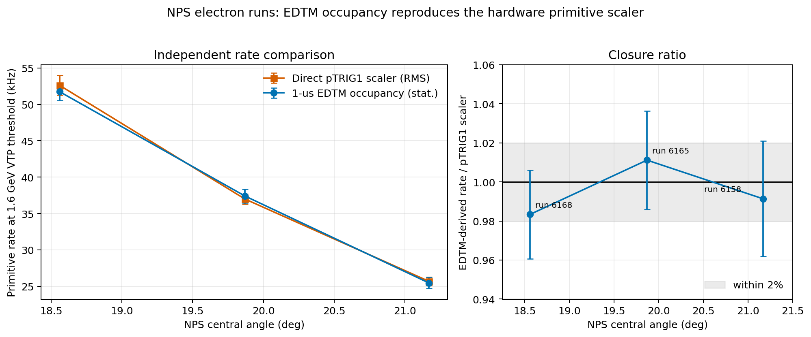

The 1.6 GeV VTP setting corresponds to an average offline-equivalent threshold of approximately 1.46 GeV, or 30.1% of the 4.838 GeV proposal electron energy. Applying the same acceptance-weighted extrapolation at that operating point gives:

| Angular model | Projected GEp NPS trigger rate | HMS-S1 accidental, 20 ns | HMS-S1 accidental, 40 ns |
|---|---:|---:|---:|
| Exponential | 652 +/- 40 kHz | 0.52--0.78 kHz | 1.04--1.56 kHz |
| Power law | 774 +/- 46 kHz | 0.62--0.93 kHz | 1.24--1.86 kHz |

The quoted uncertainties propagate the scaler snapshot RMS through each two-parameter angular fit. They are conservative point-variation uncertainties, not a complete uncertainty budget. In particular, the difference between angular models and the unquantified transfer from the 6.37 GeV calibration beam to the proposal beam energy remain separate. This low-threshold result also explains why a calorimeter trigger rate of order 1 MHz was a reasonable initial trigger-design expectation.

The resulting high-threshold measurements are:

| NPS angle | 70% = 3.387 GeV | 75% = 3.629 GeV | 80% = 3.870 GeV |
|---:|---:|---:|---:|
| 21.17 degrees | 1.26 +/- 0.17 kHz | 0.89 +/- 0.14 kHz | 0.55 +/- 0.11 kHz |
| 19.87 degrees | 2.44 +/- 0.24 kHz | 1.76 +/- 0.20 kHz | 1.08 +/- 0.16 kHz |
| 18.56 degrees | 3.76 +/- 0.32 kHz | 2.70 +/- 0.27 kHz | 2.01 +/- 0.23 kHz |

The rates increase monotonically as NPS moves to smaller electron angle, by approximately a factor of three across only 2.6 degrees. This is the central empirical result: the rate is controlled strongly by angular acceptance, so neither inverse-distance scaling nor luminosity scaling by itself can describe the 3 m proposal geometry.

The proposed 0.615 by 0.738 m active face at 3 m covers approximately 20.82--33.14 degrees in polar angle. The acceptance-weighted projection fits the three measured face integrals with two angular laws and integrates each over that proposed face before applying the current and target-length scaling.

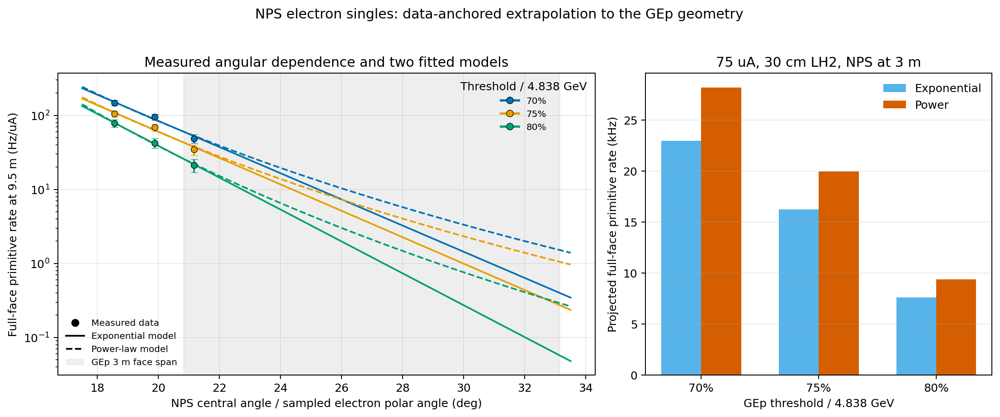

*Points are the measured EDTM-window rates. Color denotes physical threshold; solid and dashed curves are exponential and power-law fits to the three face-integrated measurements. The shaded band is the polar-angle range sampled by the proposed 3 m face. The right panel shows the result after integrating each model over that face and applying the stated current and target-length scaling. The model spread is not a complete uncertainty estimate.*

Run 1918 remains useful as a method cross-check: its EDTM occupancy reproduces the NPS trigger scaler rate within 3.1%. However, run 1918 used NPS as a DVCS real-photon detector, so its earlier luminosity-scaled curve is not the primary electron-singles estimate.

The beam-energy dependence has now been checked against five-pass electron runs 2855, 5183, and 3888 at 10.54 GeV beam energy and 14.76--16.58 degrees. Their EDTM-derived rates reproduce the independent pTRIG1 scalers within 4% after using the actual run-specific hardware thresholds. The five-pass points continue the strong rise toward smaller angles but lie below an extrapolation of the three-pass angular trend at the same absolute high thresholds.

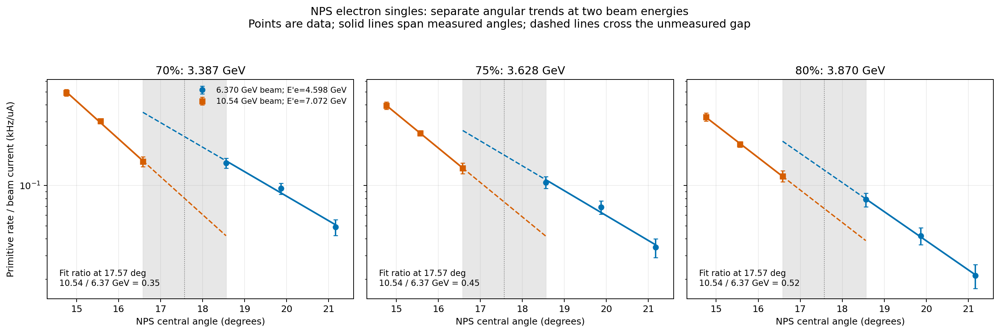

*Points are measured current-normalized rates. Solid lines are separate fits within the measured angular ranges; dashed lines cross the unmeasured 16.58--18.56-degree gap. The five-pass/three-pass fit ratios at the 17.57-degree midpoint are 0.35, 0.45, and 0.52 at the 70%, 75%, and 80% thresholds.*

This comparison argues against assuming that the higher incident beam energy must produce a much larger high-threshold trigger rate. By itself it is not a numerical correction because the datasets do not overlap in angle and run 2855 has a less stable VTP/offline calibration. It instead supplies the second beam-energy anchor for the absolute generator validation below.

An absolute generator validation is now available. The `F1F2IN21` Born inclusive-inelastic calculation and matched SIMC radiated-elastic electron-singles samples were run at the actual conditions of all six electron runs without normalization to the data. Evaluating thresholds relative to each run's own elastic endpoint gives excellent closure for the three larger-angle runs: the inclusive/data ratios span 0.95--1.35. Run 2855 similarly spans 0.90--1.27. Runs 5183 and 3888 preserve the observed angular and threshold trends but are overpredicted, by factors reaching approximately three near 80% of the endpoint. This direction is conservative for proposal-rate planning.

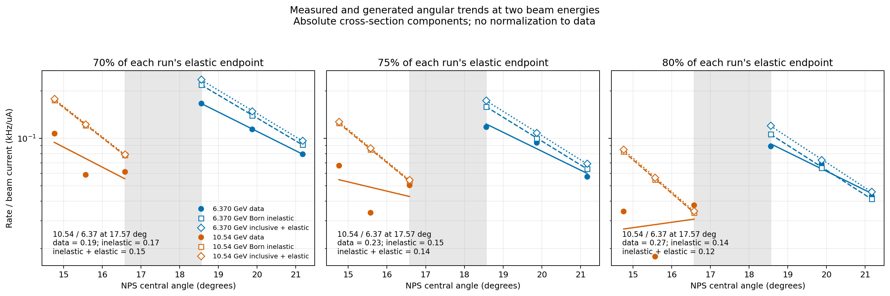

The correct sign and approximate magnitude of the beam-energy transition emerge from the absolute cross sections rather than an empirical rescaling. A direct proposal-kinematics calculation uses 10.7 GeV, 75 uA, 30 cm LH2, and the full NPS face at 26.651 degrees and 3 m. Its inclusive rates are 14.339, 10.256, and 7.054 kHz at 70%, 75%, and 80% of the 4.838 GeV elastic energy. A matched two-million-trial SIMC electron-singles calculation adds only 0.076, 0.047, and 0.030 kHz of radiated elastic events. Neither component is normalized to data.

A two-run GEANT4 response pilot now applies the hottest-block 3x3 sum and each run's measured VTP/offline threshold convention. For five-pass run 5183, the predicted rates are 7.79, 6.83, and 5.97 kHz at 70%, 75%, and 80%, compared with measured values of 8.87, 7.22, and 5.94 kHz. This is excellent absolute closure without normalizing the calculation to the data. For three-pass run 6168, the corresponding prediction/data ratios are only 0.60, 0.44, and 0.23. Near that run's 4.6-GeV elastic region, applying the 3x3 response removes the inelastic continuum and exposes missing high-threshold elastic/radiative strength. Resolving the SIMC final-state-radiation convention is therefore required before the response model is transferred to the proposal setting.

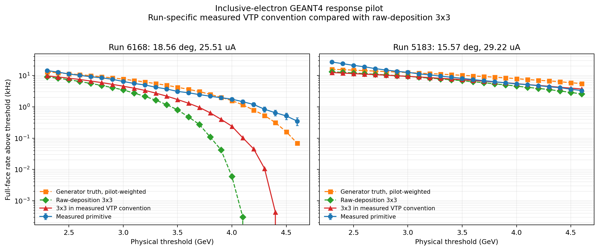

The numerical inputs and reproducible projection are retained in [the scaler-closure table](nps_electron_edtm_scaler_closure.csv), [the hardware-threshold projection](nps_electron_gep_hardware_threshold_projection.csv), [the measured threshold key points](nps_electron_edtm_angle_key_points.csv), [the high-threshold GEp projection table](nps_electron_gep_acceptance_projection.csv), and [the acceptance-weighting script](model_nps_electron_gep_acceptance.py).

### Independent elastic-efficiency cross-check

Run 6151 addresses signal efficiency rather than the trigger-rate normalization. Its proton-tagged elastic core has a 4.598 GeV electron energy, close to the 4.838 GeV proposal value. After applying the separate run-6151 calibration, `E_VTP = 0.2230 + 0.9112 E_offline`, the measured elastic-core efficiencies are 99.3%, 98.8%, and 96.5% for 70%, 75%, and 80% physical threshold fractions, respectively.

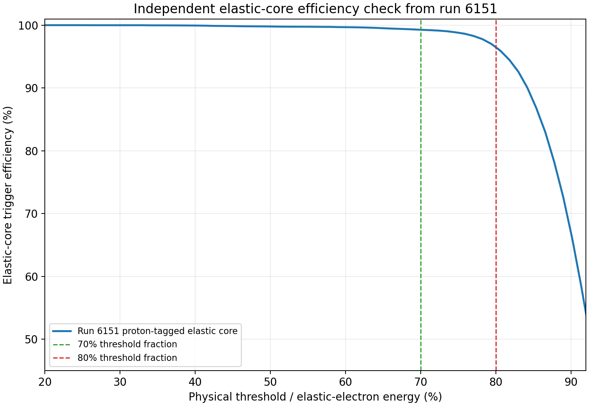

*This conditional efficiency describes the selected, non-radiative elastic core. It does not include the full radiative SIMC distribution or the NPS geometric fiducial and therefore does not replace the GEANT4 retention used in the event-yield projection.*

Paddle masking outside the elastic envelope may help, but it should remain an optimization until paddle-by-paddle scaler rates demonstrate the available reduction.

## 3. Elastic-yield anchor and NPS acceptance gain

Run 17193 supplies the data normalization: 800 selected elastic events in 150.465 mC on 10 cm LH2. The matched SIMC studies give:

- HMS-SHMS coincidence accepted-yield ratio for 30 cm versus 10 cm target: 1.8863. This is not an HMS-only extended-target factor. A direct matched scan at the Q2 = 11 HMS+NPS setting gives 20 cm/10 cm = 1.847 and 30 cm/10 cm = 2.571; see the [target-length audit](xem2_run17193_target_length_audit.md).
- NPS versus SHMS yield ratio in a common comparison window: 4.1078.
- Full displayed NPS versus SHMS acceptance ratio: 4.3139.

At the run-17193 kinematics, using 45 PAC days as 45 x 24 hours at 75 uA, with no operational-efficiency discount:

| Electron-arm configuration | Projected selected elastic events | Mean selected-elastic rate |
|---|---:|---:|
| SHMS-like acceptance | 2.92 million | 0.75 Hz |
| NPS at 3 m, run-17193 kinematics | approximately 12.05 million | approximately 3.10 Hz |

These are selected elastic yields, not raw singles, coincidence-trigger, or DAQ rates.

The data/SIMC closure is encouraging but imperfect:

- Broad HMS delta comparison: 1124 / 1200.95 = 0.936.
- Tighter elastic selection: 800 / 1034.34 = 0.773.

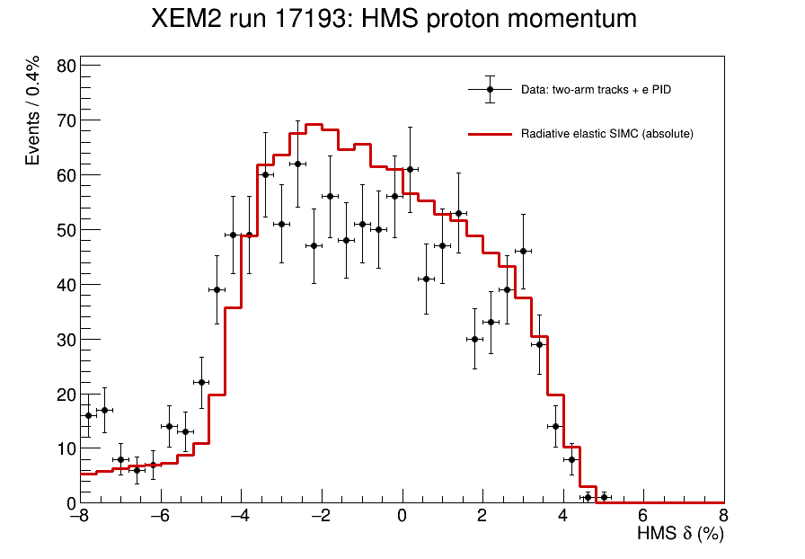

*Run 17193 HMS momentum acceptance. The broad data/SIMC normalization is 0.936, while the tighter elastic selection gives the 0.773 factor used in the yield anchor.*

The normalization must be read in the following order:

1. At the run-17193 kinematics, scaling the absolute SIMC yield to 45 PAC days, the 30 cm target, and the NPS acceptance gives approximately 15.5 million selected elastic events.
2. Run 17193 recorded 800 events where the matched SIMC calculation predicts 1034.34, so the measured data/SIMC factor is `800 / 1034.34 = 0.7734`.
3. Applying that factor once gives `15.5 million x 0.7734`, or approximately 12.05 million events at the run-17193 kinematics.

**The 0.773 run-17193 data/SIMC reduction is already included in the quoted 12.05-million-event projection. It must not be applied a second time.** Equivalently, the same result is obtained by starting directly from the 800 recorded run-17193 events and using SIMC only for the target-length and NPS/SHMS acceptance ratios.

The 45-PAC-day convention applies no separate reduction for accelerator or scheduled operational availability. Additional GEp-specific losses—for example, FPP tracking loss or higher-rate deadtime—must be identified separately.

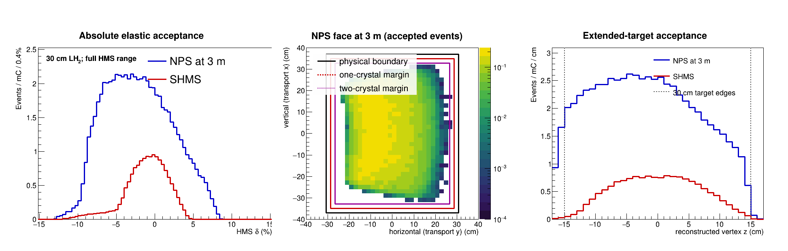

*SIMC comparison of the measured SHMS configuration with NPS at 3 m, including the HMS momentum distribution, NPS face coverage, and extended-target acceptance.*

### Transfer to the original Q2 = 11 kinematics

A new 10-million-trial SIMC calculation uses 10.700 GeV beam energy, a 4.838 GeV electron at 26.651 degrees, and a 6.735 GeV/c proton at 18.797 degrees, giving Q2 = 10.9947 GeV2. The 30 cm target, NPS distance, acceptance limits, radiation convention, and event-level HMS selection are matched to the run-17193 NPS calculation.

The selected SIMC yields are 54.2538 events/mC at Q2 = 11 and 61.2019 events/mC at the run-17193 setting. Their ratio is 0.88647. Applying that kinematic ratio to the already data-anchored 12.053-million run-17193 projection gives 10.685 million events before an NPS response threshold, or 2.75 Hz averaged over 45 PAC days. The run-17193 factor of 0.7734 remains included exactly once.

The corresponding 110,774-event GEANT4 sample gives:

| NPS requirement | Weighted retention | Projected 45-day events |
|---|---:|---:|
| Inclusive 3x3 sum, 70% of incident electron energy | 72.579% | 7.76 million |
| 3x3 plus working fiducial, 70% | 72.048% | 7.70 million |
| Inclusive 3x3 sum, 80% | 70.753% | 7.56 million |
| 3x3 plus working fiducial, 80% | 70.250% | 7.51 million |

These response-reduced numbers are provisional rather than final efficiency claims. The threshold is expressed as a fraction of the incident electron energy, not a renormalized 3x3 elastic peak. The simulation transports the post-radiation electron but not a collinear final-state bremsstrahlung photon that could add energy to the same cluster, and it retains the inherited run-6151 passive/sweeper geometry. Each effect can make the apparent threshold loss too large or otherwise distort the edge response.

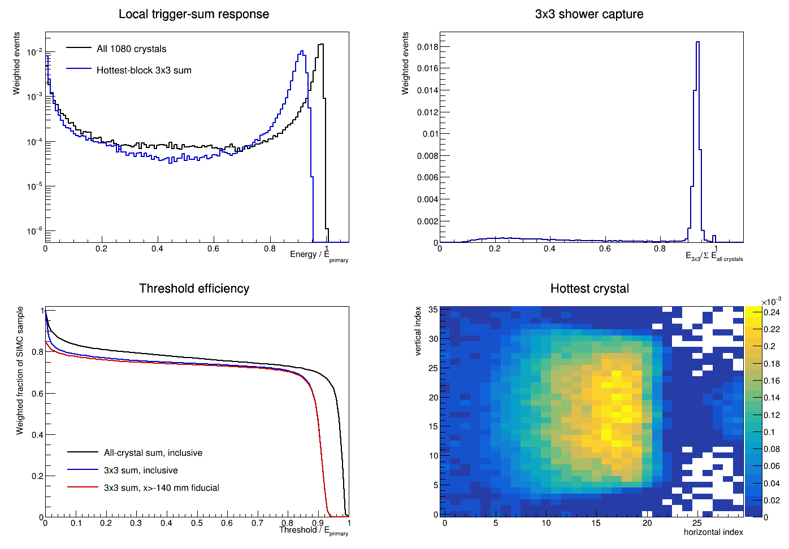

*GEANT4 response for 110,774 weighted Q2 = 11 events. The lower-left panel supplies the selected-elastic 3x3 threshold efficiencies quoted above; the red curve includes the working `x > -140 mm` fiducial. This fiducial is not included in the full-face NPS trigger rate and accidental-rate projections.*

The proton-arm elastic consistency is shown independently in the GEp-III-style variable:

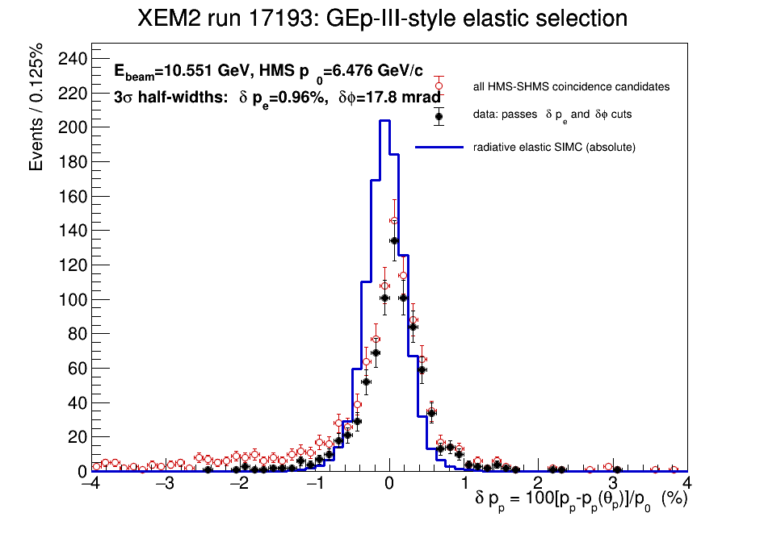

*Run 17193 data and SIMC in the proton momentum-consistency variable used in the GEp-III analysis.*

### First Hall C FPP figure-of-merit projection

The new public Hall C FPP GEANT4 calculation replaces the earlier assumed
20% polarimeter efficiency with a first integrated, analyzing-power-weighted
result.  For a single legacy 22-inch (55.88 cm) polyethylene analyzer, four Hall C FPP drift
chambers, and 6.7 GeV/c incident protons, the ideal truth-associated
calculation gives:

| Quantity | Result |
|---|---:|
| Useful-pT efficiency | 26.264% |
| Effective analyzing power within the useful sample | 0.06311 |
| Intrinsic FOM per incident proton | 0.001046 |
| Polarized FOM per incident proton at Pe = 0.85 | 0.0007558 |

Approximately 76% of the intrinsic FOM lies below 5 degrees.  A one-degree
lower polar-angle cut nevertheless retains 97.3%, identifying one degree as a
practical initial lower limit and establishing why four-chamber tracking is
important at small angle.

Using the provisional NPS-response-reduced yield of 7.5--7.7 million events
gives an integrated polarized FOM of approximately 5,670--5,820 and an
approximate single-component uncertainty of 0.0188--0.0185.  The corresponding
SBS best-case planning baseline, constructed from 9.3 million events, a 20%
useful FPP efficiency, the same effective analyzing power, and 85% beam
polarization, is approximately 5,350 with a component uncertainty of 0.0193.
Thus the present Hall C result is competitive and perhaps modestly better, but
the difference is only 6--9% in FOM and 3--4% in component uncertainty.

The Hall C result is still idealized: hits are truth-associated, exact drift
distances are used, and chamber inefficiency, resolution, noise, dead regions,
and multi-track pattern recognition are absent.  The four-chamber closure plot
therefore validates the geometry, wire mapping, left/right enumeration, and
fit algebra; it is not a prediction of experimental angular resolution.

The 22-inch analyzer is the legacy constructed hardware baseline rather than
an optimized GEp-4 thickness.  The simplified geometry can accommodate the
60 cm scan point, but the actual analyzer frame and chamber clearances must be
checked before treating any thickness beyond the legacy module as available.

The full assumptions, angular-cut scan, SBS comparison, and remaining work are
collected in the [focused FPP FOM summary](fpp_fom_summary.md).

## 4. What the DVCS/NPS studies established

NPS E12-13-010 runs 6151 and 2875 were valuable development samples. They established that real hcana data can be compared with SIMC events transported through the NPS GEANT4 model; that run 6151 is dominantly elastic; that the elastic peak is much less dominant at the higher-Q2 run 2875 setting; and that NPS response, occupancy, pileup, and correlated pi0 backgrounds can be studied with the existing pipeline.

They did not directly determine the raw GEp online-trigger rate. Accidental samples made after reconstruction or physics selections answer an offline-background question, not the hardware-trigger-rate question. This distinction is now explicit in the current proposal narrative.

## 5. NPS geometry and reconstruction assumptions

The current design standard is NPS at 3 m, with a nominal active face of approximately 61.5 cm by 73.8 cm. This distance was an educated acceptance-matching choice, not a completed optimization. The calorimeter should be placed as far from the target as possible while preserving the electron solid-angle coverage needed to match the accepted HMS elastic envelope. A larger distance would improve angular resolution and could reduce background occupancy and rates, but would eventually reduce elastic acceptance. A representative 5 mm position resolution corresponds to about 1.67 mrad at 3 m; this remains an assumption to validate for the chosen cluster algorithm and energy range.

The HMS proton track and calibrated optics reconstruct the reaction vertex along the target. Combining that vertex with the NPS cluster position defines the electron direction and permits elastic kinematic consistency variables without an NPS tracking detector.

Two modeling cautions remain relevant:

- A 3x3 sum loses shower energy relative to a larger cluster, so a threshold stated as a fraction of elastic-electron energy must use the actual trigger-sum response.
- Final-state bremsstrahlung photons can remain close to the electron and contribute to the cluster; transporting only the post-radiation electron can overstate threshold losses.

## 6. Proposal-readiness matrix

| Question | Current status | Significance |
|---|---|---|
| Enough elastic yield? | 10.68 million before NPS response; approximately 7.5--7.7 million with the provisional 70--80% 3x3 threshold and fiducial | Encouraging, with response caveats |
| HMS raw S1 rate? | XEM2 establishes 40--60 kHz for double-ended, paddle-matched S1X AND S1Y; the broad S1X OR S1Y is approximately 810 kHz | Strong empirical baseline; online efficiency still to verify |
| NPS raw rate versus threshold? | Electron component is constrained; run 6887 requires substantial additional electromagnetic activity; baseline Wiser-pi0 and pi-minus do not close it | Critical unresolved item |
| Raw accidentals? | HMS input is constrained to 40--60 kHz, but the total NPS input remains unresolved; retain the explicit 0.1--1.0 MHz NPS scenario table | Bounded parametrically, not yet predicted |
| HMS 3-of-4 with FPP? | Attractive measured rate; implementation and efficiency need study | Major mitigation |
| Hall C DAQ capacity? | Relevant event-size limit and deadtime need confirmation | Critical path |
| Optimal NPS distance? | 3 m is a reasonable design standard but has not been optimized | Important design study |
| Selected NPS backgrounds and response? | Substantial data-plus-GEANT4 groundwork exists | Supporting evidence |
| FPP precision projection? | First single-analyzer calculation gives an SBS-scale integrated FOM; ideal four-chamber tracking closes below 5 degrees, but detector realism, data validation, SIMC phase space, and spin transport remain | Encouraging; no longer an unquantified feasibility assumption |

## 7. Immediate next steps

1. Complete and validate the fully inclusive target-background calculation, using separated target-exit phase space, importance sampling, and a production-cut convergence scan.
2. Verify the narrowest realistic online coincidence width using the actual NPS and HMS timing chain.
3. Test S1/S2 3-of-4 logic, including FPP compatibility and elastic efficiency across the extended target.
4. Obtain the Hall C DAQ sustainable-rate and deadtime specification for the expected event size.
5. Optimize the NPS distance by finding the largest target-to-calorimeter distance that still provides the required solid-angle matching to the HMS elastic acceptance; quantify elastic yield, edge losses, angular resolution, occupancy, and trigger-rate consequences versus distance.
6. Extend the first FPP FOM calculation with chamber response and pattern-recognition losses, weighted GEp-4 SIMC phase space, GEp-III/2gamma data validation, hadronic-model variations, and event-by-event HMS spin transport.

## Current supporting documentation

- [XEM2 HMS benchmark and NPS projection](xem2_hms_nps_benchmark.md)
- [Current NPS validation status](nps_validation_status.md)
- [Active NPS trigger-particle-composition investigation](trigger_particle_composition/README.md)
- [Archived NPS and SIMC-GEANT4 development record](archive/nps_simulation_development_2026-10-25/README.md)
- [Archived DVCS benchmark exploration](archive/dvcs_benchmark_exploration_2026-10-24/README.md)
- [Focused Hall C FPP figure-of-merit summary](fpp_fom_summary.md)
- [Public GEANT4 FPP implementation](https://github.com/brash99/gep4_fpp_geant4)
