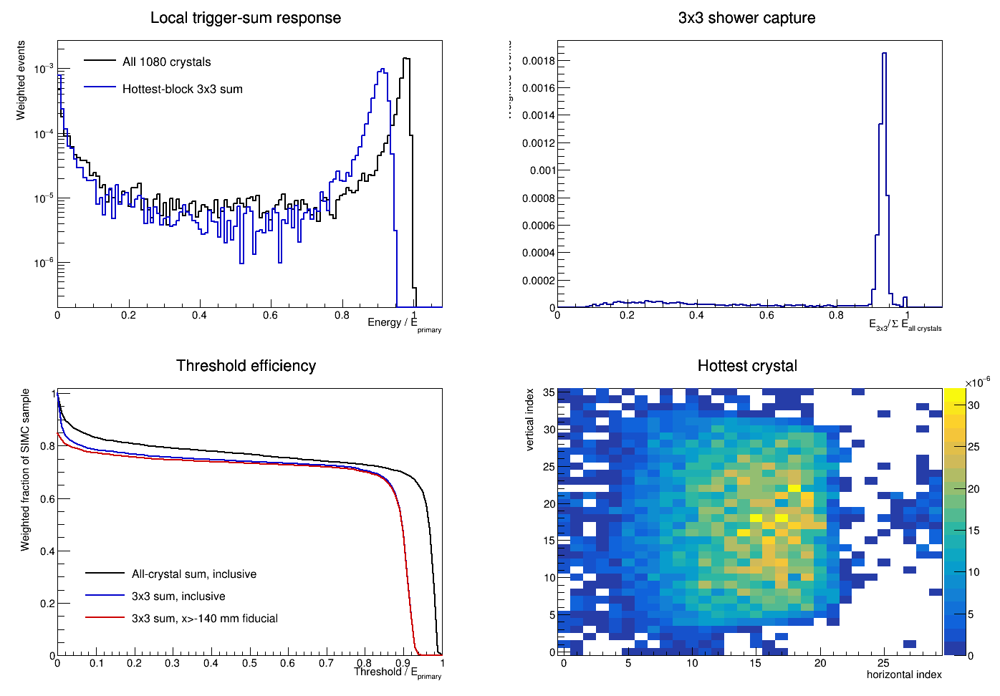
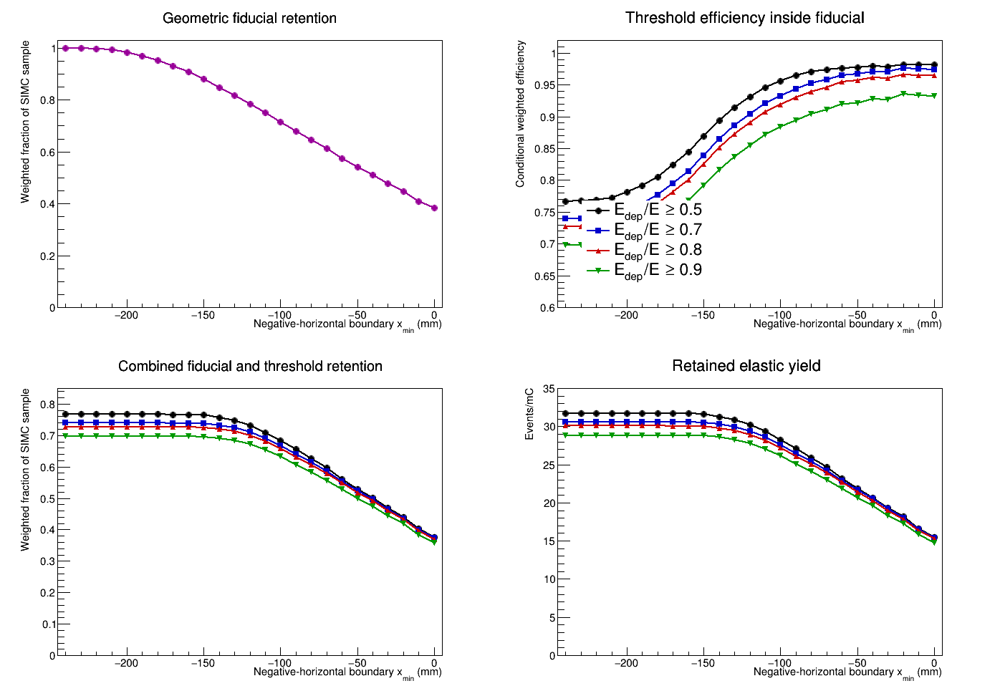
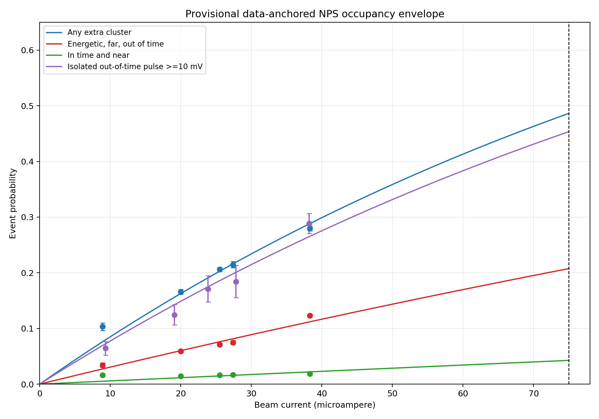
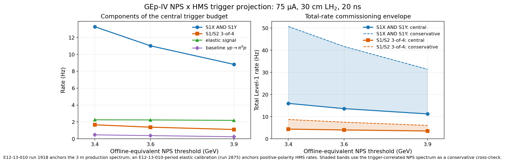

# GEp-IV Hall C reboot: proposal-readiness summary

**Internal review draft for Andrew Puckett, Garth Huber, and Steffen Strauch**  
**Status date:** 24 October 2026  
**Working configuration:** 10.7 GeV beam, Q² approximately 11 GeV², 75 μA,
30 cm LH2, HMS proton detection, NPS electron detection at 3 m

## Executive assessment

The Hall C GEp-IV reboot is now supported by a coherent, reproducible chain
from elastic SIMC generation through crystal-level NPS response, together with
data-driven studies of NPS occupancy and NPS--HMS trigger rates. The present
results support the **technical plausibility** of an HMS+FPP/NPS measurement at
Q² approximately 11 GeV². They do not yet constitute a complete PAC-ready
performance projection.

The strongest conclusions are:

- The reconstructed elastic yield is consistent with the historical PAC37
  scale at the 12--21% level, depending on the historical cut convention.
- A maintained SIMC-to-GEANT4 calculation predicts approximately 2.17 Hz of
  elastic events passing a local 3x3 NPS sum at an 80%-of-elastic-energy
  threshold, before DAQ, tracking, elastic-selection, and FPP efficiencies.
- The corresponding raw 45-PAC-day sample is approximately 8.43 million
  events before those experiment-side losses.
- Existing NPS data indicate substantial detector activity at high current,
  but measured resolved-cluster and random-pulse overlays have negligible
  effect on the local elastic 3x3 threshold in the tested timing windows.
- The best current 20 ns trigger projection is not kilohertz-scale after the
  high NPS threshold and proton-coincidence requirements are applied. It is
  approximately 11--16 Hz total for `NPS AND (S1X AND S1Y)`, or 3.5--4.5 Hz
  with the standard HMS S1/S2 three-of-four primitive. Conservative
  commissioning envelopes are approximately 31--51 Hz and 6--9 Hz.
- The dominant modeled correlated trigger background,
  `gamma p -> pi0 p`, contributes approximately 0.24--0.47 Hz in the baseline
  model over the proposed threshold range. It is important but does not
  dominate the present hardware-rate estimate.

The proposal is therefore beyond a speculative concept stage. The critical
remaining work is to establish the acceptance-weighted FPP figure of merit and
full precision projection, validate the combined trigger at representative
geometry and polarity, and close the inherited NPS passive-geometry question.

## Proposed experimental point

| Quantity | Working value |
| --- | ---: |
| Beam energy | 10.7 GeV |
| Q² | 11 GeV² |
| Scattered-electron energy | 4.838 GeV |
| NPS angle and distance | 26.651°, 3.0 m |
| Proton momentum | 6.735 GeV/c |
| HMS angle | 18.797° |
| Beam current | 75 μA |
| Target | 30 cm LH2 |
| Virtual-photon polarization, epsilon | 0.6837 |

These values have been independently reconstructed from stationary-proton
elastic kinematics. The possible Q² approximately 8 GeV² commissioning point
remains useful, but its role and beam-time allocation have not yet been
defined.

## 1. Elastic yield and NPS response

The current radiated SIMC calculation gives 41.34--41.48 elastic events/mC,
or approximately 3.1 Hz at 75 μA, before detector response and analysis
efficiencies. A separate reconstruction of the 2011 PAC37 point gives 40.87
events/mC. That is 11.9% below the historical 3-sigma-cut yield and 20.5%
below the historical 6-sigma-cut yield. This is adequate as a historical
scale check, although it is not an exact reproduction of the unavailable
original deck and code revision.

The current SIMC-to-GEANT4 sample contains 10,923 transport-accepted elastic
electrons. The figure below shows the local 3x3 response used as the present
trigger-like baseline. At a threshold equal to 80% of the central elastic
electron energy, the fiducial 3x3 retention is 69.95%, corresponding to 28.92
events/mC, 2.17 Hz at 75 μA, and approximately 8.43 million raw events in 45
PAC days.

Vector version: [PDF](plots/gep_reboot_q11_trigger_sum.pdf). The 3x3 sum is a
physics-motivated approximation, not a full emulation of the installed VTP
firmware: seed logic, electronics response, calibration spread, timing, and
the exact firmware energy convention remain to be applied.

### Acceptance and fiducial choice

The hybrid calculation exposed a low-response band on the negative-horizontal
side. A geometry-only scan found a useful working boundary at local
`x > -140 mm`. At an 80% threshold this retains 29.78 events/mC, only about 1%
below the inclusive deposited-energy yield, while raising the conditional
threshold efficiency from 74.1% to 85.1%.

Vector version: [PDF](plots/gep_reboot_q11_fiducial_scan.pdf). The low-response
band may reflect the inherited run-6151 sweeper or other passive geometry.
Until a geometry-tagged rerun resolves that question, the 75.6% primary
active-crystal entry fraction must not be presented as an intrinsic NPS
efficiency.

## 2. High-current NPS environment

Private replays of Hall C NPS Run Group 1a elastic-calibration runs 6151 and
2875 provide a first data-anchored extrapolation to 75 μA. Both were acquired
during the E12-13-010 running period; they are commissioning/calibration data,
not DVCS production data. The provisional model predicts:

| Occupancy category | Probability at 75 μA |
| --- | ---: |
| Any reconstructed extra cluster | 48.64% |
| Energetic, far, out-of-time cluster | 20.76% |
| In-time and near cluster | 4.26% |
| Isolated out-of-time decoded pulse at least 10 mV | 45.36% |

Vector version: [PDF](plots/nps_occupancy_projection_75uA.pdf). The high overall
occupancy should be treated as a DAQ, reconstruction, and trigger-environment
warning—not automatically as an elastic-efficiency loss. In the explicit
overlay studies:

- no measured resolved secondary cluster entered the elastic 3x3 sum within
  2 or 4 ns;
- a conservative 5x5, 4 ns cluster overlay changed the 80% threshold
  retention by only 0.018 percentage points; and
- the EDTM random-window projection for a pulse entering the shower 3x3 within
  4 ns was 0.00375%, with no observed threshold change.

These are encouraging results, but activity below the run-6151 sparsification
threshold remains unbounded. The extrapolation from a highest stable measured
current near 38 μA to 75 μA is also model dependent.

## 3. Experimental trigger-rate budget

The trigger study now combines complementary data rather than extrapolating a
single calibration run:

- E12-13-010 production run 1918 supplies an NPS singles spectrum at the
  relevant 3 m distance.
- E12-13-010-period elastic-calibration runs 6151 and 2875 supply
  positive-polarity proton-side primitive rates.
- Elastic-calibration run 2875 directly recorded an unprescaled NPS--HMS
  three-of-four trigger at
  55.7 Hz at 38.27 μA and a loose 1.4 GeV VTP threshold. This validates the
  trigger definition and rate scale, although it is not the proposal setting.
- The NPS VTP output width is documented as 20 ns. The effective downstream
  counting-house coincidence width has not yet been measured.

At 75 μA, 30 cm LH2, and an assumed 20 ns effective window, the current central
budget is:

| NPS threshold | Elastic | Baseline pi0 | S1X AND S1Y accidental | S1X AND S1Y total | Three-of-four accidental | Three-of-four total |
| ---: | ---: | ---: | ---: | ---: | ---: | ---: |
| 3.4 GeV | 2.25 Hz | 0.47 Hz | 13.3 Hz | 16.0 Hz | 1.66 Hz | 4.38 Hz |
| 3.6 GeV | 2.23 Hz | 0.38 Hz | 11.0 Hz | 13.6 Hz | 1.38 Hz | 3.99 Hz |
| 3.9 GeV | 2.18 Hz | 0.24 Hz | 8.8 Hz | 11.2 Hz | 1.10 Hz | 3.52 Hz |

Vector version: [PDF](plots/pac_trigger_budget.pdf). The shaded range uses the
trigger-correlated NPS spectrum as a deliberately conservative cross-check;
it is not a statistical uncertainty band.

The modest central rates are physically consistent with the beam's 4 ns
microstructure. A 20 ns coincidence spans approximately five relative bucket
positions, and explicit bucket counting reproduces
`R_accidental = R_NPS R_HMS Delta-t`. Kilohertz rates are nevertheless quite
plausible with a loose NPS threshold, an HMS S1 OR, or a substantially longer
gate. For example, the projected loose-threshold NPS singles rate is about
4 MHz, which already gives approximately 0.6 kHz with the intended S1X--S1Y
primitive in a 20 ns window.

The S1/S2 three-of-four option is attractive enough to retain as a serious
alternate trigger. Its implementation depends on Andrew's proposed FPP/HMS
detector configuration and must be shown to preserve high proton efficiency.
The present HMS calorimeter primitives are not suitable primary proton
triggers: observed proton efficiencies are only approximately 10--15%, with
non-negligible reconstructed zero-energy tails.

### Experimental provenance of the replayed runs

All three analyzed runs come from the Hall C NPS Run Group 1a 2023--2024
campaign. The specific experiment is **[E12-13-010, “Exclusive Deeply Virtual
Compton and Neutral Pion Cross-Section Measurements in Hall C”](https://wiki.jlab.org/cuawiki/index.php/NPS_Experiments).** Run Group 1a
also served other approved NPS experiments, so “NPS data” or “Run Group 1a
data” alone is not sufficiently specific.

| Run | E12-13-010 data category | Beam pass | Target | NPS distance | Role in this study |
| ---: | --- | ---: | --- | ---: | --- |
| 1918 | `KinC_x60_3` production | 5 | 10 cm LH2 | 3.0 m | Measured NPS singles spectrum and installed coincidence-trigger audit |
| 2875 | NPS elastic calibration/commissioning | 5 | 10 cm LH2 | 9.5 m | High-current positive-polarity proton primitive and direct Trigger-5 check |
| 6151 | NPS elastic calibration/commissioning | 3 | 10 cm LH2 | 9.5 m | Proton-trigger timing/efficiency, lower-momentum rate anchor, and prompt-tail study |

Run 1918 is therefore the only DVCS/π⁰ **production run** used in the present
rate study. Runs 2875 and 6151 should always be described as elastic
calibrations taken during the E12-13-010 running period. None of the three is a
GEp run, and none exactly reproduces the proposed 3 m NPS plus high-momentum
positive-polarity proton configuration. Their value lies in the complementary
measured constraints they provide.

The run categories and configurations in this table were checked against the
[Hall C NPS run spreadsheet](https://docs.google.com/spreadsheets/d/1N4DRE8M2qgMPtcTH9TlrFsK312dUje6ug98FPQK1eEg/edit): the `KinC_x60_3`,
five-pass commissioning, and three-pass commissioning worksheets contain runs
1918, 2875, and 6151, respectively.

## 4. Correlated inelastic background

The principal modeled correlated channel is endpoint hard bremsstrahlung
followed by `gamma p -> pi0 p`. Exact two-body kinematics put its recoil proton
inside the HMS elastic setting, so it cannot be estimated from independent
singles rates.

The current normalized SIMC model gives 1.00 Hz after proton transport and NPS
geometric acceptance but before an NPS energy threshold. Applying the photon
threshold gives 0.24--0.47 Hz for the baseline `s^-7` model and 0.13--0.90 Hz
over the explicit `s^-8` to `s^-6` model envelope. The baseline background is
11--21% of the elastic trigger rate across the 3.4--3.9 GeV range.

This establishes the correct scale for the hardware budget, but not the final
offline contamination. Both decay photons must still be transported through
the maintained NPS geometry and evaluated with the same local trigger sum and
elastic-correlation cuts as the signal. Aluminum windows and other correlated
electroproduction channels are not yet included.

## 5. Beam time and precision

The gross elastic arithmetic is understood:

| Basis | Rate or total |
| --- | ---: |
| Transport-accepted SIMC rate at 75 μA | approximately 3.1 Hz |
| Gross 45-PAC-day transport-accepted yield | approximately 12.1 million |
| 80% local-sum/fiducial trigger-like rate | approximately 2.17 Hz |
| Corresponding raw 45-PAC-day yield | approximately 8.43 million |

The 8.43 million value is not the final polarization sample. It precedes DAQ
live time, HMS tracking, elastic-selection, FPP reconstruction, secondary-
scattering efficiency, and analyzing-power weighting. Likewise, comparison
with the quoted approximately 9.3 million recovered SBS events cannot establish
the relative form-factor precision from event counts alone.

The single largest missing proposal quantity is the acceptance-weighted
polarimeter figure of merit, including event-by-event spin transport. Near a
possible zero crossing, the proposal should quote projected **absolute**
uncertainty on `GE/GM` or `mu_p GE/GM`, not a relative uncertainty with respect
to a value near zero.

## 6. Proposal-readiness matrix

| Topic | Current status | PAC disposition |
| --- | --- | --- |
| Central kinematics | Independently reproduced | Ready |
| Historical elastic scale | Reconstructed within 12--21% of cut-level PAC37 values | Ready with stated qualification |
| Current elastic normalization | Fixed-seed, radiated SIMC chain is reproducible | Ready as working baseline |
| NPS geometry and local response | Full SIMC-to-GEANT4 chain and 3x3 scan completed | Promising; passive-geometry audit remains |
| High-current occupancy | Data-anchored projection and explicit overlays completed | Suitable as an envelope, not a final inefficiency |
| NPS--HMS trigger rate | Anchored to runs 1918, 2875, and 6151 | Suitable for feasibility; commissioning test required |
| S1X AND S1Y efficiency | 98.5% at a 20 ns plane-overlap window in E12-13-010-period elastic-calibration run 6151 | Strong preliminary evidence |
| HMS three-of-four option | Low projected rate; measured primitive exists | Configuration and proton efficiency unresolved |
| Correlated pi0 trigger | Absolute model with explicit scaling envelope | Adequate for rate feasibility; detector/cut propagation remains |
| HMS calorimeter trigger | Approximately 10--15% proton primitive presence | Reject as baseline trigger |
| FPP figure of merit | Not yet recalculated for proposed configuration | Critical blocker for precision claim |
| Full uncertainty projection | Not yet assembled | Critical blocker for beam-time request |
| Updated physics motivation | Historical case reviewed; modern theory/data review incomplete | Required for proposal narrative |

## 7. Recommended next decisions and measurements

### Critical path before a PAC submission

1. **Close the polarimetry calculation.** Define the realizable HMS/FPP stack,
   analyzer material and thickness, tracking planes, angular acceptance,
   efficiency, analyzing power, and event-by-event spin transport. Produce the
   final `delta(GE/GM)` versus beam-time calculation.
2. **Perform one combined trigger commissioning measurement.** Use NPS near
   3 m, positive-polarity high-momentum protons, a 3.4--3.9 GeV-equivalent NPS
   threshold, and both S1X--S1Y and three-of-four logic. Record singles,
   coincidences, gate widths, live time, and timing spectra versus current.
3. **Audit the inherited GEANT4 passive geometry.** Remove or tag the sweeper
   and other run-6151-specific elements, then repeat the fixed event stream to
   establish the actual NPS fiducial efficiency.
4. **Complete the pi0 detector-level calculation.** Transport both photons and
   apply the same VTP-like sum and elastic-correlation cuts as the signal.
5. **Refresh the physics case.** Replace the 2011 theory/data context with the
   present world data, modern form-factor calculations, and a clearly stated
   scientific payoff for an absolute high-Q² constraint or zero-crossing test.

### Important but not presently on the critical path

- Recovering the exact original PAC37 SIMC deck and source revision.
- Developing an HMS calorimeter-assisted proton trigger without a detector
  configuration that removes the observed zero-energy tail.
- Refining low-amplitude NPS pileup beyond what is needed to demonstrate rate
  and efficiency margin.

## Bottom line for internal review

The work to date answers the first-order feasibility question positively:
there is a viable elastic rate, a plausible NPS acceptance and threshold
choice, no observed local-sum failure from measured overlay samples, and an
experimentally anchored coincidence-rate estimate with comfortable DAQ
margin under the intended trigger logic.

The proposal should not yet claim a final precision or beam-time requirement.
Those depend mainly on the realizable FPP configuration and its
acceptance-weighted figure of merit, followed by a combined trigger validation
and the NPS passive-geometry audit. If those three items close favorably, the
existing simulation and data studies provide a strong technical foundation
for the PAC submission.

## Supporting analysis notes

- [Overall review and historical context](findings.md)
- [Beam-time and elastic-yield check](beam_time_yield_check.md)
- [SIMC--GEANT4 hybrid response](gep_q11_hybrid_response.md)
- [NPS occupancy projection](nps_occupancy_projection.md)
- [Experimental coincidence-trigger budget](gep_coincidence_trigger_budget.md)
- [Correlated pi0 trigger projection](q11_correlated_trigger_projection.md)
- [Prompt inelastic study](prompt_inelastic_study.md)
- [NPS data/replay trigger audit](nps_hcana_trigger_audit.md)
