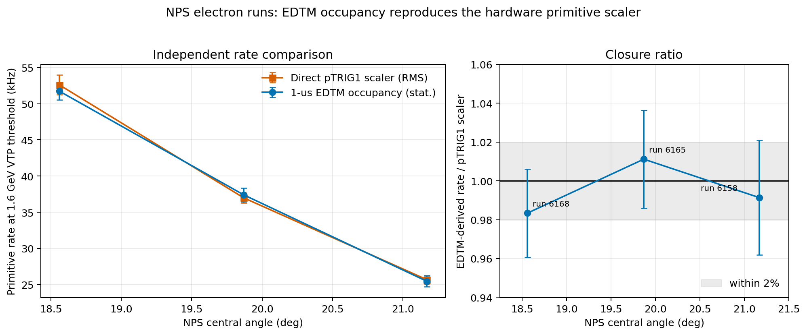
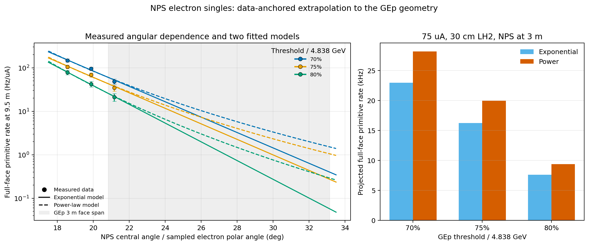
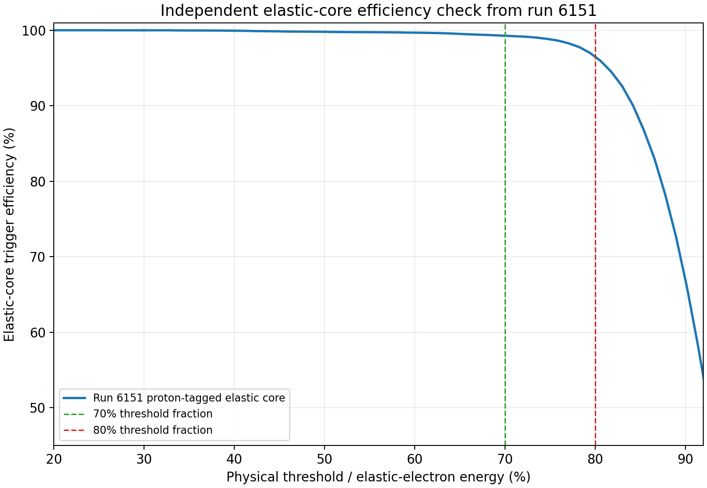
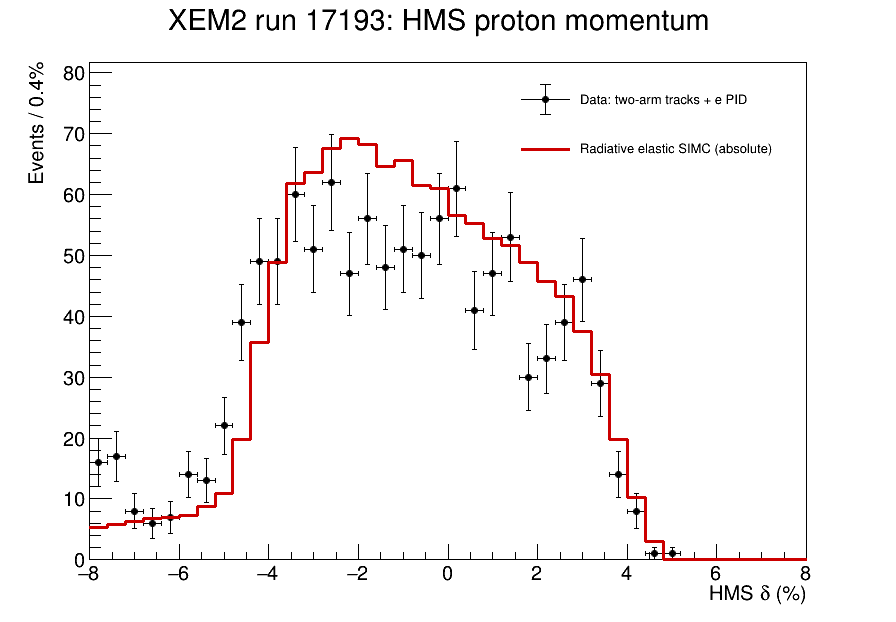
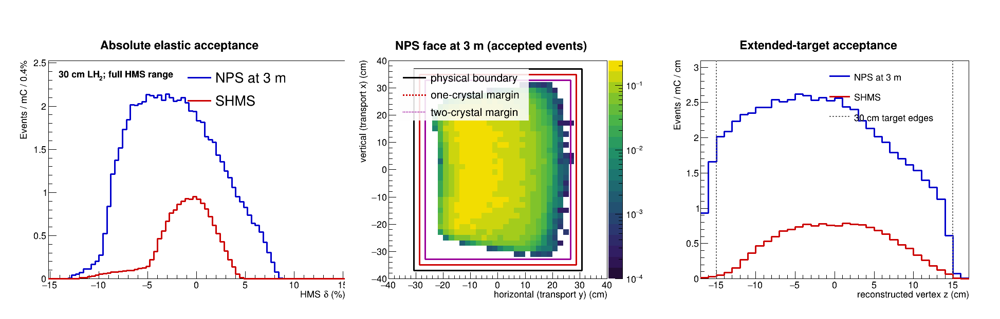
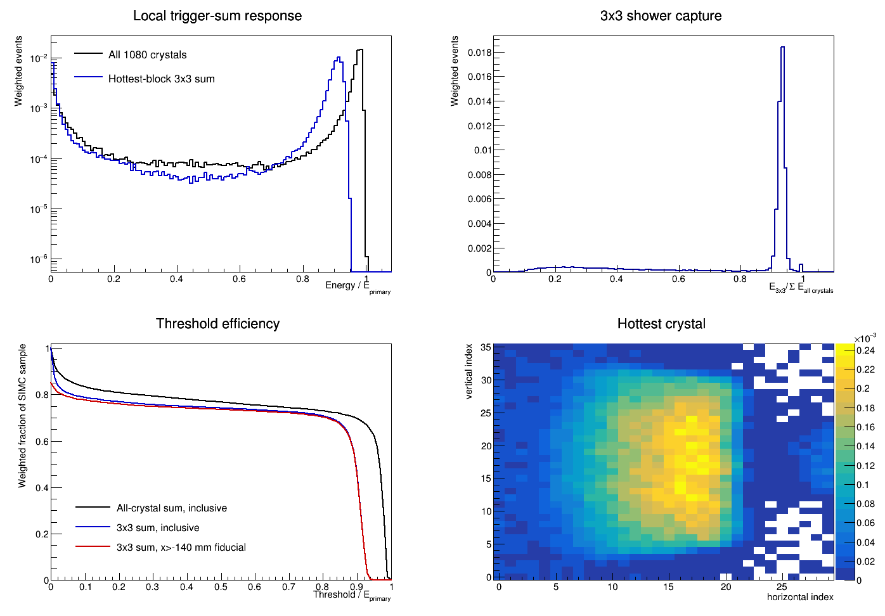
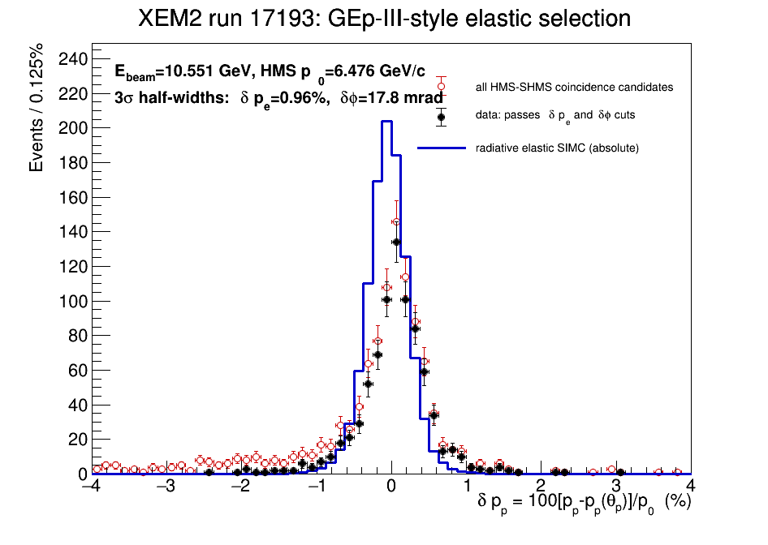

# GEp Hall C reboot: proposal-readiness summary

**Working point:** Q2 approximately 11 GeV2, 10.7 GeV beam, 75 uA, 30 cm LH2, positive-polarity HMS proton arm, NPS electron arm at 3 m

**Updated:** 25 October 2026

## Executive summary

The present evidence supports the physics reach of an HMS-plus-NPS GEp measurement, but the online trigger and DAQ design remains a critical proposal item.

- An XEM2 elastic-calibration benchmark closely matches the proposed HMS proton momentum and angle. Transferring its data normalization to Andrew's original Q2 = 11 kinematics gives approximately 10.68 million events before the NPS response requirement. The high-statistics GEANT4 calculation retains approximately 7.70 million at a 70% incident-energy threshold and 7.51 million at 80%.
- The same XEM2 runs show that the raw HMS S1X AND S1Y primitive scales to approximately 806 kHz at 75 uA and 30 cm LH2. A proposal baseline of roughly 0.8--1 MHz is therefore appropriate for an S1-only primitive.
- A direct electron-run NPS benchmark is now available from runs 6158, 6165, and 6168. Acceptance-weighting their unbiased EDTM measurements over the proposed 3 m face gives a first working bracket of 23--28 kHz at a 70% physical threshold, 16--20 kHz at 75%, and 7.6--9.4 kHz at 80%. This is substantially better grounded than the earlier run-1918 photon-arm scaling, but it still requires a generator-based transfer from the 6.37 GeV calibration beam to the proposal beam energy.
- Combining that NPS bracket with the 806 kHz HMS S1 primitive gives approximately 0.37--0.45 kHz of accidentals at 20 ns, or 0.74--0.91 kHz at 40 ns, at the 70% threshold. These are no longer the tens-of-kHz accidentals implied by the deliberately conservative 1 MHz-by-1 MHz sanity envelope, but they are still material for trigger and DAQ planning.
- The HMS 3-of-4 primitive scales to approximately 2.90 kHz. If it can be implemented with high elastic efficiency in the FPP configuration, the corresponding 70%-threshold accidental contribution falls to approximately 1.3--1.6 Hz at 20 ns, or 2.7--3.3 Hz at 40 ns.

Earlier DVCS-based studies remain useful for validating the analysis chain, calorimeter response, occupancy, and selected physics backgrounds. Their few-hertz accidental estimates described events surviving restrictive selections and must not be used as predictions of the raw online accidental rate. Those notes are preserved in the [DVCS benchmark archive](archive/dvcs_benchmark_exploration_2026-10-24/README.md).

## 1. Empirical HMS trigger benchmark

XEM2 runs 17193--17199 provide an unusually close positive-polarity HMS comparison:

- Beam energy: 10.544--10.551 GeV.
- Target: 10 cm LH2.
- HMS: +6.476 GeV/c at 19.52 degrees.
- SHMS electron arm: -4.935 GeV/c at 26.0 degrees.
- Proposed GEp HMS setting: near 6.7 GeV/c and 18.8 degrees.

The current-normalized rates agree to better than one percent across the seven runs:

| Trigger quantity | XEM2 current-normalized rate | Simple 75 uA, 30 cm projection |
|---|---:|---:|
| HMS S1X AND S1Y | 3.583 kHz/uA | 806 kHz |
| HMS S2X AND S2Y | 2.243 kHz/uA | 505 kHz |
| HMS 3-of-4 physics | 12.87 Hz/uA | 2.90 kHz |
| SHMS-HMS coincidence | 0.195 Hz/uA | 44 Hz |

The coincidence row is not a GEp trigger prediction: NPS has a different solid angle, threshold response, and background environment from SHMS. The target-length extrapolation is also intentionally simple and requires an extended-target acceptance correction. The raw HMS measurements nevertheless establish that S1-only operation is a hundreds-of-kHz to approximately 1 MHz problem.

## 2. Online accidental-coincidence budget

For independent trigger primitives:

R_accidental = R_NPS x R_HMS x coincidence_width.

With the 806 kHz projected HMS S1 primitive:

| Assumed NPS primitive | 20 ns | 40 ns |
|---:|---:|---:|
| 0.1 MHz | 1.61 kHz | 3.22 kHz |
| 0.3 MHz | 4.84 kHz | 9.67 kHz |
| 1.0 MHz | 16.1 kHz | 32.2 kHz |

The rounded 1 MHz by 1 MHz case gives 20 kHz at 20 ns and 40 kHz at 40 ns. This was a useful conservative sanity envelope before an electron-data NPS estimate existed; it is not the current working prediction. These values precede correlated physics triggers and trigger deadtime.

The electron-run angular benchmark substantially narrows this conditional range. Integrating exponential and power-law fits over the proposed 3 m face gives:

| Physical NPS threshold | Projected full-face NPS primitive | Projected HMS S1 primitive | Accidental rate, 20 ns | Accidental rate, 40 ns |
|---:|---:|---:|---:|---:|
| 70% | 23.0--28.2 kHz | 806 kHz | 0.37--0.45 kHz | 0.74--0.91 kHz |
| 75% | 16.2--20.0 kHz | 806 kHz | 0.26--0.32 kHz | 0.52--0.64 kHz |
| 80% | 7.6--9.4 kHz | 806 kHz | 0.12--0.15 kHz | 0.24--0.30 kHz |

These values use `R_accidental = R_NPS x R_HMS x coincidence_width`, assume independent primitive streams, and precede correlated physics triggers and trigger deadtime. The model spread is not a confidence interval. Only the lowest-angle edge of the proposed face overlaps the measured central-angle range, and the calibration beam energy is lower than the proposal energy. The result is a working bracket rather than a final trigger-budget number.

If the measured 2.90 kHz HMS 3-of-4 primitive can replace S1-only without sacrificing elastic efficiency, the same NPS brackets imply only approximately 1.3--1.6 Hz at 20 ns and 2.7--3.3 Hz at 40 ns at the 70% threshold. This large difference is why establishing FPP compatibility of the 3-of-4 logic remains a critical-path trigger-design question.

## NPS electron primitive rate versus threshold and angle

Runs 6158, 6165, and 6168 used NPS as an electron detector with the sweeper off. They share a 6.370 GeV beam, 10 cm LH2 target, approximately 25.6 microamp current, 4.598 GeV central electron energy, and 9.5 m NPS distance. Their central angles are 21.17, 19.87, and 18.56 degrees. Unbiased 1 microsecond EDTM windows, with run-specific VTP/offline calibrations, directly measure:

Before using those windows to scan threshold, the EDTM method was checked against the independent pTRIG1 hardware scaler at the actual 1.6 GeV VTP threshold. The same BCM4A current cut of at least 20 microamps was applied to both measurements:

| Run | NPS angle | EDTM occupancy rate | pTRIG1 scaler rate | EDTM/scaler |
|---:|---:|---:|---:|---:|
| 6158 | 21.17 degrees | 25.47 +/- 0.76 kHz | 25.69 kHz | 0.991 |
| 6165 | 19.87 degrees | 37.41 +/- 0.93 kHz | 36.99 kHz | 1.011 |
| 6168 | 18.56 degrees | 51.73 +/- 1.20 kHz | 52.60 kHz | 0.983 |

Thus the EDTM method reproduces the direct hardware primitive to within 1.7% in all three runs, with no systematic degradation as the rate doubles. This establishes the normalization method before it is applied at the higher thresholds where no separate scaler channel exists.

The 1.6 GeV VTP setting corresponds to an average offline-equivalent threshold of approximately 1.46 GeV, or 30.1% of the 4.838 GeV proposal electron energy. Applying the same acceptance-weighted extrapolation at that operating point gives:

| Angular model | Projected GEp NPS primitive | HMS-S1 accidental, 20 ns | HMS-S1 accidental, 40 ns |
|---|---:|---:|---:|
| Exponential | 652 +/- 40 kHz | 10.52 +/- 0.65 kHz | 21.04 +/- 1.30 kHz |
| Power law | 774 +/- 46 kHz | 12.48 +/- 0.73 kHz | 24.95 +/- 1.47 kHz |

The quoted uncertainties propagate the scaler snapshot RMS through each two-parameter angular fit. They are conservative point-variation uncertainties, not a complete uncertainty budget. In particular, the difference between angular models and the unquantified transfer from the 6.37 GeV calibration beam to the proposal beam energy remain separate. This low-threshold result also explains why a calorimeter primitive of order 1 MHz was a reasonable initial trigger-design expectation.

The resulting high-threshold measurements are:

| NPS angle | 70% = 3.387 GeV | 75% = 3.629 GeV | 80% = 3.870 GeV |
|---:|---:|---:|---:|
| 21.17 degrees | 1.26 +/- 0.17 kHz | 0.89 +/- 0.14 kHz | 0.55 +/- 0.11 kHz |
| 19.87 degrees | 2.44 +/- 0.24 kHz | 1.76 +/- 0.20 kHz | 1.08 +/- 0.16 kHz |
| 18.56 degrees | 3.76 +/- 0.32 kHz | 2.70 +/- 0.27 kHz | 2.01 +/- 0.23 kHz |

The rates increase monotonically as NPS moves to smaller electron angle, by approximately a factor of three across only 2.6 degrees. This is the central empirical result: the rate is controlled strongly by angular acceptance, so neither inverse-distance scaling nor luminosity scaling by itself can describe the 3 m proposal geometry.

The proposed 0.615 by 0.738 m active face at 3 m covers approximately 20.82--33.14 degrees in polar angle. The acceptance-weighted projection fits the three measured face integrals with two angular laws and integrates each over that proposed face before applying the current and target-length scaling.

*Points are the measured EDTM-window rates. Color denotes physical threshold; solid and dashed curves are exponential and power-law fits to the three face-integrated measurements. The shaded band is the polar-angle range sampled by the proposed 3 m face. The right panel shows the result after integrating each model over that face and applying the stated current and target-length scaling. The model spread is not a complete uncertainty estimate.*

Run 1918 remains useful as a method cross-check: its EDTM occupancy reproduces the NPS primitive scaler within 3.1%. However, run 1918 used NPS as a DVCS real-photon detector, so its earlier luminosity-scaled curve is not the primary electron-singles estimate.

The numerical inputs and reproducible projection are retained in [the scaler-closure table](nps_electron_edtm_scaler_closure.csv), [the hardware-threshold projection](nps_electron_gep_hardware_threshold_projection.csv), [the measured threshold key points](nps_electron_edtm_angle_key_points.csv), [the high-threshold GEp projection table](nps_electron_gep_acceptance_projection.csv), and [the acceptance-weighting script](model_nps_electron_gep_acceptance.py).

### Independent elastic-efficiency cross-check

Run 6151 addresses signal efficiency rather than the primitive-rate normalization. Its proton-tagged elastic core has a 4.598 GeV electron energy, close to the 4.838 GeV proposal value. After applying the separate run-6151 calibration, `E_VTP = 0.2230 + 0.9112 E_offline`, the measured elastic-core efficiencies are 99.3%, 98.8%, and 96.5% for 70%, 75%, and 80% physical threshold fractions, respectively.

*This conditional efficiency describes the selected, non-radiative elastic core. It does not include the full radiative SIMC distribution or the NPS geometric fiducial and therefore does not replace the GEANT4 retention used in the event-yield projection.*

Paddle masking outside the elastic envelope may help, but it should remain an optimization until paddle-by-paddle scaler rates demonstrate the available reduction.

## 3. Elastic-yield anchor and NPS acceptance gain

Run 17193 supplies the data normalization: 800 selected elastic events in 150.465 mC on 10 cm LH2. The matched SIMC studies give:

- Accepted-yield ratio for 30 cm versus 10 cm target: 1.8863.
- NPS versus SHMS yield ratio in a common comparison window: 4.1078.
- Full displayed NPS versus SHMS acceptance ratio: 4.3139.

At the run-17193 kinematics, using 45 PAC days as 45 x 24 hours at 75 uA, with no operational-efficiency discount:

| Electron-arm configuration | Projected selected elastic events | Mean selected-elastic rate |
|---|---:|---:|
| SHMS-like acceptance | 2.92 million | 0.75 Hz |
| NPS at 3 m, run-17193 kinematics | approximately 12.05 million | approximately 3.10 Hz |

These are selected elastic yields, not raw singles, coincidence-trigger, or DAQ rates.

The data/SIMC closure is encouraging but imperfect:

- Broad HMS delta comparison: 1124 / 1200.95 = 0.936.
- Tighter elastic selection: 800 / 1034.34 = 0.773.

*Run 17193 HMS momentum acceptance. The broad data/SIMC normalization is 0.936, while the tighter elastic selection gives the 0.773 factor used in the yield anchor.*

The normalization must be read in the following order:

1. At the run-17193 kinematics, scaling the absolute SIMC yield to 45 PAC days, the 30 cm target, and the NPS acceptance gives approximately 15.5 million selected elastic events.
2. Run 17193 recorded 800 events where the matched SIMC calculation predicts 1034.34, so the measured data/SIMC factor is `800 / 1034.34 = 0.7734`.
3. Applying that factor once gives `15.5 million x 0.7734`, or approximately 12.05 million events at the run-17193 kinematics.

**The 0.773 run-17193 data/SIMC reduction is already included in the quoted 12.05-million-event projection. It must not be applied a second time.** Equivalently, the same result is obtained by starting directly from the 800 recorded run-17193 events and using SIMC only for the target-length and NPS/SHMS acceptance ratios.

The 45-PAC-day convention applies no separate reduction for accelerator or scheduled operational availability. Additional GEp-specific losses—for example, FPP tracking loss or higher-rate deadtime—must be identified separately.

*SIMC comparison of the measured SHMS configuration with NPS at 3 m, including the HMS momentum distribution, NPS face coverage, and extended-target acceptance.*

### Transfer to the original Q2 = 11 kinematics

A new 10-million-trial SIMC calculation uses 10.700 GeV beam energy, a 4.838 GeV electron at 26.651 degrees, and a 6.735 GeV/c proton at 18.797 degrees, giving Q2 = 10.9947 GeV2. The 30 cm target, NPS distance, acceptance limits, radiation convention, and event-level HMS selection are matched to the run-17193 NPS calculation.

The selected SIMC yields are 54.2538 events/mC at Q2 = 11 and 61.2019 events/mC at the run-17193 setting. Their ratio is 0.88647. Applying that kinematic ratio to the already data-anchored 12.053-million run-17193 projection gives 10.685 million events before an NPS response threshold, or 2.75 Hz averaged over 45 PAC days. The run-17193 factor of 0.7734 remains included exactly once.

The corresponding 110,774-event GEANT4 sample gives:

| NPS requirement | Weighted retention | Projected 45-day events |
|---|---:|---:|
| Inclusive 3x3 sum, 70% of incident electron energy | 72.579% | 7.76 million |
| 3x3 plus working fiducial, 70% | 72.048% | 7.70 million |
| Inclusive 3x3 sum, 80% | 70.753% | 7.56 million |
| 3x3 plus working fiducial, 80% | 70.250% | 7.51 million |

These response-reduced numbers are provisional rather than final efficiency claims. The threshold is expressed as a fraction of the incident electron energy, not a renormalized 3x3 elastic peak. The simulation transports the post-radiation electron but not a collinear final-state bremsstrahlung photon that could add energy to the same cluster, and it retains the inherited run-6151 passive/sweeper geometry. Each effect can make the apparent threshold loss too large or otherwise distort the edge response.

*GEANT4 response for 110,774 weighted Q2 = 11 events. The lower-left panel supplies the selected-elastic 3x3 threshold efficiencies quoted above; the red curve includes the working `x > -140 mm` fiducial. This fiducial is not included in the full-face NPS primitive and accidental-rate projections.*

The proton-arm elastic consistency is shown independently in the GEp-III-style variable:

*Run 17193 data and SIMC in the proton momentum-consistency variable used in the GEp-III analysis.*

## 4. What the DVCS/NPS studies established

NPS E12-13-010 runs 6151 and 2875 were valuable development samples. They established that real hcana data can be compared with SIMC events transported through the NPS GEANT4 model; that run 6151 is dominantly elastic; that the elastic peak is much less dominant at the higher-Q2 run 2875 setting; and that NPS response, occupancy, pileup, and correlated pi0 backgrounds can be studied with the existing pipeline.

They did not directly determine the raw GEp online-trigger rate. Accidental samples made after reconstruction or physics selections answer an offline-background question, not the hardware-primitive question. This distinction is now explicit in the current proposal narrative.

## 5. NPS geometry and reconstruction assumptions

The current design standard is NPS at 3 m, with a nominal active face of approximately 61.5 cm by 73.8 cm. This distance was an educated acceptance-matching choice, not a completed optimization. The calorimeter should be placed as far from the target as possible while preserving the electron solid-angle coverage needed to match the accepted HMS elastic envelope. A larger distance would improve angular resolution and could reduce background occupancy and rates, but would eventually reduce elastic acceptance. A representative 5 mm position resolution corresponds to about 1.67 mrad at 3 m; this remains an assumption to validate for the chosen cluster algorithm and energy range.

The HMS proton track and calibrated optics reconstruct the reaction vertex along the target. Combining that vertex with the NPS cluster position defines the electron direction and permits elastic kinematic consistency variables without an NPS tracking detector.

Two modeling cautions remain relevant:

- A 3x3 sum loses shower energy relative to a larger cluster, so a threshold stated as a fraction of elastic-electron energy must use the actual trigger-sum response.
- Final-state bremsstrahlung photons can remain close to the electron and contribute to the cluster; transporting only the post-radiation electron can overstate threshold losses.

## 6. Proposal-readiness matrix

| Question | Current status | Significance |
|---|---|---|
| Enough elastic yield? | 10.68 million before NPS response; approximately 7.5--7.7 million with the provisional 70--80% 3x3 threshold and fiducial | Encouraging, with response caveats |
| HMS raw S1 rate? | XEM2 establishes approximately 0.8--1 MHz after simple scaling | Strong empirical baseline |
| NPS raw rate versus threshold? | Three electron runs anchor the angular dependence; the first 3 m acceptance-weighted bracket is 23--28 kHz at 70% and 7.6--9.4 kHz at 80% | Critical path, substantially constrained; beam-energy transfer remains |
| Raw accidentals? | With 806 kHz HMS S1, approximately 0.37--0.45/0.74--0.91 kHz at 70% and 0.12--0.15/0.24--0.30 kHz at 80% for 20/40 ns, before correlated triggers | Critical path |
| HMS 3-of-4 with FPP? | Attractive measured rate; implementation and efficiency need study | Major mitigation |
| Hall C DAQ capacity? | Relevant event-size limit and deadtime need confirmation | Critical path |
| Optimal NPS distance? | 3 m is a reasonable design standard but has not been optimized | Important design study |
| Selected NPS backgrounds and response? | Substantial data-plus-GEANT4 groundwork exists | Supporting evidence |
| FPP precision projection? | Not yet consolidated here | Critical physics item |

## 7. Immediate next steps

1. Validate an inclusive electron generator against the three measured electron-run angular curves, then transfer the spectrum to the proposal beam energy and integrate the proposed 3 m face.
2. Verify the narrowest realistic online coincidence width using the actual NPS and HMS timing chain.
3. Test S1/S2 3-of-4 logic, including FPP compatibility and elastic efficiency across the extended target.
4. Obtain the Hall C DAQ sustainable-rate and deadtime specification for the expected event size.
5. Optimize the NPS distance by finding the largest target-to-calorimeter distance that still provides the required solid-angle matching to the HMS elastic acceptance; quantify elastic yield, edge losses, angular resolution, occupancy, and trigger-rate consequences versus distance.
6. Complete the FPP analyzing-power, efficiency, figure-of-merit, and statistical-precision projection.
7. Retain XEM2 as the principal HMS and elastic-yield benchmark; use the DVCS studies as supporting NPS-response validation.

## Current supporting documentation

- [XEM2 HMS benchmark and NPS projection](xem2_hms_nps_benchmark.md)
- [Current NPS validation status](nps_validation_status.md)
- [Archived NPS and SIMC-GEANT4 development record](archive/nps_simulation_development_2026-10-25/README.md)
- [Archived DVCS benchmark exploration](archive/dvcs_benchmark_exploration_2026-10-24/README.md)
