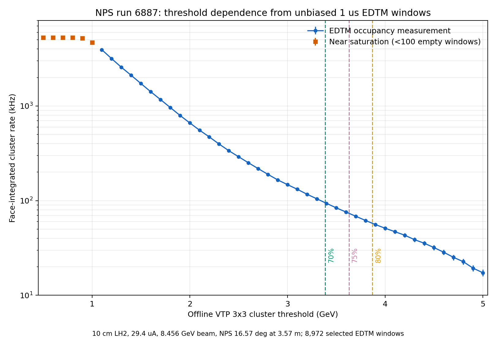
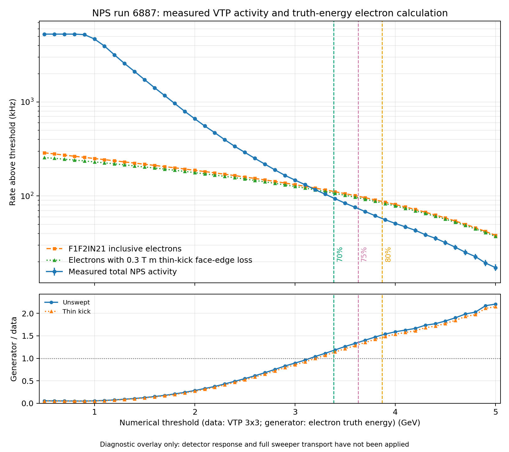
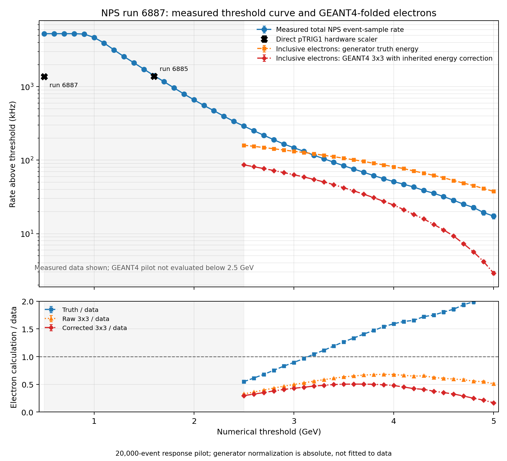
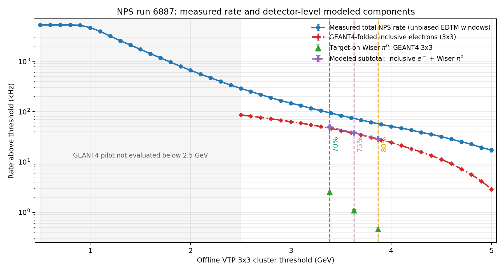
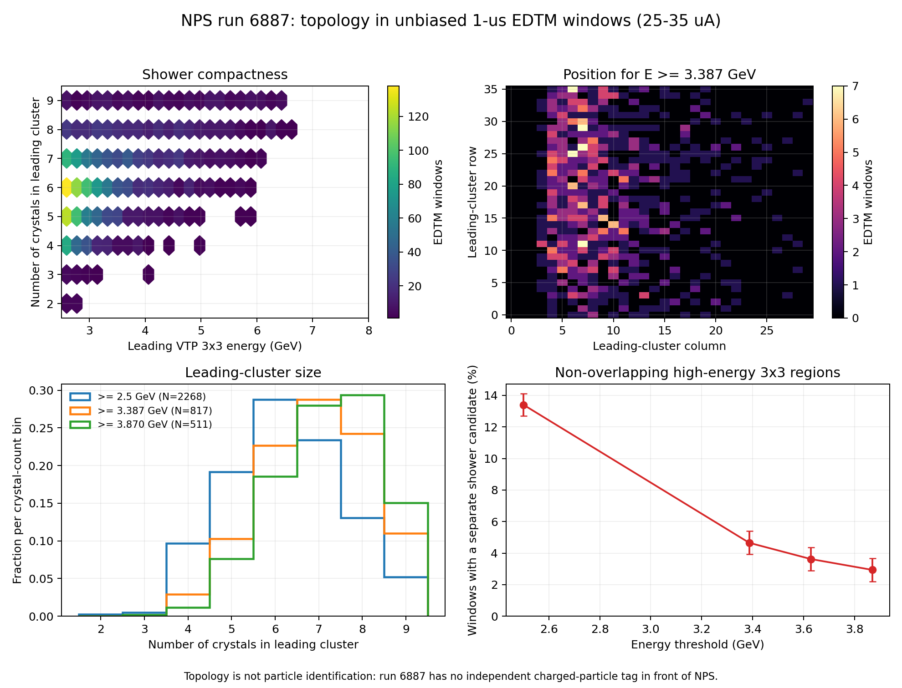
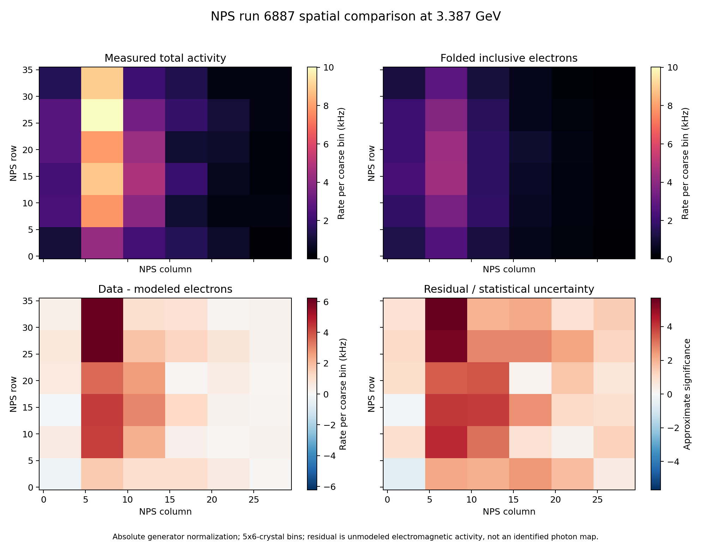

# NPS trigger particle composition: interpretation and investigation plan

**Status:** active investigation, 29 October 2026

The additive background-generator contract and the first inclusive
real-photon neutral-pion calculation are documented in
[`background_generator/`](background_generator/README.md). That first
exclusive channel contributes only about 0.18--0.41 kHz above the run-6887
high thresholds, depending on the documented cross-section variation, and
therefore cannot explain the 29--48 kHz excess over the inclusive-electron
calculation. This narrows the next work to more inclusive neutral production,
direct material-related photons, and charged-hadron channels; it does not
establish that the observed excess is non-photonic.

A first SIMC SIDIS `pi0 -> gamma gamma` pilot has also been completed. In its
explicit validity region (`Q2 > 1 GeV2`, `W > 2 GeV`) it gives generator-level
run-6887 rates of 1.214, 0.788, and 0.519 kHz above 3.387, 3.629, and
3.870 GeV. This is only a few percent of the corresponding unexplained rate.
The broad integration simultaneously showed that SIMC's fragmentation fit
cannot be extrapolated into the low-Q2 region. Inclusive quasi-real/real
photoproduction is therefore the next generator priority.

## Central question

The measured NPS VTP event sample contains any electromagnetic shower that satisfies the firmware cluster conditions. The present `F1F2IN21` generator, by contrast, calculates only the scattered-electron contribution from inclusive electron scattering,

`e + p -> e' + X`.

Here “inclusive” refers to the unspecified hadronic final state `X`; it does not mean that every particle capable of triggering NPS is generated. In particular, the calculation does not include the general population of photon-induced triggers, charged-pion triggers, secondary particles, or beamline and material backgrounds.

The observed agreement between an electron-only calculation and the measured NPS cluster-trigger rate therefore cannot yet be described as closure of the total calorimeter trigger rate. The immediate question is whether the comparison is nevertheless reasonable because the selected DVCS runs were elastic electron-calibration settings, or whether an analysis, normalization, or trigger-definition issue is hiding the expected photon contribution.

## What the existing calculations contain

### Born inclusive-electron generator

The `F1F2IN21` generator samples a scattered electron over the NPS face and weights it with the Born inclusive electron cross section. It contains no generated real photon and no charged pion. Its output is therefore an estimate of one component of the NPS rate, not a complete trigger-rate calculation.

### Radiated-elastic addition

The matched SIMC elastic-singles calculation adds the scattered elastic electron and, in the generator-level energy proxy, an idealized collinear final-state-radiation photon. This addresses part of the elastic radiative-tail convention. It is not a model of the general neutral-photon background reaching NPS.

The radiated-elastic contribution was only approximately 0.1--0.5 kHz in the six-run high-threshold comparisons. Because these were nominal elastic-calibration settings with NPS centered on the electron locus, that small contribution is itself a point requiring verification. It may reflect the SIMC radiative normalization or selection, the use of generator-level threshold energy, or a misunderstanding of which electron population dominates the measured event sample.

### Existing pi0 calculation

The existing hard-bremsstrahlung `gamma p -> pi0 p`, `pi0 -> gamma gamma` study was designed for correlated events with a proton accepted by HMS. It does not describe the untagged photon singles flux over the full NPS face and cannot be used as the missing neutral component of the NPS trigger rate.

## What the measured NPS event sample contains

The six electron-run threshold curves were obtained from unbiased 1 microsecond EDTM windows. For each window, the analysis selected the largest decoded `NPS.cal.vtpClusE` object and tested it against a run-specific VTP threshold. It imposed:

- no charged-particle tracking requirement;
- no HMS coincidence;
- no elastic kinematic cut;
- no electron-identification cut;
- no explicit particle-species requirement.

The EDTM-derived rate reproduces the direct `pTRIG1` hardware scaler to within 4% at the actual hardware threshold in all six runs. This validates the occupancy normalization and establishes that the analysis measures the hardware trigger represented by `pTRIG1`. It does not determine whether an individual cluster was produced by an electron, photon, or pion.

The present comparison must therefore be described as:

> total measured NPS cluster-trigger rate versus modeled inclusive-electron contribution.

It is not yet a particle-by-particle decomposition of the trigger sample.

## Why the elastic-calibration setting matters

Runs 6158, 6165, and 6168 were three-pass elastic electron-calibration settings with NPS used as the electron detector, the sweeper off, and NPS centered near the elastic-electron direction. Runs 2855, 5183, and 3888 were corresponding five-pass electron settings. This makes electron dominance at a sufficiently high threshold plausible:

- the detector was deliberately aimed at the elastic-electron locus;
- the elastic electron supplies a narrow high-energy endpoint;
- a threshold at 70--80% of that endpoint can strongly suppress a softer continuum;
- the large-angle high-energy photon spectrum may be smaller than a generic direct-line-of-sight calorimeter expectation.

However, “elastic calibration run” describes the spectrometer and detector configuration, not the contents of an EDTM window. An EDTM window is an unbiased snapshot of all detector activity. Photons and pions remain present unless the geometry, field, threshold, or firmware suppresses them. The run classification therefore makes low photon content possible, but does not demonstrate it.

There is also an apparent tension: if elastic electrons dominate the measured high-threshold event sample, the current radiated-elastic SIMC addition appears too small. That tension provides a useful internal diagnostic.

## Current interpretations that remain possible

1. **High-threshold electron dominance is real.** The elastic-calibration geometry and threshold preferentially select electrons, and the photon contribution is modest in these particular settings.

2. **The electron calculation is too large.** Acceptance, cross-section normalization, target treatment, or threshold mapping may overpredict electrons and accidentally compensate for an omitted photon component.

3. **The elastic electron component is mis-normalized.** The surprisingly small SIMC elastic addition may arise from the radiative convention, normalization ledger, event selection, or the definition of the energy used at threshold.

4. **The VTP objects are not a fully inclusive cluster sample.** A timing, seed, trigger-type, or readout condition may suppress part of the activity in EDTM events even though the retained objects reproduce the `pTRIG1` scaler.

5. **Generator-level and VTP thresholds are not equivalent.** Comparing incident electron energy with a measured 3x3 trigger sum can move the effective threshold substantially, particularly near an endpoint.

6. **Multiple effects compensate.** Apparent agreement of total data with an electron-only calculation may be accidental rather than evidence that every individual component is understood.

## Phase 1: data-analysis sanity checks

These checks should be completed before developing a new photon generator.

### 1. Reconfirm the six run configurations

The active audit and machine-readable working table are maintained in
[`six_run_configuration_audit.md`](six_run_configuration_audit.md) and
[`six_run_configuration_audit.csv`](six_run_configuration_audit.csv).

For each run, record from the run database and logbook:

- stated run purpose and elastic-calibration status;
- beam energy and current;
- target and target length;
- NPS angle and distance;
- elastic electron energy at the central angle;
- HMS setting and polarity;
- sweeper magnet state, field, and polarity;
- VTP cluster, seed, timing, and trigger thresholds;
- trigger routing and prescales;
- sparsification and waveform-readout configuration.

The current working assumption is that all six are electron-calibration settings, but this must be demonstrated run by run rather than inherited from grouping or nearby runs.

### 2. Audit the precise VTP and `pTRIG1` definitions

The existing scaler closure shows that the EDTM analysis reproduces `pTRIG1`. The next check is semantic rather than numerical:

- determine whether every qualifying VTP cluster is written in an EDTM event;
- identify the cluster seed and local-maximum requirements;
- identify the full cluster timing window;
- determine whether `vtpClusE` is stored before or after the trigger decision threshold;
- verify whether trigger type, sparsification, or readout masks restrict the stored objects;
- confirm that the maximum-cluster selection corresponds to the quantity presented to the online singles logic.

This will establish whether “complete trigger sample” truly means every neutral and charged shower satisfying the same online conditions.

### 3. Plot the complete EDTM cluster-energy spectra

For every run, produce the maximum-VTP-cluster spectrum in physical and native VTP-energy conventions, showing:

- the actual hardware threshold;
- 70%, 75%, and 80% of the elastic endpoint;
- the expected elastic peak location in the VTP convention;
- the region above the elastic endpoint;
- statistical uncertainties and the number of selected EDTM windows.

Questions to answer:

- Is there a visible elastic peak in the unbiased spectrum?
- Does the high-threshold rate come from a narrow endpoint population or a broad continuum?
- Does the spectrum extend materially above the elastic endpoint, suggesting pileup, calibration error, or non-elastic sources?
- Do the three-pass and five-pass spectra have qualitatively different shapes?

### 4. Make threshold-dependent NPS face maps

Plot the highest-energy VTP cluster position for progressively tighter thresholds. Compare the measured maps with the predicted elastic-electron illumination.

Electron dominance would be supported if the high-threshold clusters collapse onto the expected elastic footprint. A broad, edge-enhanced, or differently centered distribution would indicate a substantial non-elastic component or a geometry/calibration problem.

The maps should be made separately for:

- all EDTM clusters above threshold;
- ordinary NPS-triggered events;
- HMS-coincident events where available;
- an elastic-selected HMS coincidence sample.

### 5. Use HMS-tagged events to construct an elastic-electron template

The ordinary calibration data can provide the energy and position shape of proton-tagged elastic electrons. Apply HMS tracking and elastic-consistency selections to obtain a clean template, then compare that template with the high-threshold EDTM population.

The triggered and EDTM samples have different sampling biases, so the tagged template cannot directly determine the absolute electron singles rate. It can nevertheless test whether the high-threshold EDTM clusters have the same energy, position, and shower-shape distributions as known elastic electrons.

Useful comparisons include:

- VTP energy and calibrated offline energy;
- cluster row and column;
- hottest-block fraction and 3x3 sharing;
- cluster multiplicity;
- distance from the predicted elastic locus;
- threshold dependence of each distribution.

### 6. Reconstruct the elastic singles normalization independently

The SIMC elastic contribution should be audited independently of the inclusive calculation:

- verify the generated phase space covers the full NPS face;
- verify the luminosity and target-length normalization;
- separate Born-peak and radiative-tail weights;
- determine how the un-radiated elastic peak is represented;
- verify the treatment of initial- and final-state radiation;
- compare generator-level electron energy, electron-plus-FSR energy, and VTP-equivalent 3x3 energy;
- compare the predicted elastic singles rate with the HMS-tagged elastic yield using a common acceptance.

If the calibration data are electron dominated, this audit should explain why the present elastic addition is small.

### 7. Check whether the measured rate factorizes with current and target

For each run or suitable sub-run interval, measure the threshold-dependent trigger rate versus beam current. A target-produced single-particle component should be approximately linear at low occupancy. Deviations can reveal:

- pileup and accidental cluster merging;
- rate-dependent VTP behavior;
- beamline backgrounds with a different current dependence;
- pedestal or calibration shifts;
- deadtime or readout losses.

Where dummy, empty-target, carbon, or alternate-target data exist at the same setting, compare them before attempting a physics-model decomposition.

### 8. Compare the six runs in dimensionless variables

Repeat the data comparison using:

- VTP energy divided by the measured elastic-peak position;
- cluster position relative to the predicted elastic locus;
- rate per microampere;
- rate per unit target thickness where justified;
- common fractional thresholds and common absolute thresholds.

This will test whether the apparent three-pass/five-pass behavior is driven by physics, calibration conventions, or detector response.

## Phase 2: data-driven charged/neutral controls

Proceed to these checks after the Phase 1 definitions and spectra are secure.

### Sweeper-on versus sweeper-off comparison

Search for runs at otherwise similar beam energy, target, NPS geometry, and current with different sweeper settings. With the sweeper on, charged electrons should be displaced while photons remain on the undeflected line of sight. A well-matched pair would provide the cleanest empirical estimate of the neutral component.

The comparison must account for field-dependent material paths, changes in detector position, trigger thresholds, current, and run configuration. An unmatched pair should be treated as qualitative rather than converted directly into a photon fraction.

### Target and beam controls

Look for:

- empty-target or dummy-target data;
- alternate target lengths;
- low-current runs;
- beam-off or pedestal periods;
- radiator or magnet-configuration changes.

These can separate target-produced photons from beamline, cell-wall, and pileup contributions.

### Trigger and coincidence controls

Compare NPS singles, HMS-tagged coincidences, and prescaled monitoring triggers. Where possible, measure the fraction of high-threshold NPS triggers associated with a reconstructed HMS proton, while recognizing that the complement contains both neutral events and untagged charged events.

## Phase 3: simulation only after the data decomposition

If the data show a material neutral component, the simulation program should expand beyond electron scattering.

Required components may include:

1. untagged bremsstrahlung and photoproduction photons over the full NPS face;
2. inclusive pi0 production and both decay photons without requiring an HMS proton;
3. secondary photons from target windows, beamline material, and the sweeper region;
4. charged-pion showers at lower thresholds;
5. pileup and cluster merging in the actual VTP time and spatial logic;
6. transport of final-state radiative photons with their associated electrons.

Each simulated component should be validated against a data control before being used in the GEp trigger budget.

## Decision points

The investigation should answer the following in order:

1. Are the six runs and VTP objects correctly classified and calibrated?
2. Do high-threshold EDTM clusters look like the proton-tagged elastic-electron template?
3. Can the elastic singles normalization reproduce the electron-like component?
4. Is a residual neutral component required by the data?
5. Can a sweeper or target control measure that component directly?
6. Only then: what neutral-particle simulation is needed to transfer the result to GEp?

## Direct threshold scan from run 6887

Run 6887 provides a particularly useful total-rate measurement because it was
taken with a 500 MeV single-cluster trigger setting and a 250 MeV cluster
readout threshold.  Its conditions were a 10 cm LH2 target, 8.456 GeV beam,
approximately 29.4 microampere selected current, and NPS at 16.57 degrees and
3.57 m.  A pass-2 replay segment contains 8,972 unbiased 1 microsecond EDTM
windows after the 25--35 microampere current selection.

For each EDTM window, the largest decoded VTP 3x3 cluster energy was retained.
The fraction of windows above each trial threshold was converted to an
underlying cluster rate using the Poisson empty-window relation.  The lowest
points are near occupancy saturation: only 46 of 8,972 selected windows are
empty at 0.5--0.8 GeV.  Above approximately 1 GeV the curve is well resolved.

| Offline VTP threshold | Measured run-6887 rate |
|---:|---:|
| 0.5 GeV | 5.27 +/- 0.15 MHz |
| 1.0 GeV | 4.68 +/- 0.11 MHz |
| 1.6 GeV | 1.418 +/- 0.019 MHz |
| 2.0 GeV | 663.7 +/- 10.2 kHz |
| 3.0 GeV | 147.7 +/- 4.2 kHz |
| 3.387 GeV (70% GEp reference) | approximately 95.1 +/- 3.3 kHz |
| 3.629 GeV (75% GEp reference) | approximately 73.7 +/- 2.9 kHz |
| 3.870 GeV (80% GEp reference) | approximately 57.7 +/- 2.6 kHz |
| 5.0 GeV | 17.3 +/- 1.4 kHz |

The independent hardware-scaler anchors make the transition particularly
clear.  In adjacent run 6885, whose actual hardware threshold was 1.6 GeV,
the direct `pTRIG1` scaler gives 1.393 MHz at 29.53 microamperes.  This is only
1.7% below the 1.418 MHz rate inferred by applying the same threshold to the
run-6887 EDTM windows.  At the actual 0.5 GeV setting of run 6887, however,
the direct scaler gives only 1.371 MHz while the underlying EDTM cluster rate
is 5.27 MHz.  The scaler records only about 26% of the inferred incoming rate
there.  The scaler output therefore saturates or incurs substantial
pulse-width/deadtime loss at very high input rates and cannot be used by
itself to infer the low-threshold cluster rate.  Both hardware-scaler anchors
are shown explicitly on the response-comparison plot below.

This result is direct evidence that the total calorimeter rate can be much
larger than the inclusive-electron component.  It is not yet a GEp rate
prediction: run 6887 has a different beam energy and NPS angle, a 10 cm target,
and a 3.57 m distance.  A transfer must account for the angular distribution,
target-length geometry, current, detector distance, and sweeper configuration.

## How the electron-generator and run-6887 results fit together

The apparently disparate results become coherent once the electron component
is separated explicitly from the total calorimeter activity.

### The inclusive generator predicts real scattered electrons

The inclusive generator has been validated against NPS electron-calibration
runs, five-pass NPS electron runs, and XEM2 SHMS electron singles.  Its GEp
prediction of approximately 7--14 kHz at the 70--80% reference thresholds is
therefore a credible estimate of the genuine inclusive-electron scattering
contribution.  It is not, and has not been validated as, a prediction of the
complete NPS hardware-trigger rate.

### Run 6887 measures a different and much broader event population

Run 6887 was a DVCS production configuration in which NPS looked along the
photon direction.  It was not one of the special configurations in which NPS
served as the electron detector.  Its threshold curve can consequently
contain real photons from the target, photons from pi0 decays and other
reactions, secondary electromagnetic backgrounds, charged particles reaching
NPS, genuine electrons where geometrically possible, and pileup or overlapping
activity.

The much larger run-6887 rates are therefore understandable.  This is the type
of total electromagnetic-calorimeter activity that is absent from an
inclusive-electron generator and that must be considered for trigger and DAQ
planning.

### The results are complementary rather than contradictory

At comparable high thresholds, the electron-only GEp calculation gives
approximately 7--14 kHz, while the total run-6887 NPS activity is approximately
58--95 kHz under that run's conditions.  The difference does not prove that
every residual event is photon-induced, but photons are the leading candidate.
This comparison is consistent with the expectation that an electromagnetic
calorimeter with direct line of sight to the target can have a large photon
contribution that is invisible to an inclusive-electron generator.

### The low-threshold scaler is rate-limited

At the 500 MeV setting, the unbiased EDTM windows imply approximately 5.3 MHz
of qualifying calorimeter activity, whereas the `pTRIG1` scaler records only
approximately 1.37 MHz.  The trigger-output path evidently saturates, merges
pulses, or incurs substantial deadtime.  At 1.6 GeV, where the rate is lower,
the EDTM method and `pTRIG1` agree near 1.4 MHz.  The scaler can therefore be
used directly around 1.6 GeV and above in this setting, but it cannot count
every qualifying occurrence at 500 MeV.  The EDTM empty-window method recovers
the incoming activity, subject to increasing statistical sensitivity as the
occupancy approaches unity.

### Run 6887 cannot be scaled naively into a GEp prediction

Run 6887 used an 8.456 GeV beam, NPS at 16.57 degrees and 3.57 m, a 10 cm LH2
target, approximately 29.4 microampere beam current, and a DVCS photon-arm
configuration.  GEp instead places NPS near 26.65 degrees and 3.0 m at much
higher luminosity, with potentially different sweeper conditions.  The larger
GEp angle should reduce strongly forward photon backgrounds, while the larger
current-times-target-length luminosity and closer calorimeter tend to increase
the rate.  The net result cannot be obtained from a single multiplicative
scale factor.

The present conclusion is therefore:

> The inclusive generator plausibly predicts the electron component, but run
> 6887 demonstrates that the total NPS rate can be dominated by additional
> electromagnetic activity.  The remaining critical task is to transfer or
> model that neutral-background component at the actual GEp geometry.

The next useful calculation was to run the inclusive-electron generator at the
actual run-6887 conditions and compare it directly with the measured threshold
curve.  That comparison has now been completed, but it shows that a residual
cannot yet be interpreted as a particle-by-particle decomposition.

### Run-6887 inclusive-electron comparison

A five-million-trial `F1F2IN21` calculation used the actual run-6887 beam
energy, selected current, 10 cm LH2 target, NPS angle, 3.57 m distance, and full
active face.  The calculation contains Born inclusive-inelastic electrons but
no photons, pions, secondary interactions, detector response, pileup, or full
sweeper transport.

At low numerical thresholds the measured NPS activity is much larger than the
electron calculation.  At 0.5 GeV the data give approximately 5.27 MHz while
the unswept electron calculation gives 0.288 MHz; at 1.6 GeV the corresponding
values are 1.418 and 0.212 MHz.  This is strong evidence for substantial
additional low-energy calorimeter activity.

The curves cross near 3.1--3.2 GeV.  Above that point the truth-energy electron
calculation exceeds the measured VTP 3x3 rate.  At the 70%, 75%, and 80% GEp
reference thresholds the numerical comparisons are:

| Numerical threshold | Measured VTP rate | Unswept electron truth rate | Thin-kick electron rate |
|---:|---:|---:|---:|
| 3.387 GeV | 95.1 kHz | 111.8 kHz | 107.4 kHz |
| 3.629 GeV | 73.7 kHz | 99.5 kHz | 95.8 kHz |
| 3.870 GeV | 57.7 kHz | 87.5 kHz | 84.5 kHz |

The run start EPICS record confirms that the NPS sweeper was at +468 A, with
both upstream and downstream correctors at zero.  Applying the documented
approximately 0.3 T m field integral as a thin vertical kick reduces the
high-threshold face acceptance by only about 4--5%; this simple face-edge loss
does not resolve the overprediction.  It is not a substitute for the sweeper
field map, magnet aperture, or intervening material.

Most importantly, the overlay compares generated incident-electron energy with
measured VTP 3x3 cluster energy.  Shower leakage, calibration, clustering, and
material losses move events between numerical thresholds.  Consequently, a
negative high-threshold residual is not physical evidence that the data lack
photons; it shows that generator truth energy cannot be subtracted directly
from the VTP threshold curve.

### Run-6887 GEANT4 response pilot

The next step transported 20,000 weighted inclusive-electron events through
the current NPS GEANT4 model at the run-6887 angle and distance.  The
normalization is absolute: the pilot weights were rescaled to the full
five-million-trial inclusive-generator rate above the 2.3 GeV transport cut,
not fitted to the measured threshold curve.  The plot shows the full measured
curve down to 0.5 GeV, while the simulated comparison curves begin at 2.5 GeV
so that omitted lower-energy generator events cannot contribute.

The detector response changes the high-threshold interpretation materially:

| Numerical threshold | Measured total rate | Electron truth rate | GEANT4 raw 3x3 rate | GEANT4 corrected 3x3 rate |
|---:|---:|---:|---:|---:|
| 3.387 GeV | 95.1 kHz | 112.2 kHz | 57.7 kHz | 47.0 kHz |
| 3.629 GeV | 73.7 kHz | 99.7 kHz | 48.2 kHz | 37.1 kHz |
| 3.870 GeV | 57.7 kHz | 87.5 kHz | 39.1 kHz | 28.5 kHz |

The raw 3x3 calculation accounts for approximately 61%, 66%, and 68% of the
measured total rate at the three reference thresholds.  With the inherited
`1.04^2` GEANT4-to-data energy correction, the corresponding fraction is
approximately 49%, 50%, and 49%.  Thus detector response does not merely make
a small numerical adjustment: it changes the electron calculation from an
unphysical overprediction of the total high-threshold rate into a substantial
but subdominant-to-comparable contribution.  The remaining measured rate is
then qualitatively consistent with the expected photon-induced and other
non-generator contributions.

This is an encouraging closure of the specific concern raised by the
truth-energy overlay, but it is still a pilot rather than a final particle
decomposition.  The `1.04^2` energy correction is inherited and must be
validated for this run; the current GEANT4 executable uses the existing
run-6151 geometry selection with explicit run-6887 event kinematics, angle,
and distance; and the passive material and full run-6887 sweeper configuration
have not yet been independently certified.  Consequently, the difference
between the measured curve and the folded electron curve should be described
as room for non-electron activity, not yet as a measured photon rate.

### Detector-level Wiser-pi0 contribution

The baseline low-Q2 Wiser-pi0 channel has now been carried through a separated
two-phase calculation.  Weighted Wiser events are transported through the
physical target, written as correlated target-exit phase space, projected onto
the NPS face, and then transported through the NPS GEANT4 model.  This removes
the earlier vacuum-target ambiguity and provides a reusable interface for
additional background sources.

The distinction between a face-integrated incident-energy rate and a local
trigger rate is essential:

| Threshold | Full-face incident-energy rate | Raw GEANT4 3x3 | Corrected GEANT4 3x3 |
|---:|---:|---:|---:|
| 3.387 GeV | 75.794 kHz | 6.046 +/- 0.266 kHz | 2.546 +/- 0.122 kHz |
| 3.629 GeV | 43.408 kHz | 2.893 +/- 0.137 kHz | 1.091 +/- 0.057 kHz |
| 3.870 GeV | 25.197 kHz | 1.288 +/- 0.067 kHz | 0.461 +/- 0.030 kHz |

The full-face quantity sums the energies of particles anywhere on the NPS
face and therefore cannot be compared directly with the local VTP 3x3
threshold.  The raw and corrected detector-level columns bracket the
unresolved inherited `1.04^2` convention.  Even the larger raw values account
for only 12.6%, 7.9%, and 4.4% of the measured residual; the corrected values
account for 5.3%, 3.0%, and 1.6%.  Transported pi-minus is below 0.04 kHz.

The present calculation therefore establishes that baseline Wiser-pi0 is a
real but subdominant detector-level contribution.  It does not yet model all
photons produced when beam electrons strike the target.  Completing that
fully inclusive calculation remains the next simulation task.

### First data-driven EDTM topology diagnostic

The first composition-oriented study uses the same 8,972 unbiased 1-microsecond
EDTM windows from run 6887 in the 25--35 microampere current band.  For each
window it records the leading VTP 3x3 candidate's energy, crystal multiplicity,
time, and position.  It also searches for a second high-energy 3x3 candidate
whose 3x3 region does not overlap the leading candidate.  This non-overlap
requirement is essential because the firmware reports hundreds of overlapping
candidate windows per event; the raw VTP candidate count is not a shower
multiplicity.

At 2.5 GeV, 304 of 2,268 occupied windows contain at least one separate
high-energy candidate, or 13.40 +/- 0.72%.  The fraction falls rapidly with
threshold:

| Threshold | Occupied EDTM windows | With a separate non-overlapping candidate | Fraction |
|---:|---:|---:|---:|
| 2.500 GeV | 2,268 | 304 | 13.40 +/- 0.72% |
| 3.387 GeV | 817 | 38 | 4.65 +/- 0.74% |
| 3.629 GeV | 635 | 23 | 3.62 +/- 0.74% |
| 3.870 GeV | 511 | 15 | 2.94 +/- 0.75% |

Thus widely separated high-energy pileup is present but is not the dominant
topology at the 70--80% reference thresholds.  The leading candidates are
generally compact: at 3.387 GeV the median leading-cluster size is seven
crystals and the central 50% spans six to eight crystals.  Their positions are
also markedly nonuniform, with most entries concentrated at low column number;
that structure should be compared with the expected photon and transported
electron illumination patterns in a later step.

This study is deliberately described as shower topology rather than particle
identification.  The run-6887 replay contains no independent charged-particle
tag immediately in front of NPS.  An electromagnetic shower's VTP cluster size
alone cannot distinguish an electron from a photon after conversion and shower
development.  The data therefore constrain multiple-shower pileup and spatial
structure, but they do not yet measure a photon fraction.

### Spatial comparison with folded inclusive electrons

The next diagnostic compares the measured EDTM illumination with the
GEANT4-folded inclusive-electron calculation in common NPS column/row
coordinates.  The electron normalization remains absolute; it is not fitted to
the measured map.  Rates are accumulated in 5-column by 6-row bins to retain
useful EDTM statistics.

This comparison required an explicit coordinate audit.  GEANT4 assigns its
30-crystal outer index from positive to negative local X, whereas the decoded
VTP column increases from negative to positive local X.  The data-aligned
mapping is therefore `VTP column = 29 - GEANT index`.  The 36-row coordinate
has the same orientation in the two representations.  Without this reflection,
the electron band appears spuriously on the opposite side of the calorimeter.

| Threshold | Measured total rate | Folded inclusive-electron rate | Residual |
|---:|---:|---:|---:|
| 3.387 GeV | 95.08 +/- 3.33 kHz | 47.00 +/- 0.72 kHz | 48.08 kHz |
| 3.629 GeV | 73.65 +/- 2.92 kHz | 37.19 +/- 0.64 kHz | 36.47 kHz |
| 3.870 GeV | 57.66 +/- 2.57 kHz | 28.42 +/- 0.55 kHz | 29.24 kHz |

The spatial shapes are more similar than the different total rates might
suggest.  At 3.387 GeV the measured and modeled column centroids are 9.35 and
8.43, with nearly identical RMS widths of 5.08 crystals.  Their row centroids
are 18.63 and 17.52, with RMS widths of 9.54 and 9.28.  The same behavior
persists at 3.629 and 3.870 GeV: centroid differences remain only about one to
1.7 crystals and the widths remain close.

Consequently, the residual does not isolate a spatially distinct neutral
population.  The additional activity is positive over most of the populated
acceptance and is largest in the same low-column band occupied by the modeled
electrons.  This is useful evidence against a simple picture in which the
missing rate occupies a separate region of NPS, but it does not distinguish
photons from electrons statistically.  The residual must still be called
unmodeled electromagnetic activity rather than an identified photon map.

The plotted per-bin significances include EDTM counting statistics, the
measured total-rate uncertainty, and weighted Monte Carlo statistics.  They do
not include systematic uncertainties from the inherited response correction,
passive geometry, sweeper modeling, or the inclusive cross-section model and
must not be interpreted as a precision goodness-of-fit test.

## Current conservative interpretation

Until these checks are complete:

- the six EDTM curves are valid measurements of the total NPS VTP cluster-trigger rate in those runs;
- the `F1F2IN21` result is an electron-component calculation;
- agreement between them is informative but not total-rate closure;
- the XEM2 SHMS electron-enriched comparison remains the cleanest present validation of the inclusive-electron generator;
- the 7--14 kHz GEp calculation should be labeled as the modeled electron contribution, not the complete NPS trigger rate;
- the GEp total NPS trigger rate and accidental-coincidence budget must retain an unresolved neutral-background allowance.

The elastic-calibration nature of the six runs makes a small photon fraction plausible, particularly at high fractional thresholds, but that conclusion must come from the energy, position, coincidence, and field-control data rather than from the run label alone.

