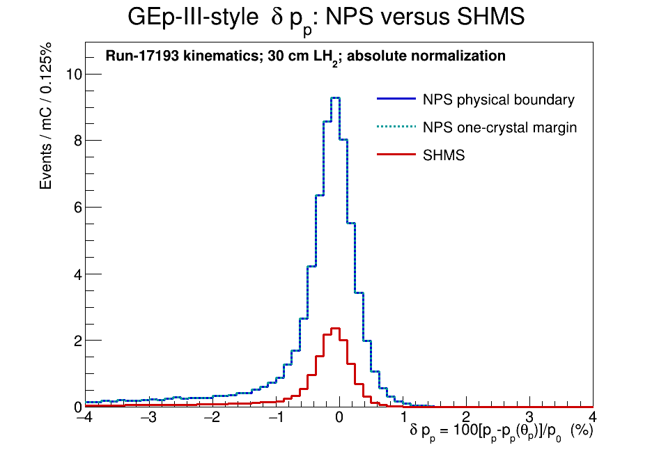

# XEM2 HMS benchmark and NPS projection

**Status:** current working benchmark, 25 October 2026

## Why these data matter

XEM2 elastic-calibration runs 17193--17199 are the closest empirical positive-polarity HMS benchmark found for the proposed GEp reboot. They used a 10.544--10.551 GeV beam on 10 cm LH2, with the HMS at +6.476 GeV/c and 19.52 degrees and the SHMS electron arm at -4.935 GeV/c and 26.0 degrees. The HMS setting is close to the working GEp setting near 6.7 GeV/c and 18.8 degrees.

## Measured HMS trigger primitives

The seven runs agree at the sub-percent level after current normalization:

| Quantity | Measured per microampere | Naive projection to 75 microamperes and 30 cm LH2 |
|---|---:|---:|
| HMS S1X AND S1Y | 3.583 kHz/uA | 806 kHz |
| HMS S2X AND S2Y | 2.243 kHz/uA | 505 kHz |
| HMS 3-of-4 physics trigger | 12.87 Hz/uA | 2.90 kHz |
| SHMS-HMS coincidence | 0.195 Hz/uA | 44 Hz |

The first three rows are the useful HMS measurements. The last row must not be transferred directly to GEp because the electron detector, acceptance, and elastic cross section change. The factor-of-three target scaling is also a first estimate; extended-target acceptance must be simulated.

The proposal baseline should therefore assume approximately 0.8--1 MHz for an S1-only HMS primitive until a better measurement or simulation establishes otherwise.

## Raw accidental scale

For independent raw primitives,

R_accidental = R_NPS x R_HMS x coincidence_width.

Using the measured 806 kHz HMS projection gives:

| NPS primitive | 20 ns window | 40 ns window |
|---:|---:|---:|
| 0.1 MHz | 1.61 kHz | 3.22 kHz |
| 0.3 MHz | 4.84 kHz | 9.67 kHz |
| 1.0 MHz | 16.1 kHz | 32.2 kHz |

Andrew's rounded 1 MHz by 1 MHz estimate gives 20 kHz at 20 ns and 40 kHz at 40 ns. By contrast, pairing a 2.90 kHz HMS 3-of-4 primitive with a 1 MHz NPS primitive gives 58 Hz at 20 ns. This is why the attainable HMS trigger logic and the measured NPS rate-versus-threshold curve are critical-path questions.

## Elastic normalization and acceptance study

For run 17193, the data/SIMC comparisons are:

- Broad HMS delta selection: 1124 data events / 1200.95 SIMC events = 0.936.
- Tighter elastic selection: 800 data events / 1034.34 SIMC events = 0.773.

*The broad distribution tests the overall HMS acceptance and normalization; the tighter elastic region provides the 0.773 data/SIMC factor.*

The corresponding simulations give:

- 30 cm / 10 cm accepted-yield ratio: 1.8863, not 3.
- NPS / SHMS accepted-yield ratio in a common comparison window: 4.1078.
- Full displayed NPS / SHMS acceptance ratio: 4.3139.

*The three panels show the gain in accepted HMS-correlated elastic yield, the projected NPS face illumination, and the extended-target vertex acceptance.*

Anchoring to the 800 selected data events in 150.465 mC, scaling to 75 uA and 45 PAC days (100% operational efficiency), applying the simulated target factor and common-window NPS/SHMS ratio gives approximately:

- SHMS-like electron acceptance: 2.92 million elastic events.
- NPS at 3 m: 12.0 million elastic events, or about 3.09 Hz averaged over PAC time.

These are selected elastic yields, not raw trigger or DAQ rates.

### Normalization ledger: do not apply the 0.773 factor twice

The equivalent SIMC-first calculation gives approximately 15.5 million events before data normalization. Run 17193 has 800 selected data events versus 1034.34 from matched SIMC, giving

`data/SIMC = 800 / 1034.34 = 0.7734`.

Applying this measured factor once gives approximately 12.0 million events. The published 12.0-million-event projection therefore already contains the run-17193 data/SIMC reduction. Multiplying 12.0 million by 0.773 again would assume an additional 23% loss relative to the realized run-17193 performance and would double-count the measured run-17193 deficit if described as the same correction.

The 100% PAC-day convention means that no separate accelerator or scheduled operational-efficiency factor is applied. Any further reduction must be labeled as a distinct GEp-specific efficiency or livetime allowance.

## Transfer to Andrew's original Q2 = 11 setting

A matched 10-million-trial calculation at Ebeam = 10.700 GeV, electron momentum 4.838 GeV/c at 26.651 degrees, and proton momentum 6.735 GeV/c at 18.797 degrees gives Q2 = 10.9947 GeV2. With the 30 cm target, NPS at 3 m, and the same event-level HMS selection, its yield is 54.2538 events/mC compared with 61.2019 events/mC for the run-17193 NPS calculation.

The kinematic ratio is 0.88647. Applying it to the data-anchored 12.053-million run-17193 projection gives 10.685 million events before the NPS response threshold. The 0.7734 run-17193 data/SIMC factor is already included and is not applied again.

A 110,774-event GEANT4 response calculation retains 72.048% with the working fiducial and a 70% incident-energy 3x3 threshold, or 7.70 million events. At an 80% threshold it retains 70.250%, or 7.51 million events. These are provisional because the threshold has not been renormalized to the measured 3x3 elastic peak, final-state radiative photons are not transported with the electron, and the model retains inherited run-6151 passive/sweeper geometry.

*High-statistics GEANT4 shower response and weighted threshold efficiency. The red efficiency curve combines the 3x3 trigger sum with the working fiducial.*

## Proton elastic-consistency comparison

*Run 17193 data and SIMC shown using the proton momentum-consistency variable from the GEp-III analysis.*

*SIMC comparison of the proton elastic-consistency spectrum accepted with SHMS and with the larger NPS solid angle.*

## Measurements still required

1. Measure or credibly bound the NPS hardware primitive rate versus cluster threshold at comparable luminosity.
2. Establish the effective end-to-end online coincidence width; 20 ns is an aggressive working value, not yet a demonstrated specification here.
3. Determine whether the HMS S1/S2 3-of-4 logic can be implemented with the proposed FPP configuration and quantify its elastic efficiency.
4. Establish sustainable modern Hall C DAQ rates and deadtime for the relevant event size.
5. Evaluate whether disabling paddles outside the elastic envelope provides useful rate reduction without harming acceptance.
6. Optimize the NPS distance. The present 3 m value is a well-motivated design standard, but the preferred placement is the largest distance that still matches the NPS solid angle to the HMS-accepted elastic envelope. The study should track elastic yield and edge losses together with angular resolution, occupancy, and trigger-rate changes.
