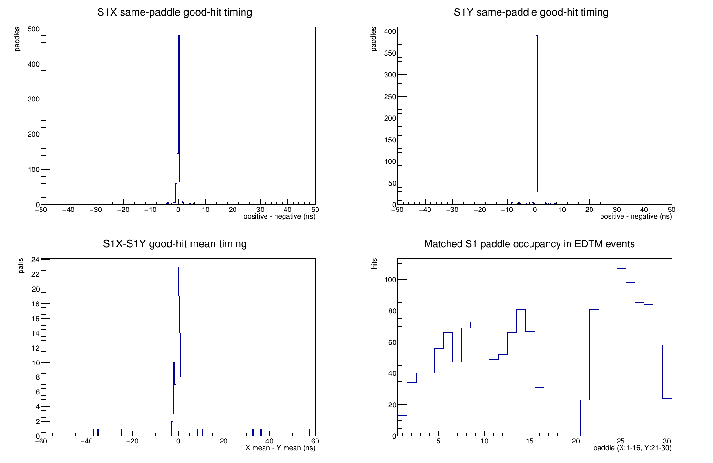
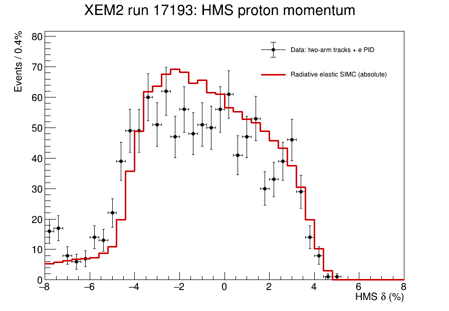
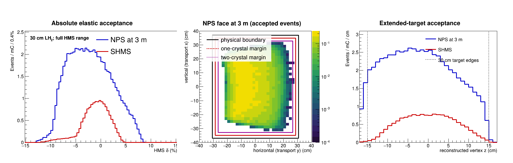
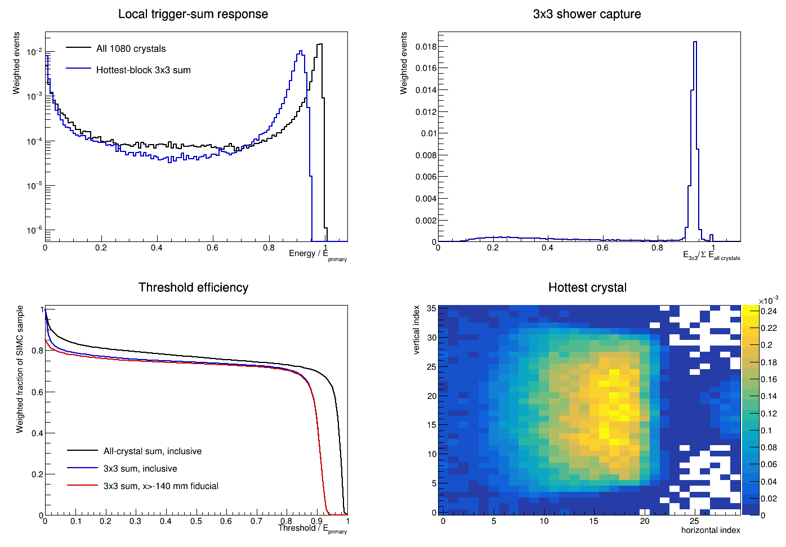
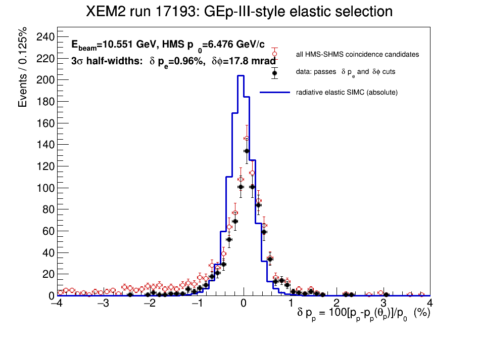
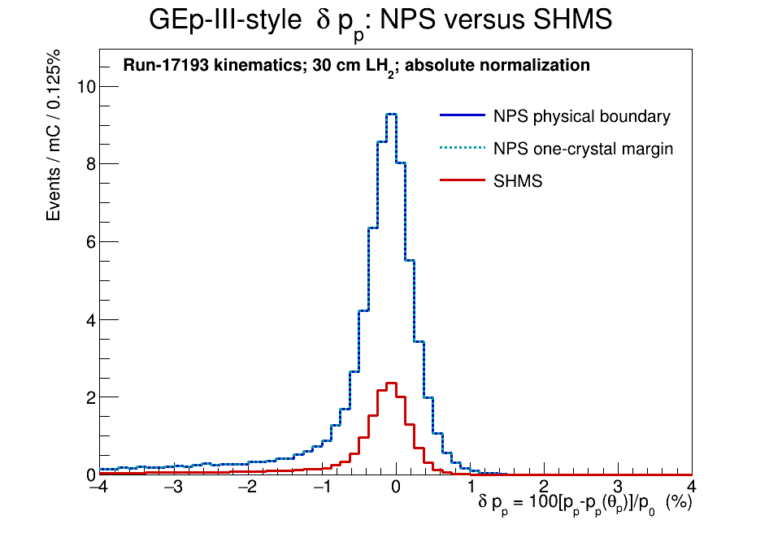
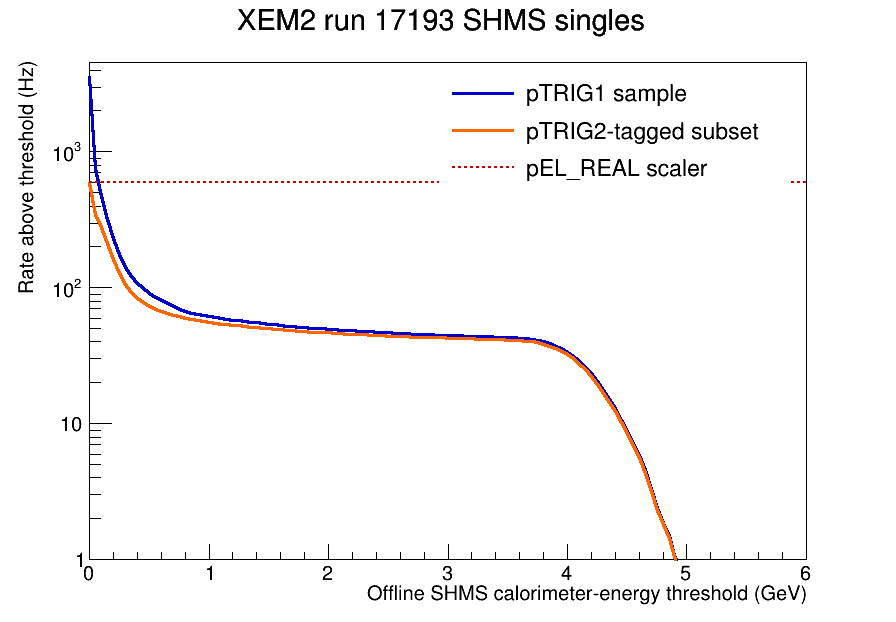
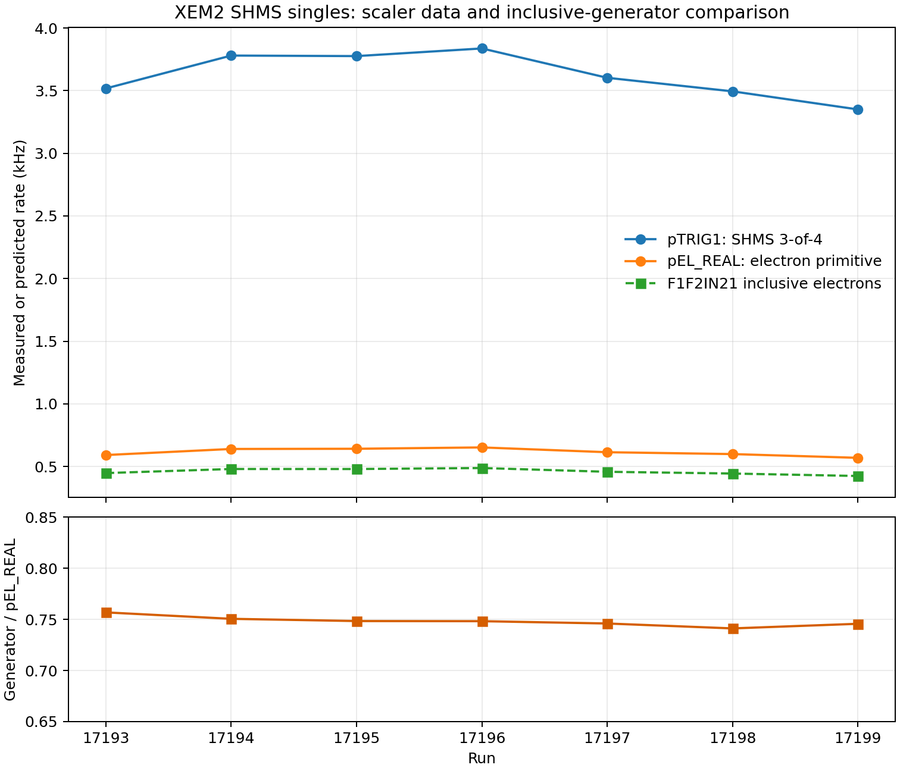

# XEM2 HMS benchmark and NPS projection

**Status:** current working benchmark, 28 October 2026

## Why these data matter

XEM2 elastic-calibration runs 17193--17199 are the closest empirical positive-polarity HMS benchmark found for the proposed GEp reboot. They used a 10.544--10.551 GeV beam on 10 cm LH2, with the HMS at +6.476 GeV/c and 19.52 degrees and the SHMS electron arm at -4.935 GeV/c and 26.0 degrees. The HMS setting is close to the working GEp setting near 6.7 GeV/c and 18.8 degrees.

## Measured HMS trigger signals

The seven runs agree at the sub-percent level after current normalization:

| Quantity | Measured per microampere | Naive projection to 75 microamperes and 30 cm LH2 |
|---|---:|---:|
| HMS S1X plane | 1.972 kHz/uA | 444 kHz |
| HMS S1Y plane | 1.807 kHz/uA | 407 kHz |
| Branch named `S1XS1Y`, numerically S1X OR S1Y | 3.602 kHz/uA | 810 kHz |
| Derived S1X AND S1Y plane overlap | 0.1773 kHz/uA | 39.9 kHz |
| HMS 3-of-4 physics trigger | 12.87 Hz/uA | 2.90 kHz |
| SHMS-HMS coincidence | 0.195 Hz/uA | 44 Hz |

The earlier version of this table mislabeled the `H.S1XS1Y.scalerRate` branch as an AND. Its rate is larger than either plane rate and satisfies the OR inclusion-exclusion relation in every run. It is therefore S1X OR S1Y, not AND and not XOR. The derived plane overlap is `S1X + S1Y - (S1X OR S1Y)`. The SHMS-HMS coincidence row must not be transferred directly to GEp because the electron detector, acceptance, and elastic cross section change. The factor-of-three target scaling is also a first estimate; extended-target acceptance must be simulated.

### Paddle-level test of the practical S1 logic

A dedicated 100,000-event replay of run 17193 retains 7,669 unbiased 1 microsecond EDTM windows and the individual HMS S1 paddle-end TDC information. A valid plane hit requires both PMTs on the same physical paddle; the S1 trigger then requires at least one such double-ended, paddle-matched hit in S1X and independently at least one in S1Y. The S1X and S1Y paddle numbers need not match and have no common meaning because the planes are orthogonal.

The EDTM occupancies give 107.4 kHz for double-ended S1X and 97.3 kHz for double-ended S1Y at the run-17193 conditions. The direct scalers give approximately 110.7 and 101.0 kHz, so the independent EDTM method closes to within 3--4%. Requiring both planes gives 12.73 kHz with a +/-2 ns X--Y mean-time condition, 13.26 kHz at +/-5 ns, and 14.84 kHz without an X--Y timing condition. The scaler inclusion-exclusion value is approximately 9.9 kHz.

Naively scaling these measurements to 75 microamperes and 30 cm LH2 gives approximately 51--60 kHz for the paddle-matched trigger, while scaler inclusion-exclusion gives 39.9 kHz. The current working range is therefore **40--60 kHz**. The 810 kHz OR remains useful only as a deliberately loose upper bound, not as the rate of a practical GEp-III-style S1 trigger. The precise online gate and elastic efficiency still require hardware-level confirmation, including prescaled looser efficiency triggers.

*The replay uses calibrated `GoodPosTdcTimeUnCorr` and `GoodNegTdcTimeUnCorr` values. Missing hits are excluded; the paddle index enforces the same-paddle requirement within each plane.*

## Raw accidental scale

For independent raw singles trigger streams,

R_accidental = R_NPS x R_HMS x coincidence_width.

Using the current 40--60 kHz practical HMS S1 range gives:

| NPS trigger rate | 20 ns window | 40 ns window |
|---:|---:|---:|
| 0.1 MHz | 80--120 Hz | 160--240 Hz |
| 0.3 MHz | 0.24--0.36 kHz | 0.48--0.72 kHz |
| 1.0 MHz | 0.80--1.20 kHz | 1.60--2.40 kHz |

The earlier rounded 1 MHz by 1 MHz estimate gives 20 kHz at 20 ns and 40 kHz at 40 ns, but it combines the broad S1 OR upper bound with an assumed 1 MHz NPS rate. The paddle-level measurement reduces the practical HMS input by roughly an order of magnitude. Pairing the 2.90 kHz HMS 3-of-4 trigger with a 1 MHz NPS trigger rate would give 58 Hz at 20 ns. The attainable HMS trigger logic, its elastic efficiency, and the measured NPS rate-versus-threshold curve remain critical-path questions.

## Elastic normalization and acceptance study

For run 17193, the data/SIMC comparisons are:

- Broad HMS delta selection: 1124 data events / 1200.95 SIMC events = 0.936.
- Tighter elastic selection: 800 data events / 1034.34 SIMC events = 0.773.

*The broad distribution tests the overall HMS acceptance and normalization; the tighter elastic region provides the 0.773 data/SIMC factor.*

The corresponding simulations give:

- 30 cm / 10 cm HMS-SHMS coincidence accepted-yield ratio: 1.8863. This is not an HMS-only extended-target factor. With SHMS replaced by NPS at 3 m, the existing 30 cm sample gives full-30-cm/central-10-cm = 2.564. A separate matched scan at the Q2 = 11 HMS+NPS setting gives 20 cm/10 cm = 1.847 and 30 cm/10 cm = 2.571; see the [target-length audit](xem2_run17193_target_length_audit.md).
- NPS / SHMS accepted-yield ratio in a common comparison window: 4.1078.
- Full displayed NPS / SHMS acceptance ratio: 4.3139.

*The three panels show the gain in accepted HMS-correlated elastic yield, the projected NPS face illumination, and the extended-target vertex acceptance.*

Anchoring to the 800 selected data events in 150.465 mC, scaling to 75 uA and 45 PAC days (100% operational efficiency), applying the simulated target factor and common-window NPS/SHMS ratio gives approximately:

- SHMS-like electron acceptance: 2.92 million elastic events.
- NPS at 3 m: 12.0 million elastic events, or about 3.09 Hz averaged over PAC time.

These are selected elastic yields, not raw trigger or DAQ rates.

### Normalization ledger: do not apply the 0.773 factor twice

The equivalent SIMC-first calculation gives approximately 15.5 million events before data normalization. Run 17193 has 800 selected data events versus 1034.34 from matched SIMC, giving

`data/SIMC = 800 / 1034.34 = 0.7734`.

Applying this measured factor once gives approximately 12.0 million events. The published 12.0-million-event projection therefore already contains the run-17193 data/SIMC reduction. Multiplying 12.0 million by 0.773 again would assume an additional 23% loss relative to the realized run-17193 performance and would double-count the measured run-17193 deficit if described as the same correction.

The 100% PAC-day convention means that no separate accelerator or scheduled operational-efficiency factor is applied. Any further reduction must be labeled as a distinct GEp-specific efficiency or livetime allowance.

## Transfer to Andrew's original Q2 = 11 setting

A matched 10-million-trial calculation at Ebeam = 10.700 GeV, electron momentum 4.838 GeV/c at 26.651 degrees, and proton momentum 6.735 GeV/c at 18.797 degrees gives Q2 = 10.9947 GeV2. With the 30 cm target, NPS at 3 m, and the same event-level HMS selection, its yield is 54.2538 events/mC compared with 61.2019 events/mC for the run-17193 NPS calculation.

The kinematic ratio is 0.88647. Applying it to the data-anchored 12.053-million run-17193 projection gives 10.685 million events before the NPS response threshold. The 0.7734 run-17193 data/SIMC factor is already included and is not applied again.

A 110,774-event GEANT4 response calculation retains 72.048% with the working fiducial and a 70% incident-energy 3x3 threshold, or 7.70 million events. At an 80% threshold it retains 70.250%, or 7.51 million events. These are provisional because the threshold has not been renormalized to the measured 3x3 elastic peak, final-state radiative photons are not transported with the electron, and the model retains inherited run-6151 passive/sweeper geometry.

*High-statistics GEANT4 shower response and weighted threshold efficiency. The red efficiency curve combines the 3x3 trigger sum with the working fiducial.*

## Proton elastic-consistency comparison

*Run 17193 data and SIMC shown using the proton momentum-consistency variable from the GEp-III analysis.*

*SIMC comparison of the proton elastic-consistency spectrum accepted with SHMS and with the larger NPS solid angle.*

## SHMS singles and electron-trigger benchmark

The same XEM2 setting also provides a useful electron-arm singles benchmark because the SHMS central kinematics, 4.935 GeV/c at 26.0 degrees, are close to the proposed 4.838 GeV electron at 26.651 degrees. Scaler-only replays of runs 17193--17199 give exceptionally stable current-normalized rates:

| SHMS quantity | Mean rate per microampere | Run-to-run variation | Naive 75 microampere, 30 cm scaling |
|---|---:|---:|---:|
| pTRIG1, SHMS 3-of-4 | 62.93 Hz/uA | 0.08% | 14.16 kHz |
| pEL_REAL / pTRIG2 electron-enriched trigger | 10.75 Hz/uA | 0.63% | 2.42 kHz |
| pSTOF | 103.77 Hz/uA | 0.94% | 23.35 kHz |

The simple luminosity-scaled values are SHMS rates, not NPS predictions. SHMS and NPS have very different angular and momentum acceptances, and the full 3 m NPS face extends to substantially smaller electron angles.

Run 17193 recorded the broad pTRIG1 singles trigger with prescale 6. Of 286,148 event-type-1 singles, 47,316 also contain the pTRIG2 TDC tag, a fraction of 0.16535. Multiplying that fraction by the measured 3.515 kHz pTRIG1 scaler rate gives 581 Hz, within 1.9% of the independently measured 592 Hz pEL_REAL scaler rate. This demonstrates that the prescaled pTRIG1 events form an unbiased sample of the electron-enriched hardware trigger.

Scanning the offline SHMS calorimeter total energy within this sample gives:

| Threshold fraction of 4.935 GeV | Offline threshold | pTRIG1-sample rate above threshold | pTRIG2-tagged subset |
|---:|---:|---:|---:|
| 70% | 3.455 GeV | 43.33 Hz | 41.49 Hz |
| 75% | 3.701 GeV | 41.84 Hz | 40.08 Hz |
| 80% | 3.948 GeV | 35.63 Hz | 34.08 Hz |

The approximately 592 Hz pEL_REAL trigger rate is therefore not equivalent to a 70--80% offline calorimeter threshold; it contains substantial low-energy activity. Above roughly 1 GeV, the reconstructed spectrum settles into a 40--60 Hz plateau before falling at the elastic endpoint. That detector-response scan is separate from the scaler-level comparison below.

A five-million-trial absolute `F1F2IN21` calculation was integrated over the nominal SHMS generated envelope: electron target angles of +/-90 mrad in-plane and +/-50 mrad vertically, with momentum acceptance from -15% to +25%. At the run-17193 current of 55.868 microamperes, it gives 447.74 +/- 0.53 Hz of Born inclusive-inelastic electrons, or 8.014 Hz/microampere. The seven runs measure an average pEL_REAL rate of 10.713 Hz/microampere, so the generator reproduces 74.8% of the electron-trigger rate. The ratio is exceptionally stable, with only 0.65% run-to-run relative variation.

This is encouraging scaler-level agreement, but it should not be overinterpreted. The calculation uses the nominal hard-edged generated envelope rather than detailed SHMS transport, contains Born inclusive-inelastic electrons rather than detector and beam backgrounds, and does not model trigger efficiency. The 3.5--3.8 kHz pTRIG1 rate is shown only as a reference: it is the broad SHMS 3-of-4 scintillator trigger and is not expected to be reproduced by an inclusive-electron generator. The relevant comparison is with pEL_REAL/pTRIG2.

The numerical inputs are retained in [the seven-run scaler table](xem2_shms_singles_scalers.csv), [the scaler analysis](analyze_xem2_shms_singles_scalers.C), [the generator comparison](plots/xem2_shms_scaler_generator_comparison.csv), [the comparison script](plot_xem2_shms_scaler_generator_comparison.py), and [the run-17193 event-level analysis](analyze_xem2_run17193_shms_singles.C).

## Measurements still required

1. Measure or credibly bound the NPS hardware trigger rate versus cluster threshold at comparable luminosity.
2. Establish the effective end-to-end online coincidence width; 20 ns is an aggressive working value, not yet a demonstrated specification here.
3. Determine whether the HMS S1/S2 3-of-4 logic can be implemented with the proposed FPP configuration and quantify its elastic efficiency.
4. Establish sustainable modern Hall C DAQ rates and deadtime for the relevant event size.
5. Evaluate whether disabling paddles outside the elastic envelope provides useful rate reduction without harming acceptance.
6. Optimize the NPS distance. The present 3 m value is a well-motivated design standard, but the preferred placement is the largest distance that still matches the NPS solid angle to the HMS-accepted elastic envelope. The study should track elastic yield and edge losses together with angular resolution, occupancy, and trigger-rate changes.

The first dedicated single-analyzer Hall C polarimeter calculation is now
documented separately in the [focused FPP FOM summary](fpp_fom_summary.md).
It establishes an SBS-scale ideal integrated FOM, while the trigger-logic
compatibility and realistic reconstruction-efficiency questions above remain
open.
