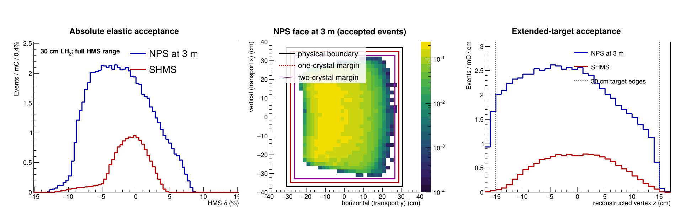
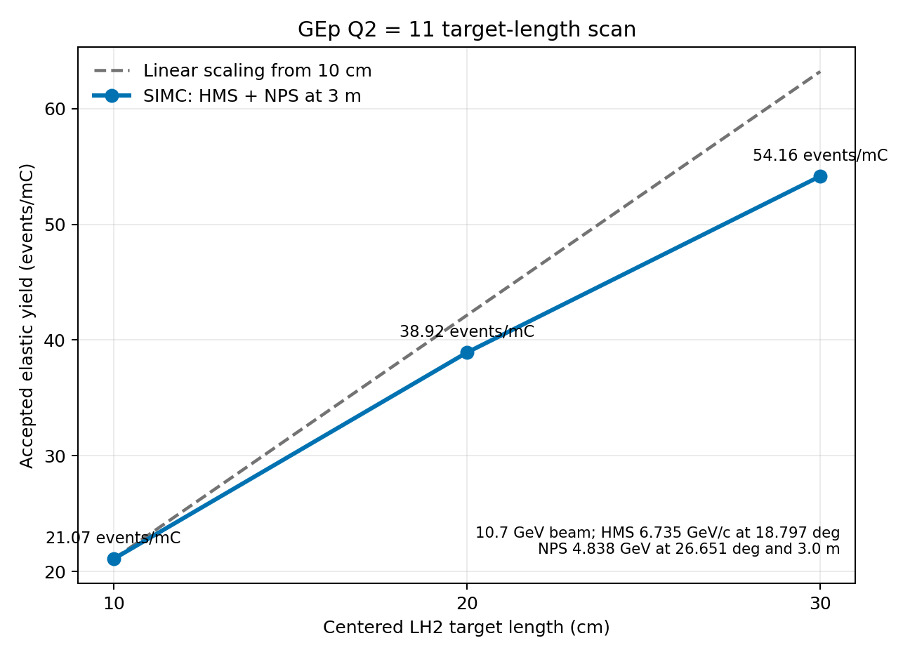

# Run 17193 target-length acceptance audit

## Question

The original run-17193 extrapolation used an accepted-yield ratio of 1.8863
between otherwise matched 30 cm and 10 cm LH2 SIMC runs. Because the HMS
proton angle is 19.52 degrees, a centered 30 cm target projects to only about
10.0 cm across the HMS non-dispersive target coordinate. It was therefore
important to determine whether 1.8863 was really an HMS extended-target
acceptance factor.

## Configuration check

The two SIMC inputs are identical except for the random seed and the target
areal thickness:

- 10 cm: 723 mg/cm2;
- 30 cm: 2169 mg/cm2.

Both targets have `targ%zoffset = 0`, and all spectrometer offsets are zero.
The 30 cm target is therefore centered on the Hall C pivot. Its SIMC report
explicitly gives a length of 30.0 cm and a z offset of 0.0 cm. The SIMC
normalization factor increases by the expected factor of approximately three.
There is no hidden target displacement or luminosity-normalization error in
the 1.8863 result.

## What the 1.8863 ratio actually measures

The original simulations transported the proton through the HMS and the
electron through the SHMS. Consequently, their 30 cm/10 cm ratio is the
acceptance ratio of the complete HMS-SHMS elastic coincidence, not an HMS-only
target-length factor.

This distinction is visible directly in the accepted-vertex distributions:

The red SHMS-coincidence distribution is strongly suppressed near both ends
of the target. Replacing the SHMS with NPS at 3 m produces the much broader
blue distribution, even though the HMS treatment and proton kinematics are
unchanged.

As a normalization-independent check, the existing 30 cm samples were
integrated over their own reconstructed vertex distributions. Relative to
the accepted yield from the central 10 cm:

| Configuration | Central 20 cm / central 10 cm | Full 30 cm / central 10 cm |
|---|---:|---:|
| HMS + NPS at 3 m | 1.874 | 2.564 |

The corresponding full-target ratio inferred from the 30 cm HMS-SHMS sample
is only about 1.96. This within-sample value is not expected to equal the
separate-run value 1.8863 exactly, because changing the physical target length
also changes material, energy loss, and radiative thickness. It nevertheless
confirms that the strong end suppression belongs to the SHMS-coincidence
configuration.

## Consequence

The statement that the HMS can use only an effective 18.9 cm of a 30 cm target
was not justified. The existing HMS+NPS simulation uses substantially more of
the target and gives a first target-length acceptance estimate closer to 2.56
than to 1.89. The original 1.8863 factor may still appear as one factor in an
algebraic decomposition of the data-anchored NPS projection, provided it is
paired with the 30 cm NPS/SHMS acceptance ratio. It must not be interpreted
or reused independently as an HMS target-length correction.

## Direct proposal-kinematics target scan

A matched one-million-trial SIMC scan has now been completed at the working
Q2 = 11 setting: 10.700 GeV beam energy, a 4.838 GeV electron at 26.651
degrees in NPS at 3 m, and a 6.735 GeV/c proton at 18.797 degrees in HMS.
Only the centered LH2 target length and corresponding areal thickness were
changed.

| Target length | Selected yield (events/mC) | Ratio to 10 cm |
|---:|---:|---:|
| 10 cm | 21.070 | 1.000 |
| 20 cm | 38.918 | 1.847 |
| 30 cm | 54.161 | 2.571 |

The independent 30 cm result agrees with the previous ten-million-trial yield
of 54.254 events/mC to 0.17%. Going from 20 to 30 cm increases the accepted
elastic yield by 39.2% relative to the 20 cm yield; the final 10 cm supplies
28.1% of the full 30 cm yield. The acceptance is not perfectly linear, but the
30 cm target is being used efficiently enough that it is not overkill on
elastic-yield grounds. The numerical ledger is
[gep_q11_target_length_scan.csv](gep_q11_target_length_scan.csv).

The remaining target optimization should balance this elastic-yield gain
against target boiling and the approximately linear growth of calorimeter
background from portions of the target visible to NPS. It should not begin
from the earlier 1.8863 HMS-SHMS coincidence ratio.
